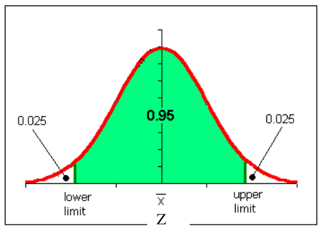
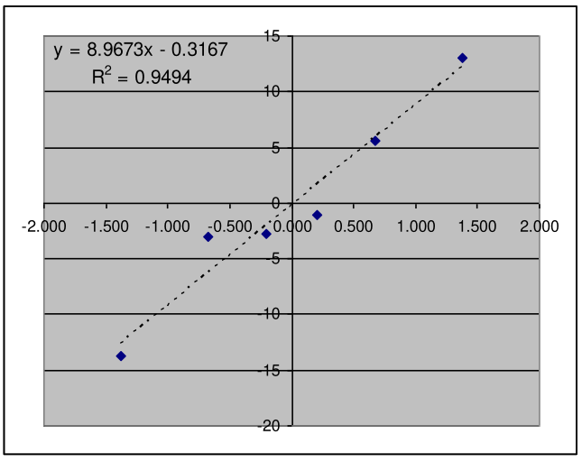
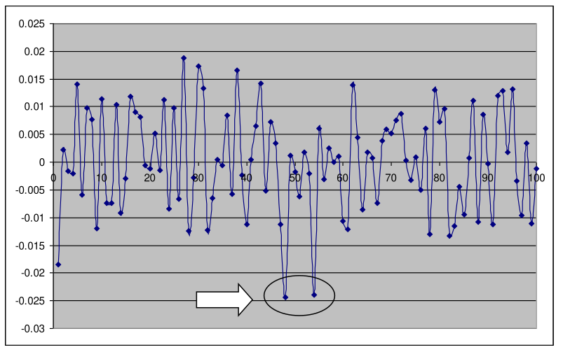

# 1. Index

<!--toc:start-->

- [1. Index](#1-index)
- [2. Confidence Intervals](#2-confidence-intervals)
  - [2.1. Computing Confidence Intervals](#21-computing-confidence-intervals)
    - [2.1.1. Population Mean](#211-population-mean)
      - [2.1.1.1. Exercise: Signal and Noise](#2111-exercise-signal-and-noise)
    - [2.1.2. Paired Experiments](#212-paired-experiments)
      - [2.1.2.1. Example: Paired Experiments](#2121-example-paired-experiments)
    - [2.1.3. Success Probability](#213-success-probability)
      - [2.1.3.1. Exercise: Success in two Systems](#2131-exercise-success-in-two-systems)
    - [2.1.4. Sample Width](#214-sample-width)
      - [2.1.4.1. Example: Packets Forwarding Algorithms](#2141-example-packets-forwarding-algorithms)
  - [2.2. Testing the Assumption of Independence](#22-testing-the-assumption-of-independence)
    - [2.2.1. Example: Correlogram of a LCG](#221-example-correlogram-of-a-lcg)
    - [2.2.2. Dealing with not IID samples](#222-dealing-with-not-iid-samples)
    <!--toc:end-->

# 2. Confidence Intervals

As part of the **scientific method** we are duty-bound to **_show the accuracy of
a measurement_** whenever we produce one.

We can **lie blatantly** by _omitting to state the accuracy_ of a measurement.

Especially when we are dealing with **random variables and samples**, we never
know how much of the result we are claiming is due to **luck** (i.e., a
_particularly lucky sample_).

Assume for example that we get two samples of the same measure from
two systems $A$ and $B$, and we compute the mean for both, let it be $\overline{X}_A$
and $\overline{X}_B$.

Suppose, we find $\overline{X}_A > \overline{X}_B$, since the sample means
estimate the _population mean_, we can conclude that **system A performs
better than B**.

However, if we manipulate our data, we can obtain that the interval where we are
extracting our samples are very different, for example by inserting a 95% confidence
interval just for one of the two systems, using data too variable or sample
too small).

By doing so, the **accuracy** of our statistic and our conclusion simply **do not
hold anymore**.

Instead, if the two samples are taken from both 95% confidence intervals, we
can be **95% sure** that the _true population mean_ follows our claim.

> [!IMPORTANT]
> Every statistic taken from a sample is itself a **random variable**.  
> Therefore, its accuracy must be **_always_** _quantified_ and reported in the
> form of a **confidence interval**.

## 2.1. Computing Confidence Intervals

We define $[l, h]$ a **confidence interval** for parameter $\beta$ at level
$(1-\alpha)$ if:

$$
P\Set{l \le \beta \le h} \ge (1-\alpha)
$$

A **confidence interval** at level $(1-\alpha)$ is an interval where we have
_a probability of at least_ $(1-\alpha)$ to find the parameter we are estimating
using our sample statistics.

The value $(1-\alpha)$ is called the **confidence level** of the interval, and
it is typically values such as $90\%, 95\%, 98\%, 99\%$.

Confidence intervals are computed differently from a sample of IID RVs, depending
on what parameter we want to estimate.

We will see two different methods, one for the **population mean** and one for the
**probability of success** of a Bernoulli experiment.

> [!warning]
> The methods we will see will only hold **under the assumption that the sample
> consists of IID RVs**, otherwise we will obtain _false conclusions_.

### 2.1.1. Population Mean

Assuming we are dealing with a population with **finite mean and variance**, we
have defined the _sample mean_ to be:

$$
\overline{X} = \frac{1}{n} \sum_{i=1}^{n} X_i
$$

And found that $E[\overline{X}] = \mu$ and $\operatorname*{Var}(\overline{X})
= \frac{\sigma^2}{n}$.

We also stated that $\overline{X} \sim \mathcal{N}\left(\mu,
\frac{\sigma^2}{n}\right)$ for either _large_ $n \ge 30$, or if each $X_i$ is Normal.

A inefficient way to compute a 90%-CI for the sample mean is to:

1. Take $k$ independent samples of $n$ observation each
1. Compute the sample means of each of the $k$ samples, $\overline{X}_1,
\overline{X}_2, \ldots, \overline{X}_k$
1. Compute the 5-th and 95-th percentiles of the $k$ sample means

A more efficient use of the amount of information that is inherent in a sample
of $n$ IID RVs can be done by leveraging the **sample variance** we defined as:

$$
S^2 = \frac{1}{n-1} \cdot \sum_{i=1}^n{\left(X_i - \overline{X}\right)^2}
$$

We found that $E[S^2] = \sigma^2$, and that, **only if the sample is large**
$(n \ge 30$)$ then:

$$
\frac{\overline{X} - \mu}{S / \sqrt{n}} \sim \mathcal{N}(0, 1)
$$

Even if we don't know $\sigma$ we can estimate it using $S^2$, hoping that if $n$
is large:

$$
Z = \frac{\overline{X} - \mu}{S / \sqrt{n}} \sim \mathcal{N}(0, 1)
$$

In this case, the (symmetric) interval that defines an area equal to
$(1-\alpha)$ in the Standard Normal is the one colored in the figure.

The point that leaves out a right tail with an area equal to $0.025$, i.e. the
one such that $P\Set{Z > z_{0.025}} = 0.025$ is the 97.5-th percentile of the
Standard Normal, and is equal to $z_{0.025} = 1.96$.

Therefore, the interval $[-z_{0.025}, z_{0.025}]$ includes $Z$ with 95% probability.

More in general, we take the $(1-\alpha / 2)$ percentile, and we can write:

$$
\begin{align*}
  P\Set{-z_{\alpha / 2} \le \frac{\overline{X} - \mu}{S/ \sqrt{n}} \le
z_{\alpha / 2}} &= 1 - \alpha \\
  P\Set{\overline{X} - z_{\alpha / 2} \cdot \frac{S}{\sqrt{n}} \le \mu \le
\overline{X} + z_{\alpha / 2} \cdot \frac{S}{\sqrt{n}}} &= 1 - \alpha
\end{align*}
$$

Therefore, the $(1-\alpha)$ level confidence interval for the population mean
$\mu$ is:

$$
\left[\overline{X} - z_{\alpha / 2} \cdot \frac{S}{\sqrt{n}}, \overline{X} +
  z_{\alpha / 2} \cdot \frac{S}{\sqrt{n}}\right]
$$

This will hold only if the population has a _finite variance_ and the _sample
is large_.

If the sample is small, we can apply this method **only if the population consists
of Normal RVs**.

In this case, we take for granted that for Normal RVs:

$$
(n-1) \cdot \frac{S^2}{\sigma^2} \sim \chi^2_{n-1}
$$

Meaning that the sample variance is distributed like a chi-square with $n-1$
degrees of freedom.

Moreover, since $\overline{X}$ and $S^2$ are independent, we have that:

$$
T = \frac{\overline{X} - \mu}{S / \sqrt{n}} \sim t_{n-1}
$$

Therefore, we can immediately obtain that:

$$
\begin{CD}
{
P\Set{\overline{X} - \frac{S}{\sqrt{n}} \cdot t_{\alpha / 2, n-1} \le \mu \le
\overline{X} + \frac{S}{\sqrt{n}} \cdot t_{\alpha / 2, n-1}} = 1 - \alpha
} \\
@VVV \\
{
  \left[\overline{X} - \frac{S}{\sqrt{n}} \cdot t_{\alpha / 2, n-1},
\overline{X} + \frac{S}{\sqrt{n}} \cdot t_{\alpha / 2, n-1}\right]
}
\end{CD}
$$

Of course, the larger the sample, the **higher the number of degrees of freedom**
in the Student's T distribution, hence the _smaller percentiles_ $t_{\alpha /
2, n-1}$, and the _narrower_ the confidence interval.

Not that the CI depends on $n$ through:

- $t_{alpha / 2, n-1}$: the higher $n$, the smaller the value, down until a
  lower bound $z_{alpha / 2}$ for $n \to \infty$.
- $\sqrt{n}$: the higher $n$, the smaller the interval.
- Possibly $\overline{X}, S$, which can however expected to be **stable** with $n$.

This means that we the CI is expected to get **narrower** when we increase the sample
width.

To better understand what a CI really is, we have to remember that it is a **random
measure** of a(n unknown) estimated constant parameter.

Therefore computing the 95% CI for the population mean means:

> If we take 100 different samples, and compute the CI for the population
> mean, then:
>
> - 95 times out of 100 the population mean will be **within** that CI
> - 5 times out of 100 the population mean will be **outside** that CI

#### 2.1.1.1. Exercise: Signal and Noise

> Suppose that a signal having value $\mu$ is transmitted from location $A$.
> The value received at location $B$ is a Normal Noise with null mean and
> unknown variance $\sigma^2$.
> To reduce the decoding error, suppose the same value is sent $9$ times, with
> the successive values received being: $5, 8.5, 12, 15, 7, 9, 7.5, 6.5, 10.5$
>
> a) Construct a 95% CI for $\mu$  
> b) Repeat the above assuming $\sigma^2 = 4$  
> c) Is it possible to state in advance whether one of the two confidence
> intervals will be smaller than the other?

The sample is **small**, however it consist of **Normal RVs**, meaning we can
apply the above method.

We can start by calculate the sample mean and variance:

$$
\begin{align*}
\overline{X} &= \frac{5 + 8.5 + 12 + 15 + 7 + 9 + 7.5 + 6.5 + 10.5}{9} = 9.0 \\
S^2 &= \frac{1}{9-1} \cdot \sum_{i=1}^{9}{x_i^2 - 9 \cdot 9^2} = 9.5 \\
S &= \sqrt{9.5} \approx 3.082
\end{align*}
$$

Then, we have to compute the values such that:

$$
\begin{align*}
P\Set{-t_{\alpha/2, n-1} \le \frac{\overline{X} - \mu}{S / \sqrt{n}} \le
t_{\alpha/2, n-1}} &= 1 - \alpha \\
P\Set{\overline{X} - t_{\alpha/2, n-1 } \cdot \frac{S}{\sqrt{n}} \le \mu \le
\overline{X} + t_{\alpha/2, n-1} \cdot \frac{S}{\sqrt{n}}} &= 1 - \alpha
\end{align*}
$$

With $\alpha = 0.05$, this means that $t_{0.025, 8} = 2.306$ and the interval is:

$$
CI_a = \left(6.63; 11.37\right)
$$

On point b) we know know that $\sigma^2 = 4$, meaning that we can we use the
Normal Distribution instead of the Student's T, specifically:

$$
G = \frac{\overline{X} - \mu}{\sigma / \sqrt{n}} \sim \mathcal{N}(0, 1)
$$

Meaning:

$$
\begin{align*}
  P\Set{-z_{\alpha/2} \le \frac{\overline{X} - \mu}{\sigma / \sqrt{n}} \le
z_{\alpha/2}} &= 1 - \alpha \\
  P\Set{\overline{X} - z_{\alpha/2 } \cdot \frac{\sigma}{\sqrt{n}} \le \mu \le
\overline{X} + z_{\alpha/2} \cdot \frac{\sigma}{\sqrt{n}}} &= 1 - \alpha
\end{align*}
$$

With the above values we have that $z_{0.025} = 1.96$ and the interval is:

$$
CI_b = (7.69; 10.31)
$$

To answer point c) we have calculated that $CI_b < CI_a$, meaning that the confidence
interval is **smaller**.

We knew that $z_{\alpha / 2} < t_{alpha / 2, n-1}$, with the first being the
lower bound of the second when $n \ge 30$, meaning that we could have expected
the second interval to be smaller than the first.

However, **we could not have known it in advance** since we were not sure
whether $S$ was bigger/smaller/equal to $\sigma$.

### 2.1.2. Paired Experiments

A common use of CIs is to test if a **measure is significantly different from zero**,
for example as it happens with **_Paired Experiments_**.

Paired experiments are when two systems $A$ and $B$ are given in input
**the same workloads** and measured for the same statistics.

In this case, one gets **two paired samples**, namely the $n$ responses of $A$ and
those of $B$.

However, since there is a 1:1 correspondence between each point in the sample,
we can compute the **difference of the responses** and treat it as a **single sample**.

If that difference is **significantly different from zero**, then we can
conclude that _one system is better than the other_.

#### 2.1.2.1. Example: Paired Experiments

> Consider a paired experiment where systems $A$ and $B$ are given the same six
> workloads as an input. Their response times are measured, and the measures are
> as in the table.
>
> Explain if $A$ is better than $B$ with a confidence of 90%.

|                |  $A$  |  $B$  | $D = A - B$ |
| :------------: | :---: | :---: | :---------: |
|      $1$       |  5.4  | 19.1  |    -13.7    |
|      $2$       | 16.6  |  3.5  |    13.1     |
|      $3$       |  0.6  |  3.4  |    -2.8     |
|      $4$       |  1.4  |  2.5  |    -1.1     |
|      $5$       |  0.6  |  3.6  |     -3      |
|      $6$       |  7.3  |  1.7  |     5.6     |
| $\overline{X}$ | 5.32  | 5.63  |    -0.32    |
|     $S^2$      | 38.22 | 44.06 |    81.62    |
|      $S$       | 6.18  | 6.64  |    9.03     |

Before we even start, we must denote that:

- $n$ is small
- $S$ is big

Just these information should suggest that it is not possible to assert that
$A$ is better than $B$ with a 90% confidence.

However, we will still do the calculation for the sake of the example.

The first step, since $n = 6 \le 30$, is to check if the difference
is approximately Normal.

We can check it with a QQ-plot.

<figure class="60">

<figcaption>

With $n = 6$ almost everything will give us a linear equivalence.

</figcaption>
</figure>

The QQ plot confirms the sample is approximately Normal, so we can proceed with
the calculation of the 90% CI:

$$
\begin{align*}
  \left[\overline{X} - t_{\alpha / 2, n-1} \cdot \frac{S}{\sqrt{n}},
\overline{X} + t_{\alpha / 2, n-1} \cdot \frac{S}{\sqrt{n}}\right] &= \\
  \left[-0.32 - t_{0.05, 5} \cdot \frac{9.03}{\sqrt{6}}, -0.32 + t_{0.05, 5}
\cdot \frac{9.03}{\sqrt{6}}\right] &= \\
  \left[-0.32 - 2.015 \cdot \frac{9.03}{\sqrt{6}}, -0.32 + 2.015 \cdot
\frac{9.03}{\sqrt{6}}\right] &= \left[-7.75, +7,11\right]
\end{align*}
$$

Therefore, we cannot say with 90% confidence that A is better than B, since
in our interval $D$ can assume values with both signs.

### 2.1.3. Success Probability

Assume we observe a sample of $n$ observations $a_1, a_2, \ldots, a_n$, but we
are only interested in defining the _probability of success_ $p$.

For instance, we could be measuring response times, and declaring a success whenever
it is below a certain threshold.

Therefore, we can define a set of **binary outcomes** $b_1, b_2, \ldots, b_n$,
such as:

$$
b_i = \begin{cases}
  1 & a_i \text{ meets criterion} \\
  0 & \text{otherwise}
\end{cases}
$$

Thus, we can estimate the **probability of success** of the _Bernoullian experiment_
$p$ by the observations $b_i$:

$$
\hat{p} = \frac{1}{n} \sum_{i=1}^{n} b_i = \frac{1}{n} \cdot
  \sum_{i=1}^{n} 1_{(a_i\text{ meets criterion})}
$$

If we want to compute a CI for the success probability, we following methods
yields approximately correct results for one of the following conditions:

- $\min{\Set{n \cdot \hat{p}, n \cdot (1-\hat{p})}} \ge 5$
- $n \cdot \hat{p} \cdot (1 - \hat{p}) \ge 10$

This happens because, under this assumption, the distribution of the
number of successes in $n$ trials $X$ is **approximately Normal**:

$$
\begin{CD}
{
 X \sim \mathcal{N}\left(n \cdot \hat{p}, n \cdot \hat{p} \cdot (1-\hat{p})\right)
}
@>>>
{
  \frac{X - n\cdot \hat{p}}{\sqrt{n \cdot \hat{p} \cdot (1-\hat{p})}}
\sim \mathcal{N}(0, 1)
}
\end{CD}
$$

Therefore we can use the percentiles relation:

$$
\begin{align*}
  P\Set{-z_{\alpha / 2} \le \frac{X - n\cdot \hat{p}}{\sqrt{n \cdot \hat{p}
\cdot (1-\hat{p})}} \le z_{\alpha / 2}} &= (1 - \alpha) \\
  P\Set{-z_{\alpha / 2} \cdot \sqrt{n \cdot \hat{p} \cdot (1-\hat{p})} \le X - n\cdot
\hat{p} \le z_{\alpha / 2} \cdot \sqrt{n \cdot \hat{p} \cdot (1-\hat{p})}} &=
(1 - \alpha) \\
  P\Set{-z_{\alpha / 2} \cdot \sqrt{\frac{n \cdot \hat{p} \cdot (1-\hat{p})}{n}}
\le \hat{p} - \frac{X}{n} \le z_{\alpha / 2} \cdot \sqrt{\frac{n \cdot \hat{p}
\cdot (1-\hat{p})}{n}}} &= (1 - \alpha)
\end{align*}
$$

Since we want to estimate the probability of success $p = \frac{X}{n}$, it is
obvious that its CI with level $(1-\alpha)$ is:

$$
\left[
  \hat{p} - z_{\alpha / 2} \cdot \sqrt{\frac{\hat{p} \cdot (1-\hat{p})}{n}},
  \hat{p} + z_{\alpha / 2} \cdot \sqrt{\frac{\hat{p} \cdot (1-\hat{p})}{n}}
\right]
$$

#### 2.1.3.1. Exercise: Success in two Systems

> A single experiment was repeated 40 times in independent conditions on two
> systems $A$ and $B$. $A$ came out to be superior to $B$ **26 times out of 40**.
> Can we say that $A$ is superior to $B$ (i.e., it outperforms $B$ more than half
> the times):
>
> - With $99\%$ confidence?
> - With $90\%$ confidence?

Our first estimation is that $\hat{p} = \frac{26}{40} = 0.65 > 0.5$. Since, it is
above the threshold, it is a good start.

Moreover, $\min{\Set{n \cdot \hat{p}, n \cdot (1-\hat{p})}} = \min{\Set{26, 14}}
= 14$, so we are on the safe side.

In order to compute the confidence interval, we first gave to compute
$\sqrt{\frac{\hat{p} \cdot (1-\hat{p})}{n}} = 0.075$, and find from the tables
that $z_{0.005} = 2.576$ and $z_{0.05} = 1.645$.

Therefore, the required CIs are:

- At $99\%$ confidence: $[0.46, 0.84] \quad \to \quad$ it is not always
  above $0.5$, so **we cannot say that $A$ is superior to $B$ with $99\%$ confidence**.
- At $90\%$ confidence: $[0.53, 0.77] \quad \to \quad$ is is always above
  $0.5$, so **we can say that $A$ is superior to $B$ with $90\%$ confidence**.

This means, that our confidence lies somewhere between $90\%$ and $99\%$, and
we could compute it using a bit of algebra (but we will not).

We can immediately observe that, had the sample been $n = 400$ with $k = 260$
successes, we would have had:

- **The same estimate** $\hat{p} = 0.65$
- **A narrower confidence interval**, to be exact $\sqrt{10} \approx 3.16$
  times narrower, which means that we would also be able to say that $A$ is superior
  to $B$ with $99\%$ confidence.

### 2.1.4. Sample Width

The example above raises a fundamental question: **What confidence level
should we use?**.

Most of the times, the CI is **imposed by management**, meaning that we have to
balance the **gains** against the **loss** to try to meet the requirements.

Obviously, the CI is connected to both _confidence level_ and _sample width_.
Wanting a **small CI** with a **high level of confidence**, requires a **large sample**.

Given an estimate of the _sample mean_ and _sample variance_, it is possible to
compute the **sample width** required to obtain a **confidence interval** of a given
width.

Assume we want our $(1-\alpha)$ confidence interval to be:

$$
\left[(1-r) \cdot \overline{X}, (1+r) \cdot \overline{X}\right]
$$

Where $r$ is the **relative accuracy**, and $\overline{X}$ the current
estimate of the sample mean.

To calculate how large a sample de we need, we could always assume $n>30$ so we
can assume the Normal Approximation, equating the upper extreme of the CI
to $(1-r) \cdot \overline{X}$:

$$
  \overline{X} + z_{\alpha / 2} \cdot \frac{S}{\sqrt{n}} = (1+r) \cdot \overline{X}
$$

> [!warning]
> This works only if $\overline{X} > 0$. If it were to be negative, the upper
> extreme of the CI should be equated to $(1-r) \cdot \overline{X}$ instead.

From the above formula, we can derive the required sample width $n$:

$$
  n = \left(\frac{z_{\alpha / 2} \cdot S}{r \cdot \overline{X}}\right)^2
$$

This might still not be sufficient, since, when we add observations, both
$\hat{X}$ and $S$ might change, and therefore the CI might not be as expected.

However, the result is representative if the initial estimates are good.
Moreover, we can note that the required sample width **grows quadratically with**:

- The required confidence level $z_{\alpha / 2}$
- The variability of the sample $S$
- The required precision $r$
- The **inverse of the simple mean** $\overline{X}$

This last point is not so obvious. For instance, if $\overline{X} = 0.01$, we will
need 100 times as many points as for $\overline{X} = 0.1$ (all else being equal).

> [!IMPORTANT]
> We must avoid using relative position if $\vert \overline{X} \vert$ is
> **too close to zero**.

#### 2.1.4.1. Example: Packets Forwarding Algorithms

> Two packet forwarding algorithms $A$ and $B$ are believed to exhibit $0.5\%$
> and $0.6\%$ loss rate.
>
> How many packets do we need to observe to state that $A$ is better than $B$ with
> $95\%$ confidence?

If we want to uphold the claim, the success probability of $A$ and $B$
_should not overlap_. In particular, for $A$ to be better that $B$, its **upper
extreme must be below the lower extreme of $B$**.

$0.5\%$ and $0.6\%$ are "success probabilities", hence we can use the related formulas:

$$
\begin{CD}
\begin{align*}
  \hat{p}_A + z_{\alpha / 2} \cdot \sqrt{\frac{\hat{p}_A \cdot (1-\hat{p}_A)}{n}}
&\le \hat{p}_B - z_{\alpha / 2} \cdot \sqrt{\frac{\hat{p}_B \cdot (1-\hat{p}_B)}
{n}} \\
  \sqrt{\frac{\hat{p}_A \cdot (1-\hat{p}_A)}{n}} + \sqrt{\frac{\hat{p}_B \cdot
(1-\hat{p}_B)}{n}} &\le \frac{\hat{p}_B - \hat{p}_A}{z_{\alpha / 2}} \\
  \frac{\sqrt{\hat{p}_A \cdot (1-\hat{p}_A)} + \sqrt{\hat{p}_B \cdot
(1-\hat{p}_B)}}{\sqrt{n}} &\le \frac{\hat{p}_B - \hat{p}_A}{z_{\alpha / 2}} \\
\end{align*} \\
@VVV \\
{
  n \ge \left[z_{alpha/2} \cdot \frac{\sqrt{\hat{p}_A \cdot (1-\hat{p}_A)} +
\sqrt{\hat{p}_B \cdot (1-\hat{p}_B)}}{\hat{p}_B - \hat{p}_A}\right]^2
}
\end{CD}
$$

## 2.2. Testing the Assumption of Independence

Assume we have a sample of $n$ IID RVs, on which we compute the _sample mean_,
_sample variance_ and _CI_ for the mean.

Suppose we are measuring a system where we know that **even** measures are always
equal to the preceding **odd** measure. In other words, we always get the
same value **twice** when we measure the system (e.g., $[5, 5, 3, 3, 7, 7,
2, 2, 4, 4, 5, 5, ...]$).

Or another system that always gives out **bursts of ten consecutive equal values**
(e.g., $[ 5, 5, 5, 5, 5, 5, 5, 5, 5, 5, 6, 6, 6, 6, 6, 6, ...]$).

It would obviously not be correct to measure a sample of $n$ observations and compute
a CI on these sample.

This happens because we cannot just **inflate** our sample by adding values
that **do not bring any additional information**.

In the above example, a correct way to compute the CI would be to take
every second/tenth value, thus using $n/2$ or $n/10$ in the CI formula.

If we forget to do this, we are using an **inappropriately large value for
$n$, overestimating our confidence**.

The assumption of IID-ness implies that the sample contain the **maximum possible
information** that can be stored in $n$ observations.

Everything that we have said so far requires that a sample **consists of IID RV**,
which is an assumption that until now we always taken for granted. In reality
it **_should always be verified before even starting to make computations_**.

If we have designed our experiments, then it is up to us to ensure that the
results are IID. For instance, in simulations there are several methods to do this
that we will see later on in the course.

When taking measurements on a running system, then the bad news is that it is
**quite unlikely** that your observations will be IID.

More specifically, fine-grained measures (e.g., delay of consecutive packets at
a switch, response time of two subsequent transactions in a web server, etc.) are
almost **invariably positively correlated**, hence they are _not independent_.

The explanation is simple: if a packet encounters a large delay, it is because
it finds many packets queued ahead of it. Hence, it becomes highly likely
that, when the next packet arrives, the situation will not be too different
(unless it arrives considerably later in time).

This means that the two consecutive delays will be **positively correlated** (_low
calls for low, high calls for high_).

To test the assumption of independence we should test that $X_j, X_{i+j}$ have
**zero correlation** for any $i, j$.

A quick visual test is the **lag-plot**, where we plot $\left(X_i, X_{i+j}\right)$
on a _Cartesian plane_ for a given lag $j$. Data that are **positively correlated**
tend to **align on a line going SW-NE**, while data negatively correlated tend to
align on a line going NW-SE.

However, on a large sample, we are more likely to see a **cloud of points**
rather than lines, thus being unable to understand anything from it.

A more rigorous way is to to compute the **autocorrelation function** (ACF) of the
sample for various lags, which is defined as:

$$
R(j) = \frac{E[(X_i-\mu)(X_{i+j}-\mu)]}{\sigma^2} \in [-1, +1]
$$

Where $-1$ is **perfect anti-correlation** and $+1$ is **perfect correlation**.
Ideally, for our considerations to be IID it should be $R(j) = 0$ for any $j
\ge 1$.

However, we do not know either $\mu$ or $\sigma$, so we cannot compute it.

Instead, we can _estimate it_ using the **Sample AutoCorrelation Function** (SACF):

$$
\overline{R}(j) = \frac{\frac{1}{n} \sum_{i=1}^{n-j} (X_i - \overline{X})
(X_{i+j} - \overline{X})}{S^2}
$$

We should plot it for various lags (e.g., up until $100$ or until meaningful).

If $\vert R(j) \vert$ is **small enough**, then we can assume that the sample
is IID.

To define how small is small enough, we can use one if the previous results: the
$(1-\alpha)$ CI for the sample autocorrelation coefficients
$\left(\frac{z_{\alpha / 2}}{\sqrt{n}}\right)$.

Since we are claiming that all the **autocorrelation coefficients are null**,
hence we should compute CI for the autocorrelation coefficient and check **if it
includes zero**.

In practice, this is equal to:

1. **Computing two straight lines** at $\pm \frac{z_{\alpha/2}}{\sqrt{n}}$
2. See if **all the values $\overline{R}(j)$ are within the two lines**.

If they are, we can say that our sample **consists of IID RVs _with a significance
level equal to $(1-\alpha)$_**.

> [!tip]
> $\overline{R}(j)$ can be easily computed through Excel using built-in
> function `CORREL()` (`CORRELAZIONE()` in Italian) by giving the two vectors of
> the data to be correlated.

### 2.2.1. Example: Correlogram of a LCG

The image on the right is an autocorrelation plot (**correlogram**) for
a multiplicative LCG, using a sample of $10k$ observations.

For a $95\%$ confidence, we get $z_{0.025} = 1.96$, and $\sqrt{n} = 100$.

Therefore, the assumption of IID-ness cannot be rejected with the above
significance level if all sample autocorrelation coefficients are within $\pm0.0196$.

We can easily see that this is **false**, hence we must take a closer look in
order to read correlograms.

Three things that we should keep in mind are:

1. It is _perfectly normal_ that a fraction $\alpha$ of the points are outside the
   two bands (this is intrinsic in the fact that we are asking for $(1 − \alpha)$
   confidence). So, if we see few values outside the band, the game is not over.
1. Keep in mind **how large are the outliers**: If their absolute value is
   _close to the limit_, then we should not worry too much. If they are
   _abnormally high_, then you should worry. So, _the higher (in absolute
   value), the worse_.
1. We should understand **where are these outliers**: If they are at large lags,
   then we should not worry, since at large lags, $\overline{R}(j)$ is
   **less reliable** due to the fact that the sum by which it is computed
   has too few values, hence it is subject to higher oscillations.
   Instead, if they are at small lags, then we should really worry.

> [!note]
> In order to keep the third phenomenon into account, some analysts use confidence
> bands of increasing width, just to signify that higher correlations at large lags
> should be tolerated.

### 2.2.2. Dealing with not IID samples

When we obtain that a sample is not IID, what we could do is to **sub-sample**.

This technique consists in taking a **smaller sample**, including every point of
previous sample **_at random with probability $p$_**.

We could try different values of $p$ (typically $p_k = \frac{1}{2^k}$ for
$k = 1, 2, \ldots$) and **repeat the analysis**.

Unless our data is very _wild_, this method should work after a while.

Of course, this come with the disadvantage of **reducing our sample width**.
Starting from $n$ points, on average we end up with $\frac{n}{2^k}$ points.

Therefore, it is important to stop as soon as our data shows negligible
autocorrelation.

> [!tip]
> Sub-sampling can be done automatically on _Excel_, by using `SAMPLE()`
> (`CAMPIONAMENTO()` in Italian) function, from the additional component
> `DATA ANALYSIS` (`ANALISI DATI` in Italian).  
> _OpenOffice Calc_ also has a similar feature.
