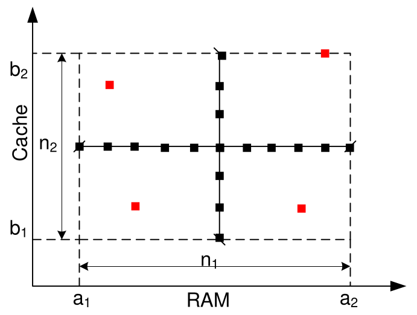
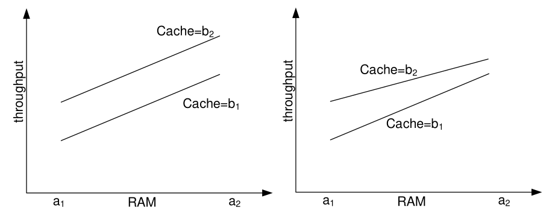
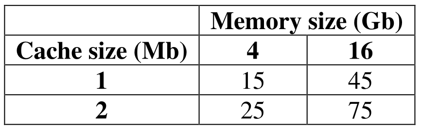

# 1. Index

<!--toc:start-->

- [1. Index](#1-index)
- [2. Design of Experiments](#2-design-of-experiments)
  - [2.1. Simple Factor Design](#21-simple-factor-design)
  - [2.2. Full Factorial Design](#22-full-factorial-design)
  - [2.3. 2kr Factorial Design](#23-2kr-factorial-design)
  - [2.4. 2k Factorial Analysis](#24-2k-factorial-analysis)
  <!--toc:end-->

# 2. Design of Experiments

Quite often we will have to analyze one or more systems whose performance depends
on **several factors**.

The impact of these factors is not known in advance, and it is typically
exactly what we need to access.

For instance, assume that we want to evaluate the performance of a **web server**,
given a workload as a function of:

- The type of CPU (two alternatives):
- The amount of RAM (interval)
- The cache size (interval)
- The number of disks (interval)
- The software architecture (two alternatives: `Apache TomCat` and `OpenLiteSpeed`)

Th above are called **factors** and they are defined as:

- **Binary** factors: they can take a finite number of values
  (e.g., CPU type, software architecture).
- **Discrete**/**Continuous** factors: they can take a range of values
  (e.g., RAM, cache size, number of disks).

We might need to answer the following questions:

1. Which factors are **the most relevant** to our metric of interest?
1. How can we **_tune_ this factors** to maximize the performance?

## 2.1. Simple Factor Design

This is what most Computer Engineer end up doing.

We start by identifying the **levels** $n_i$ of each factor.

We choose an _arbitrary configuration_, i.e., a point in the factor space (e.g.,
CPU x, 16GB RAM, 1GB cache, 2 disks, `TomCat`), and proceed **varying one factor
at a time**.

For instance, we might start varying the RAM in its interval, then the cache, etc.

This approach will result in carrying out $1 + \sum_{i=1}^k{n_i - 1}$, where
$k$ is the number of factors, and factor $i$ has $n_i$ levels.

If we need to repeat each experiment $r$ times in independent runs, the total
number of experiments will be $r \cdot \left(1 + \sum_{i=1}^k{n_i - 1}\right)$.

This means that the number of experiments grows **linearly** with the number of
factors.

Repeating the experiments in independent conditions is the key to **generating IID
samples**, on which compute **sample statistics**.

This is very important when doing simulations. If we are doing **measurements**
repeating experiments helps us assess the impact of **experimental errors**, since
measurements are independent if the output of one measure does not affect the
output of the others.

Of course, the downside of this approach is that we are _never going to explore
all the space of the factors_, and we will neglecting the possibility that
**two or more factors might interact with each other**.

In a simple example with two factors, we are only exploring **along the two
straight lines**, neglecting all the other combinations of levels.

## 2.2. Full Factorial Design

If we want **full knowledge** of the factor space, an obvious solution is to
**explore all the factor space**.
With the above notation, the number of required experiments would be:

$$
\begin{matrix}
  \displaystyle \prod_{i=1}^k n_i & \qquad &
  r \cdot \displaystyle \prod_{i=1}^k n_i \\
 \text{One experiment} & & \text{With Replicas}
\end{matrix}
$$

It is clear that the number of experiments we need to perform gets
_quickly out of control_, even with relatively few factors.

In the initial example, assuming that factors RAM and cache have $10$ levels and
factor _number of disks_ has $5$, we end up with $2 \cdot 10 \cdot 10 \cdot 5 \cdot
2 = 2000$, or $2000 \cdot r$.
If each experiment takes one hour, we end up requiring **more than one year** to
have all the results in with five replicas.

And jolly good luck to us with storing the results so that we can remember which
output came from which combination of factor levels one year later.

Another downside is that, if at some point we understand that we need another factor
in our analysis (e.g., the NIC speed), then we have to undergo a lot more experiments.

> [!note]
> Very often, we start up an analysis thinking that we already know which factors
> we will need to consider, and only later we discover we need more.

There is, of course, a clear advantage to this technique: we can **assess the
interplay of two or more factors**.

For instance, it may be that the benefits of having a larger RAM are more evident
if the cache is large, or if the number of disks is large, things we could never
discover with a _single-factor analysis_.

In the below graphs, we see that the metric of interest increases with both
RAM and cache.

However, in the left graph, the two factors seem to be **independent**: the increase
in throughput when the RAM size changes from $a_1 \to a_2$ is the same at the two
cache levels.

Instead, on the right, we can see that the metric still increases with both factors,
but factors do interact: the improvement due to increasing the RAM **depends on
the cache size**.

With a large cache, the performance improvement due to increasing the RAM is smaller.

Knowing how factors interact is particularly important to know if we want to
tune our system for maximum performance.

## 2.3. 2kr Factorial Design

This is a third technique, which allows us to reap **most of the benefits** of the
previous two, at a moderate implementation cost.

It consists in exploring **only the combinations of _extremes_ of the factor levels**.
This way we can assess the **relative importance** of factors in our metric,
being able to decide which to investigate.

It also yields informations about the _interplay between factors_.

It requires to analyze "only" $2^k \cdot r$ configurations (supposing replicas),
hence its name.

Continuing with the previous example, we would need a total of $2^5 \cdot r = 32r$
experiments, instead of, respectively, $2.000r$ and $10.000r$.

Of course, this is still a large number of experiments that doesn't scale
well with the number of factors. It's better than the former techniques,
but still doesn't allow us to analyze a system with, say, $20$ factors.

However, it is a good compromise, since it is quite unlikely that we will need
to analyze systems with more than $5$ or $6$ factors.

If we are particularly unfortunate, and we need to do so, other techniques,
called $2^{k-p}cdot r$ (we discount $p$ out of $k$ factors), allow us to reduce
the number of experiment to the minimum necessary to get meaningful results.

> [!important]
> These techniques are to **design experiments**.  
> They work with **any kind of experiments**: from simulations to measurements.
> They can be used seamlessly in one case or the other.

## 2.4. 2k Factorial Analysis

The basic of factorial analysis are easier to understand if **errors** and **replications**
are kept out of the way.

> [!note]
> For now we will assume we have _one error-free measurement per configuration_

We will analyse the following example, where we measure the performance
of a workstation in _Million Instructions Per Second_ (MIPS), with two
configurations of cache and RAM:

We want to assess the impact of the two factors on the performance.

Calling $A$ the RAM, and $B$ the cache, we define two variables $x_A$ and $x_B$
as follows:

$$
\begin{align*}
  x_A &= \begin{cases}
    -1 & \text{if RAM is at level 1} \\
    +1 & \text{if RAM is at level 2}
  \end{cases} \\
  x_B &= \begin{cases}
    -1 & \text{if Cache is at level 1} \\
    +1 & \text{if Cache is at level 2}
  \end{cases}
\end{align*}
$$

We can then fit the output model to a **non-linear regression model** having
$x_A$ and $x_B$ as predictor variables:

$$
y = q_0 + q_A x_A + q_B x_B + q_{AB} x_A x_B
$$

Where $q_i$ are the coefficients we need to determine.

We have four observations, corresponding to the four combinations of values for
the two variables:

$$
\begin{align*}
  15 &= q_0 - q_A - q_B + q_{AB} \\
  45 &= q_0 + q_A - q_B - q_{AB} \\
  25 &= q_0 - q_A + q_B - q_{AB} \\
  75 &= q_0 + q_A + q_B + q_{AB}
\end{align*}
$$

This is a $4\times4$ linear system, whose unknowns are the coefficients $q_i$.

Since the known term is **non-null**, it means **_it only has one solution_**.

Without going into the details of linear algebra (or `Excel` usage), we can solve
the system obtaining the following equation:

$$
y = 40 + 20 \cdot x_A + 10 \cdot x_B + 5 \cdot x_A x_B
$$

This result should be interpreted as follows:

- $q_0 = +40\;MIPS$ is the **mean performance** among all the observations
- $q_A = +20\;MIPS$ is the **impact of RAM** on the performance when going from
  one level to another, **independently of the cache size**.
- $q_B = +10\;MIPS$ is the **impact of cache** on the performance when going from
  one level to another, **independently of the RAM size**.
- $q_{AB} = +5\;MIPS$ is the **interaction term between RAM and cache**. Is the
  additional performance we get when both RAM and cache are at their maximum level,
  **beyond the sum of the two individual impacts**.

The performance **increases with both factors**, and for each
factor it does so **more when the other is also high**.

In the general case, if we have 2 factors, we need 4 experiments (2 factors times
2 levels), and we get the following result:

| Experiment | $0$  | $A$  | $B$  | $AB$ |  $y$  |
| :--------: | :--: | :--: | :--: | :--: | :---: |
|     1      | $+1$ | $-1$ | $-1$ | $+1$ | $y_1$ |
|     2      | $+1$ | $+1$ | $-1$ | $-1$ | $y_2$ |
|     3      | $+1$ | $-1$ | $+1$ | $-1$ | $y_3$ |
|     4      | $+1$ | $+1$ | $+1$ | $+1$ | $y_4$ |

We can observe that

- if we sum all four, we get $y_1 + y_2 + y_3 + y_4 = 4\cdot q_0$
- if we sum them with alternate signs we get $−y_1 + y_2 − y_3 + y_4 = 4\cdot q_A$
- if we sum them with alternate signs we get $-𝑦_1 - y_2 + y_3 + y_4 = 4\cdot q_B$
- if we sum them with alternate signs we get $y_1 − y_2 − y_3 + y_4 = 4 q_{AB}$

Therefore, in the end, we **don't have to use matrix algebra to solve the linear
system**, we just need to look at the signs and do some easy sums.
