# 1. Index

<!--toc:start-->

- [1. Index](#1-index)
- [2. Model Fitting](#2-model-fitting)
  - [2.1. Linear Regression](#21-linear-regression)
    - [2.1.1. Example: Excel, Disk IO and CPU times](#211-example-excel-disk-io-and-cpu-times)
    - [2.1.2. Confidence Intervals for the Parameters](#212-confidence-intervals-for-the-parameters)
    - [2.1.3. Testing the Assumptions](#213-testing-the-assumptions)
      - [2.1.3.1. Exercise: Linear Regression on Remote Procedure Call Time](#2131-exercise-linear-regression-on-remote-procedure-call-time)
  - [2.2. Overfitting](#22-overfitting)
  <!--toc:end-->

# 2. Model Fitting

**Model Fitting**, or **Regression**, consists in finding a **parametric model**
that explains the correspondence between a **predictor variable** and a
**predicted response**.

This, in turn, allows us to **make _predictions_ of the future**.

Suppose we have $n$ **observations** $\Set{(x_i, y_i),\;1\le i\le n}$, and we
want to find a model that allows us to predict values of the RV $Y$ from those of
$X$.

We define a **good model** as one that _"fits the data well"_.

<figure class="">
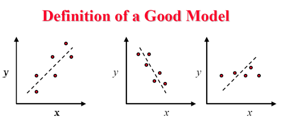
<figcaption>

The first two can be considered a _good_ model, whereas the last doesn't.

</figcaption>
</figure>

## 2.1. Linear Regression

This technique is used to model the relationship between a **scalar response**
and one or more **explanatory variables** through **straight line fitting**.

Hence, we need to find **two regression parameters**, namely the **_offset_** and
the **_slope_** of the line.

Fitting the data to the model consists in computing the _best_ $b_0, b_1$ such
that $\hat{y} = b_0 + b_1 \cdot x$, where $\hat{y}$ is the **predicted response**
and $x$ is the **predictor variable**.

Of course, the values of $b_0$ and $b_1$ will depend on the **data at our disposal**,
i.e., the sample of $n$ observations.

The difference between the **predicted** response $\hat{y}$ and the **actual**
response $y$ (i.e., measured value $y_i$ in paired observation $(x_i, y_i)$) is
called the **residual** or _error_:

$$
  e_i = y_i - \hat{y}_i = y_i - (b_0 + b_1 \cdot x_i)
$$

In practice, the **linear regression technique**, also called the **least
squares method**, consists in finding the values of $b_0$ and $b_1$ that:

- **Minimize the Sum of Squared Errors (SSE)**
- **Subject to the condition of Zero Mean**

$$
\begin{cases}
  \displaystyle \min \left(\sum_{i=1}^n e_i^2\right) = \min\left(\sum_{i=1}^n
(y_i - (b_0 + b_1 \cdot x_i))^2 \right)\\
  \displaystyle \sum_{i=1}^n e_i = \sum_{i=1}^n (y_i - (b_0 + b_1 \cdot x_i)) =
0
\end{cases}
$$

This can be done algebraically by solving the systems, and the result is as
follows:

$$
\begin{align*}
  b_1 &= \frac{\displaystyle \sum_{i=1}^n (x_i - \bar{x})(y_i - \bar{y})}
{\displaystyle \sum_{i=1}^n (x_i - \bar{x})^2} \\
  b_0 &= \overline{y} - b_1 \cdot \overline{x}
\end{align*}
$$

The same procedure, can be used to fit any other model:

$$
\begin{cases}
  \min \left(\displaystyle \sum_{i=1}^n (y_i - f(x_i))^2 \right) \\
  \displaystyle \sum_{i=1}^n \left(y_i - f(x_i)\right) = 0
\end{cases}
$$

Where $f()$ can be any function, as long as it has $n$ parameters to fit the $n$
observations.

> [!tip]
> `Excel` can solve constrained optimization problems through an add-on component
> called `SOLVER` (`RISOLUTORE` in Italian).
> Moreover, it fits automatically several types of models (_linear_, _polynomial_,
> _exponential_, _logarithmic_, _power relationship_) to the data.

To use `Excel` to fit a model the process is quite simple:

1. We do a _scatter-plot graph_ of the observations
1. We add a **_regression line_ on the graph** and ask for its equation to be played

This will output two values: **the equation of the regression curve** that minimizes
the SSE, as well as the **coefficient of determination** $R^2$.

### 2.1.1. Example: Excel, Disk IO and CPU times

> The number of Disk I/Os and CPU times of seven runs of a program were measured,
> and the results in the table were obtained.
>
> We want to fit a model which allows one to predict the CPU time from the
> disk I/O time.

| Disk I/O Time $x$ | CPU Time $y$ |
| :------------------: | :-------------: |
|          14          |        2        |
|          16          |        5        |
|          27          |        7        |
|          42          |        9        |
|          39          |       10        |
|          50          |       13        |
|          83          |       20        |

The first thing to do is to draw a _scatter-plot,_ having disk time on the $x$
axis and the CPU time on the 𝑦 axis.

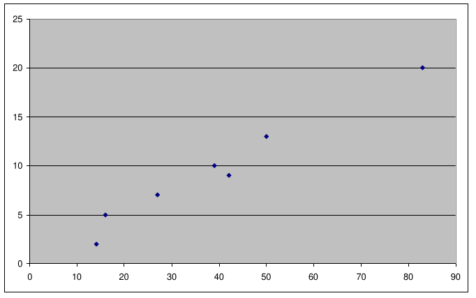

The scatter-plot looks reasonably **linear**, thus we can use the _least squares
method_ to fit a **linear model**.

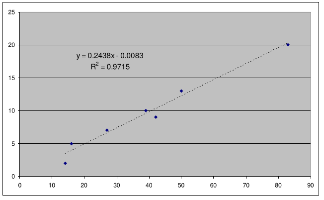

We obtain $b_1 = 0.2438$ and $b_0 = -0.0083$.

We can then compute the _residuals_ and the _SSE_:

| Disk I/O Time $x$ | CPU Time $y$ | Error $e$ | Error Squared $e^2$ |
| :------------------: | :-------------: | :----------: | :--------------------: |
|          14          |        2        |    -1.405    |         1.974          |
|          16          |        5        |    1.108     |         1.227          |
|          27          |        7        |    0.426     |         0.181          |
|          42          |        9        |    -1.231    |         1.516          |
|          39          |       10        |    0.500     |         0.250          |
|          50          |       13        |    0.818     |         0.670          |
|          83          |       20        |    -0.227    |         0.052          |

If we sum the values we obtain:

$$
\begin{align*}
  \sum_i e_i &= -0.012 \\
  \sum_i e_i^2 &= 5.869
\end{align*}
$$

Note that the sum of the residuals is not **null** due to numerical approximations.

The SSE is $5.869$, and is the **minimum value possible**, every other line will
yield a higher one.

The SSE is an interesting quantity, since it allows you to compute the **part of
the variation of the predicted response which is not explained by the model**.

The **_variation_** of the predicted response is called the **Sum of
Squares Total**, defined as:

$$
  SST = \sum_{i=1}^n (y_i - \overline{y})^2
$$

From this, we define the **coefficient of determination** $R^2$ as:

$$
  R^2 = \frac{SST - SSE}{SST} = 1 - \frac{SSE}{SST}
$$

It explains how much of $y$’s variation **can be predicted by the model we have
used**.

We can denote that that it is _the square of_ $corr(X, Y)$, and will lay
between $0$ and $1$, where $1$ would indicate that **there is no uncertainty**
int the $y$s once we have discovered their dependence from the predictor
variable $x$.

`Excel` computes $R^2$ automatically, and in this case we have $R^2 = 0.9715$,
which means that more than $97\%$ of the variation of the CPU time can be
explained by the model we choose, while the rest is due to factors the
model cannot account for.

### 2.1.2. Confidence Intervals for the Parameters

What we are interested in is showing **two aspects of model fitting** which
are interesting from a performance evaluation standpoint, namely:

- How to **predict** a value using a regression model, and how to associate a
  confidence to that prediction.
- How to **assess** whether a regression model is good or not. In particular, how
  to verify if the **underlying assumptions** are met. They may not be, and large
  errors may occur if they are not.

First of all, we observe that the model parameters $b_0, b_1$ are **random variables**
(since they are obtained from a sample whose predicted variable is affected
by random experimental errors), and they estimate the true model parameters
$\beta_0, \beta_1$.

Hence, we need to draw a confidence interval for the latter, which can get
complicated to do.

Hence, we will take directly the result, which are as follows:

$$
\begin{align*}
  \beta_0 &= b_0 \mp t_{\alpha/2, n-2} \cdot \sqrt{
\frac{SSE}{n\cdot (n-2} \cdot \frac{\overline{x}^2}{\sum_{i=1}^n (x_i - n\cdot \overline{x})^2}
} && \text{Is the }(1-\alpha) \;CI\\
  \beta_1 &= b_1 \mp t_{\alpha/2, n-2} \cdot \sqrt{
\frac{SSE}{n-2} \cdot \frac{1}{\sum_{i=1}^n (x_i - n\cdot \overline{x})^2}
} && \text{Is the }(1-\alpha) \;CI
\end{align*}
$$

The uncertainty will depend on the SSE: the higher the fraction of variation
that the model _cannot explain_, the larger the CI for its variables will be.

Especially for the slope $\beta_1$, we may want to check that our **CI does not
include zero**, otherwise we may not even be sure that there is any dependence at
all between the predicted response and the predictor variable.

If it does includes zero, the dependence may be a **coincidence**, due to a lucky
sample.

We have said that the purpose of _regression_ is to allow one to predict the
value of the predicted response for a given value of the predictor variable.
Obviously, any prediction has uncertainty, and uncertainty has to be quantified.

The uncertainty will depend, of course, on the SSE.

The $(1 − \alpha)$-prediction interval for a future observation of the predicted
variable at value 𝑥𝑝 of the predictor variable is the following:

$$
\hat{y}_p \mp t_{\alpha/2,n-2} \cdot \sqrt{
\frac{SSE}{n-2} \cdot \left[
  1 + \frac{1}{n} + \frac{(x_p - \overline{x})^2}{\sum_{i=1}^n (x_i - \overline{x})^2}
\right]
}
$$

Where $\hat{y}_p = b_0 + b_1 \cdot x_p$.

Note that the **prediction interval** depends on the **value of the predictor
variable**:

- Its **minimal** when $x_p = \overline{x}$
- It gives us less information when $x_p$ is "far" from the mean value.

If we go far outside the interval where we have sampled the predictor variable,
then we will have a **large uncertainty** (always assuming that our model
is _still valid_ outside that range, which is not always the case).

### 2.1.3. Testing the Assumptions

The problem with formal methods, is that **people stop using their brains** when
they can follow one, _blindly trusting_ the results, and ignoring possible prior
knowledge about the system being modeled.

The first assumption to be tested is if the relationship between the two variables
**indeed looks linear**, which is a simple and fast visual test bone by
drawing a scatter-plot of both quantities.

> [!NOTE]
> We should **avoid making rash assumptions** regarding the relationship between
> variables **outside our measurement interval**.  
> Most phenomena exhibit **threshold behaviour** (e.g., saturation, phase transitions,
> etc. ), hence this should be taken into account.

The linear regression in the figure on the right yields the coefficient directly
in the graph.

From these, we might conclude that our best prediction when $x_p = 1$ is
$\hat{y}_p = -0.22$.

If those two quantities **must be positive** (i.e., _time_ $y$ to do some
number of activities $x$), it is clear that we are misunderstanding the model.

This happens because the model _looks linear_ in the interval we are observing,
but it is **multi-linear** (i.e., the predicted variable saturates to zero).

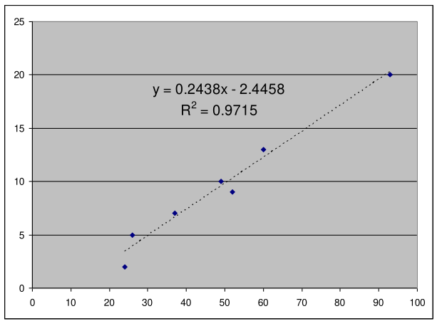

For the same reason, we might be interested to know what happens when $x_p$ becomes
large. For example, when $x_p = 120$ the model states $\hat{y}_p = 26.81$.

Still assuming we are measuring _response time_, we may know for a fact that
our system **drops requests** after $20$ seconds of computation, hence no response
larger than $20$ can be observed.

Again, this is an **indication of multi-linearity**.

If a system has a strong **multi-linear tendency**, then it may be wise to **model-fit**
its linear parts separately.

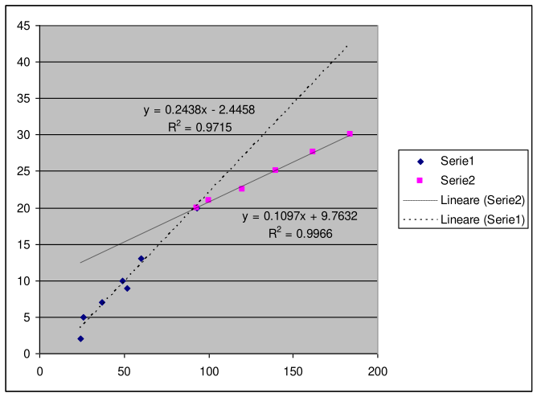

> [!warning]
> There are other cases when a model may look linear when in fact it is not.  
> For instance, the half of a parabola that lies left/right of its vertex can
> sometimes be approximated through a line, if the range is not too large.  
> If you only look at more points to the left and right, you see that the model
> is nonlinear.
>
> 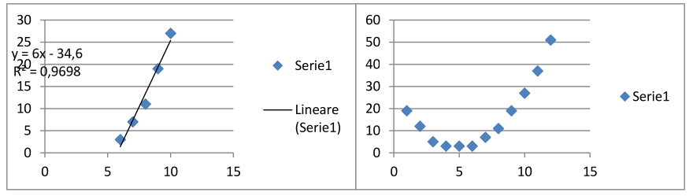

There are some hidden assumptions, which are particularly tricky and **must be
validated**.

When fitting a model $\hat{y} = f(x)$ using _Least-Sqare minimization_, we are
**assuming that residuals are**:

- **IID**
- **Normal Variables**: can be checked through a **Normal QQ-plot**. This is required
  to be using the _Student's T_ in the confidence intervals for the parameters
  and for the prediction interval.
- **Null Mean**: its already guaranteed by the fact that we use _least-square
  minimization_
- **Constant Standard Deviation**

The other two assumption can be tested using simple **visual techniques**:

- **Scatter-plot** of the _residuals_ against the _predicted response_ $\hat{y}$.
  This will test the **standard deviation**. This technique is called
  **Homoskedasticity**.
- **Scatter-plot** of the _residuals_ against the _observation number_. This
  will test the **IID-ness** of our variables.

The two scatter-plots **must show no visible trend** of the residuals. If residuals
are ascending/descending with the observation number, there may be a _bias_ (e.g.,
some incorrect initialization) that shows that **experiments are not independent**
(e.g., we forgot to reset some meter when measuring the output).

If the absolute value of the residuals shows, an increasing/decreasing (_funnel_)
trend with the predicted variable, then it is unlikely that residuals have
constant standard deviation.

The assumption of **constant standard deviation** is particularly important,
since it is **required by the least-square minimization**.
In fact, the technique gives to each point the same **weight** $w_i = 1$, meaning
that in reality we are solving:

$$
\begin{cases}
  \min \left(\displaystyle\sum_{i=1}^n w_i \cdot (y_i - f(x_i))^2 \right) \\
  \displaystyle\sum_{i=1}^n w_i \cdot \left(y_i - f(x_i)\right) = 0
\end{cases}
$$

This means that **each point carries the same amount of information**. If some
variables where to contain **more/less informations** then others, then
they have a **higher/lower variance** and should be weighted accordingly.
This is called **Weighted Least Squares**.

Something similar happens when the residuals are **correlated**.

In both cases, the net result is a **loss of precision in the model**. The
Weighted Least Squares technique can be used to get rid of both problems,
but it is outside the scope of this course.

#### 2.1.3.1. Exercise: Linear Regression on Remote Procedure Call Time

> Apply linear regression to the set of data below, taken from measurements
> of a remote procedure call time on a system.  
> Check if the model is correct.

| Bytes $x$ | Time $y$ |
| :----------: | :---------: |
|      92      |    32.8     |
|      92      |    34.2     |
|      92      |    32.4     |
|      92      |    34.4     |
|     348      |    41.4     |
|     604      |    51.2     |
|     860      |     76      |
|     1074     |    80.8     |
|     1074     |    79.8     |
|     1088     |    58.6     |
|     1088     |    57.6     |
|     1088     |    59.8     |
|     1088     |    57.4     |

The first test is to plot the data:

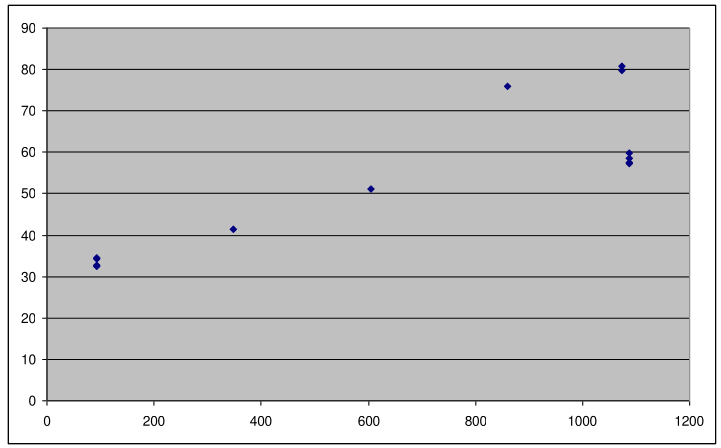

It appears that the data _can be approximated through a linear model_.

We should observe that there is something **slightly suspicious** at the right end
of the graph. Several courses of action are possible, such as:

- **Use a multilinear model**: Stop the first linear model at $1074$, and start
  with the other using the last couple of values of the predictor variable.
  Unfortunately, this does not seem much of an alternative, since a sequence of
  two values is way too small to make any inference.
- **Discard the last four measurements**: We flag them as outliers, and be content
  with the first linear model, explaining data up to $1074$ bytes. This is not too
  advisable either, unless we have good cause to do so.
- **Measure around the suspicious values**: Get measures for values of the predictor
  variable immediately to the right and left of $1088$, so that we can gain more
  information. There may be some bug according to which $1088$ creates an unusual
  behaviour, and everything goes back to normal after that. Otherwise, it may be
  that at $1074$ the system start exhibiting a different behaviour (e.g., a
  decreasing line, i.e., it starts being multi-linear or non-linear in general),
  and we might want to know that.

We choose none of these alternatives, and use linear regression for the whole set
of data.

We let `Excel` do the work, and obtain: $\hat{y} = 0.0337 \cdot x + 31.068$, with
$R^2 = 0.7482$ , which is not that much.

It means that our model cannot explain $25\%$ of the variation of the response.

In this notes I avoid the computation of all the residual (can be found on the
official notes: _Notes of Data Analysis_, pag. 54).

What we obtain is that:

  

    
Normal Variable Check

    <figure class="100">
      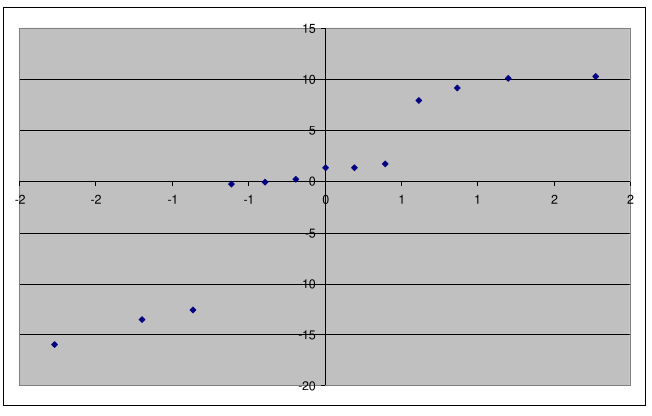
      <figcaption>
        The <em>QQ-plot</em> doesn't seem to be linear at all.
      </figcaption>
    </figure>
  

  

    
IID Check

    <figure class="100">
      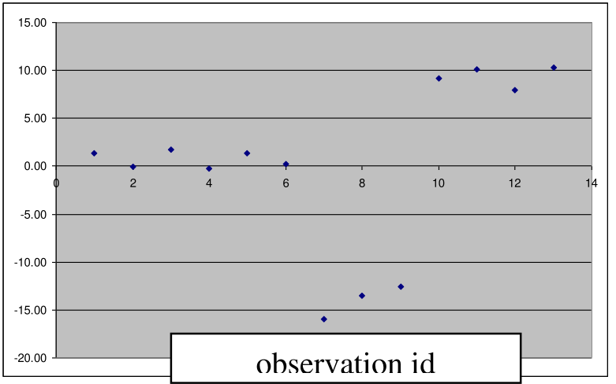
    <figcaption>
      The residuals seem to be growing in magnitude with the number of experiments
    </figcaption>
    </figure>
  

  

    
Standard Deviation Check

    <figure class="100">
      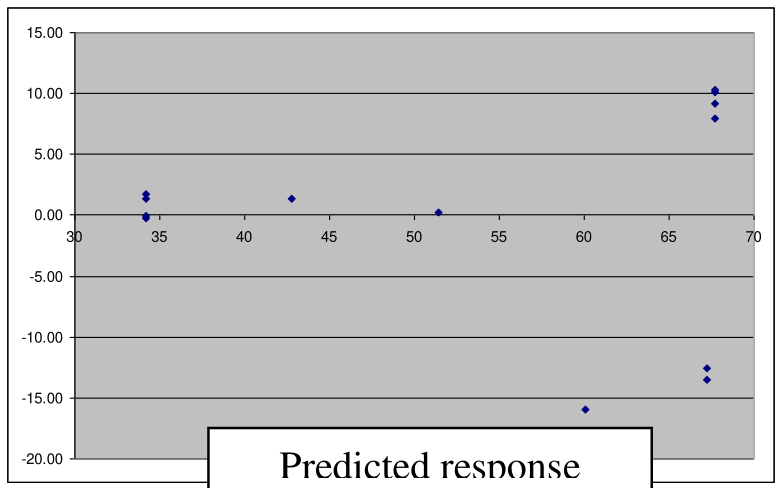
    <figcaption>
      The residuals seem to be growing in magnitude with the predicted response. 
      They do not seem to have <strong>constant standard deviation</strong>.
    </figcaption>
    </figure>
  

---

The result is that this is a **weak model**.
It is false that it explains 75% of the variation of the predicted response,
since the hypotheses are not met.

Predictions made with such a model are likely to have much smaller confidence than
they should. In other words, confidence intervals will appear smaller than they
really are.

The fact that a linear model is not a good one should not be attributed to the
fact that the model may look multi-linear. If we restrict to the interval $[92,1074]$,
then we can check that $R^2 = 0.97$, but:

- The normality assumption is still not verified (tails are heavier than a Normal)
- The assumption of constant std is not verified either (we can check that the
  above graph keeps showing an increasing trend with the predicted response even
  if we remove the four points at the top-right).

Models can also be **non-linear** (e.g., _exponential_, etc.).

For an exponential model, we need to compute $a, \alpha$, such that $\hat{y} = a
\cdot e^{\alpha \cdot x}$, where $a, \alpha$ are the regression parameters
computed based on our $n$ observations.

_Non-linear regression_ is not different in the hypotheses: the same procedure used
to verify **linear regression** should also be applied to **non-linear** regression
as well, the only difference being the visual test to determine the shape of the
regression model.

We can also use **transformations** when:

- We have a _complex relationship_, since it pays to simplify it.
  There are a lot of transformations that yield a linear model, which is easier
  to interpret and justify.
- We need to make up for not met assumptions. For instance, residuals
  may not be _Normal_, the other assumptions may not be met, the ratio $y_{max}
  \over y_{min}$ may be too large for a linear model. A **transformation involving
  the predicted variable _changes the distribution of the residuals_**.
  If it wasn't Normal before, it may be Normal after the transformation.

Some example of transformations that yield a linear model we can use are:

|           Model            |       transformation        |           New Model            |
| :------------------------: | :-------------------------: | :----------------------------: |
|   $y = a + \frac{b}{x}$    |     $x' = \frac{1}{x}$      |      $y = a + b \cdot x'$      |
| $y = \frac{1}{a+b\cdot x}$ |     $y' = \frac{1}{y}$      | $y' = \frac{1}{a + b \cdot x}$ |
|     $y = a \cdot b^x$      |        $y' = log(y)$        | $y' = log(a) + x \cdot log(b)$ |
|   $y = a + b \cdot x^n$    |         $x' = x^n$          |      $y = a + b\cdot x'$       |
|     $y = a \cdot x^b$      | $y' = \log{y},\;x'=\log{x}$ |  $y' = \log{a} + b \cdot x'$   |

## 2.2. Overfitting

**Overfitting** occurs when we try to find a model that **fits _exactly_ our data**,
without using knowledge of our system.

Taking again the example of Disk I/O and CPU times, we can see that a
_polynomial of degree 7_ will fit perfectly the seven points we had, yielding
$R^2 = 1$.

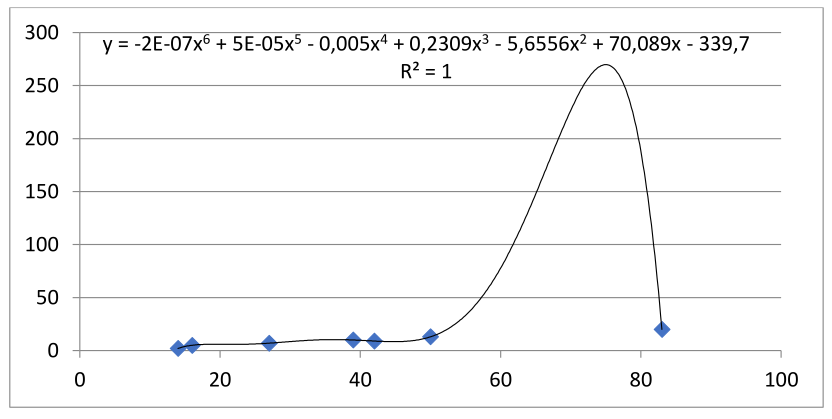

However, this is **plainly stupid**, for several reasons:

- There is **no reason whatsoever** shy the relationship between the two variables
  should be polynomial of degree $7$.
- There is **absolutely no reason** to envisage a peak in the predicted response
  around $x = 75$
- For each (non-degenere) set of $n$ points, there always exists a _degree-$n$_
  polynomial that passes through all the points.
- We are **underestimating the uncertainty** of our model, since we are _forcing_
  it to fit exactly the measurements we took (which can still be affected by random
  errors).

For example, if we add some error to point $(42, 9)$, say $(42, 11)$, then the
polynomial of degree $7$ will change drastically.

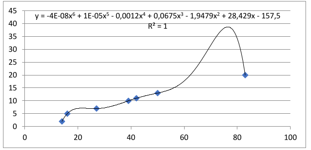

**Overfitting** occurs when a model **can only explain the very data
it has been built on**, and nothing else.

While the linear model has **good predictive capabilities**, the polynomial one
hasn’t any: it describes **random error/noise instead of the underlying
relationship**.

It occurs when a model is _excessively complex_, e.g. includes too many
parameters relative to the number of observations. As such, it **overreacts
to minor variations**.

> [!TIP]
> Always go for the **simplest model**, and give precedence to the **insight on
> our problem**.
