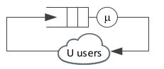
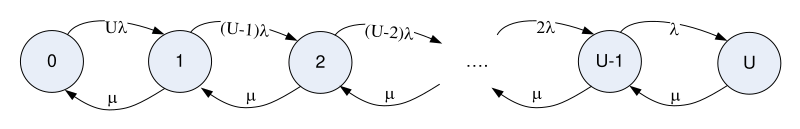
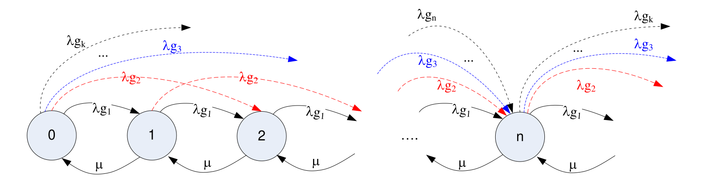
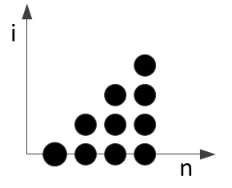
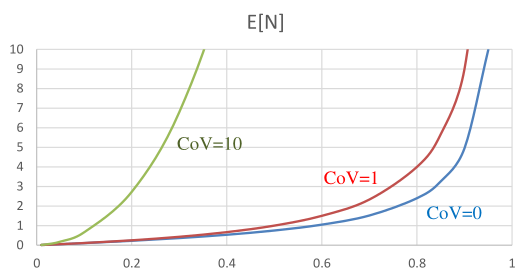

# 1. Index

<!--toc:start-->

- [1. Index](#1-index)
- [2. Queuing Theory](#2-queuing-theory)
- [3. Finite Population Systems](#3-finite-population-systems)
- [4. Bulk Arrival Systems](#4-bulk-arrival-systems)
  - [4.1. Examples](#41-examples)
    - [4.1.1. Single Arrivals](#411-single-arrivals)
    - [4.1.2. Constant Batch Multiple Arrivals](#412-constant-batch-multiple-arrivals)
- [5. Non Exponential Service Time](#5-non-exponential-service-time)
  - [5.1. Steady State Probabilities](#51-steady-state-probabilities)
  <!--toc:end-->

# 2. Queuing Theory

In this section we will discuss **Finite Population and Bulk Arrival Systems**,
as a continuation of what seen before:

1. [MM1 Systems](./Queuing%20Theory%20-%20MM1%20Systems)
1. [MMC and MM1K Systems](./Queuing%20Theory%20-%20MMC%20and%20MM1K%20Systems)

> [!IMPORTANT]
> This chapter will make usage of many concepts we discussed in the previous chapters,
> hence it is strongly recommended to read them before proceeding.

# 3. Finite Population Systems

We indicate **infinite-queue finite-population systems** as **M/M/1/\*/U**.

Typical examples are:

- A repair center for broken machines. Once fixed, machines are put back in
  operation, and broken ones are queued for repair.
  The overall population of machines is a constant $U$
- An I/O device being accessed by a finite number of processes.
- A network switch having $U$ input lines that **block** when they are being served.

Assuming that users are **independent**, and that the time a user spends **outside**
the system is _exponentially distributed_ with a rate $\lambda$.

Then, it follows that, if $U$ users are the population and $n$ users are inside
the system at time $t$, $U -n$ will be outside the system and may be entering the
system in the future.

Therefore, the next arrival will occur when the **smallest (residual) "outside"
time will have elapsed**.

However, given that outside times are IID exponentials:

1. _Residual outside times_ are distributed as _outside times_ (_memoryless_ property).
1. The minimum of $U - n$ IID exponentials is an exponential with a rate $(U -n)
\cdot \lambda$

Therefore, **the arrival rates are**

$$
\lambda n = (U - n) \cdot \lambda
$$

On the other hand, if we have only a constant-rate server, the service rates
are constant $(\mu_n = \mu)$ , and the system will have $U + 1$ states.

Hence, as long as its memory is at least equal to $U$, it does not really
matter how large it is.

This said, the CTMC is the following:

Having a finite number of states, the system is **always stable**, and the
equilibrium equations are:

 Global Equilibrium Equations 

$$
\begin{align*}
  U \cdot \lambda \cdot p_0 &= \mu \cdot p_1 && \\
  [(U - n) \cdot \lambda + \mu] \cdot p_n &= (U - n + 1) \cdot \lambda \cdot
p_{n-1} + \mu \cdot p_{n+1} && 1 \le n \le U - 1 \\
   \mu \cdot p_U &= \lambda \cdot p_{U-1} &&
\end{align*}
$$

 Local Equilibrium Equations 

$$
(U - n) \cdot \lambda \cdot p_n = \mu \cdot p_{n+1}, \quad 0 \le n \le U - 1
$$

From the local equilibrium equations we can easily compute the SS probabilities:

$$
p_n = \left(\frac{\lambda}{\mu}\right)^n \cdot \frac{U!}{(U - n)!} \cdot p_0, \quad
0 \le n \le U
$$

The system is always stable, hence we can compute $p_0$ from the normalization condition:

$$
\begin{CD}
{
  p_0 \cdot \sum_{n=0}^{U} \left(\frac{\lambda}{\mu}\right)^n \cdot
\frac{U!}{(U - n)!} = 1
} \\
@VVV \\
{
  p_0 = \frac{1}{\displaystyle\sum_{n=0}^{U} \left(\frac{\lambda}{\mu}\right)^n
\cdot \frac{U!}{(U - n)!}}
}
\end{CD}
$$

We can compute the performance indexes:

$$
\begin{align*}
  E[N] &= \sum_{n=0}^{U} n \cdot p_n = \sum_{n=0}^{U} (U - (U-n)) \cdot p_n \\
    &= \sum_{n=0}^{U} U \cdot p_n - \sum_{n=0}^{U} (U-n) \cdot p_n \\
    &= U - \sum_{n=0}^{U-1} (U-n) \cdot \left(\frac{\lambda}{\mu}\right)^n
\cdot \frac{U!}{(U - n)!} \cdot p_0 \\
    &= U - \sum_{n=0}^{U-1} \left(\frac{\lambda}{\mu}\right)^n \cdot
\frac{U!}{(U - (n + 1)!} \cdot p_0 \\
    &= U - \frac{\mu}{\lambda} \cdot \sum_{j=1}^{U}
\left(\frac{\lambda}{\mu}\right)^j \cdot \frac{U!}{(U - j)!} \cdot p_0 \\
    &= U - \frac{\mu}{\lambda} \cdot (1 - p_0) \\
\end{align*}
$$

From this we easily get the _Mean Number of Jobs in the Queue_ as:

$$
E[N_q] = E[N] - (1 - p_0) = U - \frac{\mu + \lambda}{\lambda} \cdot (1 - p_0)
$$

In order to apply Little's Law, we need to compute:

$$
\begin{align*}
  \overline{\lambda} &= \sum_{n=0}^U \lambda_n \cdot p_n \\
    &= \sum_{n=0}^U (U-n) \cdot \lambda \cdot p_n \\
    &= \gamma = \sum_{n=0}^{U} \mu_n \cdot p_n \\
    &= \mu \cdot (1 - p_0)
\end{align*}
$$

Hence, we can compute the _Mean Response Time_ and the _Mean Waiting Time_ as:

$$
\begin{align*}
  E[R] &= \frac{E[N]}{\overline{\lambda}} \cdot p_n = \frac{U}{\mu \cdot
(1 - p_0)} - \frac{1}{\lambda} \\
  E[W] &= \frac{E[N_q]}{\overline{\lambda}} = \frac{U}{\mu \cdot (1 - p_0)} -
\frac{1}{\lambda} - \frac{1}{\mu}
\end{align*}
$$

Finally, since this is not a PASTA system (non constant arrival rates), we can
compute the _Mean Number of Jobs in the System Seen by an Arrival_ as:

$$
r_n = \frac{\lambda_n}{\overline{\lambda}} \cdot p_n = \frac{(U-n) \cdot \lambda}
{\mu \cdot (1 - p_0)} \cdot \left(\frac{\lambda}{\mu}\right)^n \cdot
\frac{U!}{(U - n)!} \cdot p_0 = \frac{p_{n+1}}{1 - p_0}, \qquad n < U
$$

As usual, we could devise more complex systems with finite population and $C$ servers,
however these are simply _algebraic complications_ and do not add any new insight.

Instead, we can explore how **finite-population** and **infinite-population** systems
relate to each other.

In fact, when $U$ grows to infinity, all numbers $U - k$ are _not dissimilar_ to
$U$, hence we can approximate the arrival rate as **constant**.

This is the same approximation through which we obtained a _Poisson distribution_
from a _binomial_ when the number of trials was very large and the probability of
success was very small.

# 4. Bulk Arrival Systems

So far, we have only analyzed systems with **nearest-neighbor transitions**.

However, there are practical cases when _non-nearest-neighbor transitions_ may occur,
just think about these examples:

- A processing plant where trucks arrive with _exponential inter-arrival times_,
  carrying a **random number of items** that must be processed individually.
  Thus, if we describe the system state using the number of items in the
  processing plant, one arrival implies a state jump of as many items as the
  truck contains.
- A network protocol sending **messages** to the underlying protocol.
  Messages may be arbitrarily long, and they may be **fragmented** and transmitted
  separately.

In all these cases, if we assume that arrivals are exponential, we retain the
property that the only relevant parameter to describe the system state is the
number of jobs in the system.

However, one arrival will increase the number of queued jobs **by more than
one unit**, so we will have _non-nearest-neighbor_ transitions to the right
in the CTMC.

The problem that immediately arises is how to write our CTMC in this case.

Calling $G$ the number of jobs per arrival, and $g_k = P\Set{g = k}$ its PMF.

It is $g_0 = 0$, and obviously $\displaystyle\sum_{k=1}^{+\infty} g_k = 1$. (this does not
necessarily mean that the support of $g$ must be infinite, in fact was it finite,
we would just have $g_k = 0$ starting from some index $k \ge k_{max}$).

However, assuming $g_k$ independent of the arrival time and service time
distribution, then the **rate of the arc going from state $i$ to state $k$**
is $\lambda \cdot g_{k-i}$.

> [!NOTE]
> This hypothesis does not hold in real life, since the number of jobs in a truck
> very likely to be positively correlated with the inter-arrival time of the trucks.
> In general, a long delay in the arrival is likely to be followed by a truck
> with a large number of items, and vice versa.  
> However, our approximation is reasonable for our purposes.

This said, we can draw the CTMC as follows:

In this diagram:

- All states will have **as many outgoing arcs to the right as the support of the
  RV $G$ allows**, each one with a label $\lambda \cdot g_j$ with $j \ge 1$.  
  If the maximum number of jobs in a bulk arrival is infinite, then there will be
  _infinitely many outgoing arcs to the right from each state_.
- Each state $n$ will have **exactly $n$ incoming arcs from the left**, labeled
  $\lambda \cdot g_{n-j}$ with $0 \le j < n$ and coming from state $j$.
- The service transition going from $n$ to $n - 1$ will have a constant rate of
  $\mu_n = \mu$

Writing the **Global Equilibrium Equations** is not as difficult as it may seem,
while _Local_ ones are more prone to error due to the high number of arcs.

With $n = 0$, it is simply:

$$
\begin{CD}
{
  \lambda \sum_{i=1}^{+\infty} g_i \cdot p_0 = \mu \cdot p_1
} @>>>
{
  \lambda \cdot p_0 = \mu \cdot p_1
}
\end{CD}
$$

For a generic node $n \ge 1$:

$$
\begin{CD}
{
  \underbrace{\left[\lambda \sum_{i=1}^{+\infty} g_i + \mu\right] \cdot p_n}
  _{\text{outgoing}} = \underbrace{\mu \cdot p_{n+1} + \lambda \sum_{i=0}^{n-1}
  g_{n-i} \cdot p_{i}}_{\text{incoming}}
} \\
@VVV \\
{
  (\lambda + \mu) \cdot p_n = \mu \cdot p_{n+1} + \lambda \sum_{i=0}^{n-1}
  g_{n-i} \cdot p_{i}
}
\end{CD}
$$

Computing the SS probabilities using the **direct method** (i.e., $p_n =
f_n(p_0)$ and enforcing normalization) is probably too difficult in this case.

However, we can switch to the **PGFs**, multiplying everything by $z^n$ and summing
everything:

$$
\begin{cases}
  \lambda \cdot z^0 \cdot p_0 = \mu \cdot z^0 \cdot p_1 & \\
  (\lambda + \mu) \cdot z^n \cdot p_n =
\mu \cdot z^n \cdot p_{n+1} + \lambda \cdot z^n \cdot
\displaystyle\sum_{i=0}^{n-1} g_{n-i} \cdot p_i & n \ge 1
\end{cases}\\[1.5em]
\begin{align*}
    (\lambda + \mu) \cdot \mathbf{P}(z) - \mu \cdot p_0 &=
\mu \cdot p_1 + \mu \sum_{n=1}^{+\infty} z^n \cdot p_{n+1} + \lambda
\cdot \sum_{n=1}^{+\infty} \sum_{i=0}^{n+1} z^n \cdot g_{n-i} \cdot p_i \\
  (\lambda + \mu) \cdot \mathbf{P}(z) - \mu \cdot p_0 &=
\cancel{\mu \cdot p_1} + \frac{\mu}{z} \left[
\mathbf{P}(z) - p_0 - \cancel{z \cdot p_1} \right] + \lambda
\sum_{i=0}^{+\infty} z^n \cdot g_{n-1} \cdot p_i \\
  (\lambda + \mu) \cdot \mathbf{P}(z) - \mu \cdot p_0 &=
  \frac{\mu}{z} \cdot [\mathbf{P}(z) - p_0] + \lambda \cdot
\sum_{i=0}^{+\infty}{z^i \cdot p_i} \cdot
\sum_{n = i+1}^{+\infty} z^{n-1} \cdot g_{n-1} \\
(\lambda + \mu) \cdot \mathbf{P}(z) - \mu \cdot p_0 &=
  \frac{\mu}{z} \cdot [\mathbf{P}(z) - p_0] + \lambda \cdot
  \mathbf{P}(z) \cdot \mathbf{G}(z)
\end{align*}
$$

> [!NOTE]
> We transform the double sum into the product of two sums because if we plot
> how $n$ and $i$ vary, we can see that they form a _triangle_.
>
> 

Where $\mathbf{G}(z)$ is none other than **the PGF of $g$**.

Thus, we end up with:

$$
\mathbf{P}(z) = \frac{\mu \cdot p_0 \cdot (1 -z)}{\mu \cdot (1 - z) - \lambda
\cdot z \cdot [ 1- \mathbf{G}(z)]}
$$

In this case the normalization condition is simply $\mathbf{P}(1) = 1$, which
unfortunately leads to an undetermined expression of the form $\frac{0}{0}$
(since $G(1) = 1$ as well).

Hence, we must use _De l'Hopital's_ rule to compute it:

$$
\begin{align*}
  \lim_{z \to 1^-} \mathbf{P}(z) &=
\lim_{z \to 1^-} \frac{\frac{d}{dz} \left(\mu \cdot p_0 \cdot (1 -z)\right)}
{\frac{d}{dz}\left(\mu \cdot (1 - z) - \lambda \cdot z \cdot [ 1- \mathbf{G}(z)]
\right)} \\
&= \lim_{z to 1^-} \frac{- \mu \cdot p_0}{-\mu - \lambda \cdot [1 - \mathbf{G}(z)]
+\lambda \cdot z \cdot \mathbf{G}'(z)} \\
&= \frac{-\mu \cdot p_0}{-\mu + \lambda \mathbf{G}'(1)} = 1
\end{align*}
$$

We can then make use of a property of the PGF, which states that
$\mathbf{G}'(1) = E[G]$. Hence we have:

$$
\frac{-\mu \cdot p_0}{-\mu + \lambda \cdot E[G]} = 1 \implies
p_0 = 1 - \frac{\lambda}{\mu} \cdot E[g]
$$

Since $p_0$ is a probability, hence must always be positive, we have that our
**stability condition** is:

$$
\frac{\lambda}{\mu} \cdot E[g] < 1
$$

Hence, it becomes clear that:

$$
\rho = (1 - p_0) = \frac{\lambda}{\mu} \cdot E[g]
$$

Since, $\lambda \cdot E[g]$ is the **actual rate of job arrivals**, we can rewrite
the expression of $\mathbb{P}(z)$ as:

$$
\mathbf{P}(z) = \frac{\mu \cdot (1 - \rho) \cdot (1 -z)}{\mu \cdot (1 - z) -
\lambda \cdot z [1 - \mathbf{G}(z)]}
$$

## 4.1. Examples

In the next sections we will see some examples of bulk arrival systems.

### 4.1.1. Single Arrivals

This is the simplest case, since:

$$
g_i = \begin{cases}
  1 & i = 1 \\
  0 & i \neq 1
\end{cases}
$$

Thus, we get that the PMF is simply $\mathbf{G}(z) = 1 \cdot z^1 = z$.

Under the condition that $p_0 = 1 - \frac{\lambda}{\mu} \cdot E[g] > 0$, i.e.
$\rho = \frac{\lambda}{\mu} \cdot E[g] = \frac{\lambda}{\mu} < 1$, we get:

$$
\mathbf{P}(z) = \frac{\mu \cdot (1 - \rho) \cdot (1 -z)}{\mu \cdot (1 - z) -
\lambda \cdot z \cdot [1 - z]} = \frac{1 - \rho}{1 - \rho z}
$$

Which is the PGF of **M/M/1 SS probabilities** $p_n = (1-\rho) \cdot \rho^n$.

### 4.1.2. Constant Batch Multiple Arrivals

This is a little more complex, since we have a **constant batch size** $b$:

$$
g_i = \begin{cases}
  1 & i = b \\
  0 & i \neq b
\end{cases}
$$

In this case $E[g] = b$ and $\mathbf{G}(z) = z^b$, hence we have that the stability
condition is:

$$
\rho = \frac{\lambda}{\mu} \cdot E[g] = \frac{\lambda}{\mu} \cdot b < 1
$$

Hence, recalling that $1 - z^b = (1 - z) \cdot \sum_{i=0}^{b-1} z^i$, we have:

$$
\mathbf{P}(z) = \frac{\mu \cdot (1 - \rho) \cdot (1 -z)}{\mu \cdot (1 - z) -
\lambda \cdot z \cdot [1 - z^b]} = \frac{1 - \rho}{1 - \frac{\rho}{b}
\cdot \sum_{i=0}^{b-1} z^i}
$$

Thus, we can compute the _Mean Number of Jobs in the System_ as:

$$
\begin{align*}
E[N] &= \frac{d}{dz} P(z) \Big\vert_{z=1} \\
  &= \frac{d}{dz} \left[ \frac{1 - \rho}{1 - \frac{\rho}{b} \cdot
\sum_{i=0}^{b-1} z^i} \right]_{z=1} \\
  &= (1 - \rho) \cdot \left[ \frac{\frac{\rho}{b} \cdot
\sum_{i=1}^{b} i \cdot z^{i-1}}{\left(1 - \frac{\rho}{b} \cdot
\sum_{i=0}^{b-1} z^i\right)^2} \right]_{z=1} \\
  &= (1 - \rho) \cdot \frac{\frac{\rho}{b} \cdot \frac{b(b+1)}{2}}{(1 -
\rho)^2} \\
  &= \frac{\rho(b+1)}{2(1 - \rho)}
\end{align*}
$$

> [!NOTE]
> When $b = 1$ we obtain the formula we saw above for M/M/1 systems.

We can also compute the _Mean Job Response Time_:

$$
E[R] = \frac{E[N]}{\gamma} = \frac{E[N]}{\overline{\lambda}} =
  \frac{E[N]}{\mu \cdot (1-p_0)} = \frac{\rho(b+1)}{2(1 - \rho)} \cdot
  \frac{1}{\mu \rho} = \frac{b+1}{2\mu (1 - \rho)}
$$

# 5. Non Exponential Service Time

So far, we have always assumed that:

- Inter-arrivals are exponential
- Service times are exponential

And we have described a theory that allows one to find not only **mean values of
the steady-state performance indexes**, but also their distributions (in most
cases).

However, there are cases when inter-arrival and (more frequently)
service times **cannot be fitted to an exponential distribution**.

In these cases, the analysis is made complex by the fact that **the number of
jobs in the system _is not a sufficient characterization_ of its state**.

Despite this, some results can be found, for instance for the **M/G/1** systems,
i.e., the one with exponential inter-arrival times but _general service times_
(any distribution) and one server.

Let $t_S$ be the RV that models the service times, and assume that
$E[t_S] = \frac{1}{\mu}$ and $\operatorname*{Var}(t_S)$ are known.

Skipping completely all the 7-hour mathematical calculation that lead to
the final result, if $\rho < \frac{\lambda}{\mu} < 1$, then the system is
**stable** and the **_Pollaczek and Khinchin's_** formula states that:

$$
\large
\boxed{
  E[N] = \rho + \frac{\rho^2 + \lambda^2 \cdot \operatorname*{Var}(t_S)}{2\cdot
(1 - \rho)} = \rho + \frac{\rho^2 + \operatorname*{CoV}(t_S)^2}{2\cdot (1 - \rho)}
}
$$

> [!NOTE]
> Knowing this result enables us to:
>
> - Compute the other three performance indexes, using Little's Law and other tricks
> - Notice that when $t_S \sim Exp(\lambda)$, this formula reduces to **Kleinrock's**
>   formula for **M/M/1** systems

The version of this formula that mentions explicitly the _Coefficient of
Variation_ of the service time is particularly insightful, since we
know that the **exponential's CoV is 1**.

This means that the mean number of jobs in the system will also depend
on "how variable" service times are.

If the service is **deterministic** (which we call an **M/D/1 system**), then it
will be $\operatorname*{Var}(t_S) = \operatorname*{CoV}(t_S) = 0$,
and we will have the smallest possible average number of jobs in a system.

PK’s formula shows that the **variability** of the service time
**increases the queue occupancy**.
If that variability is very high (e.g., the service time distribution is
_fat-tailed_ or _heavy-tailed_), then a system **may become congested even when**
$\rho \ll 1$.

This confirms that it is very important to pick the right model for the
service times, otherwise we will end up thinking that our system has
negligible queueing when in fact it does not.

Furthermore, the formula also shows something with a strong physical significance:
**queueing arises from variability (randomness)**.

In a system where both inter-arrival times and service times are **constant**
(i.e., a D/D/1 system), **there will be _no queueing_ as long as** $\rho\le 1$.

It either (or both) the inter-arrival and the service times are variable, then there
will be queueing.

Queueing is nothing more than a **consequence** of stochastic inter-arrival times
that arrive _close to each other_ and/or stochastic service times that _take
longer than expected_.

## 5.1. Steady State Probabilities

PK formula computes $E[N]$ directly, but does not tell us anything
about **steady-state probabilities** in a closed form.

For instance, we cannot compute $P\Set{N \ge 3}$.

If result like this are required, we have two choices:

- Analyze our **M/G/1** system using the method of the **imbedded Markov chain**
  (IMC)
- Approximate numerical results through **Phase-Type Distributions**, with
  a tunable trade-off between accuracy and complexity.

The first method yields **exact results (for the PGF)**, but it requires entirely
different mathematics related to _discrete-time processes_ (ours are
continuous time), thus will not be explored by this course.

Instead, with the second method, we can model the general service-time
distribution using **compositions of exponential distributions**, allowing
us to write a more complex CTMC and solve it with _numerical techniques_,
such as \*\*Neut's matrix-analytic method.
