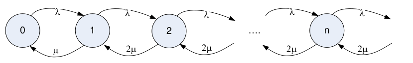
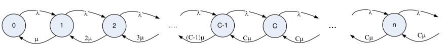

# 1. Index

<!--toc:start-->

- [1. Index](#1-index)
- [2. Queuing Theory](#2-queuing-theory)
- [3. MMC Systems](#3-mmc-systems)
  - [3.1. Global and Local Equilibrium Equations](#31-global-and-local-equilibrium-equations)
  <!--toc:end-->

# 2. Queuing Theory

In this section we will discuss **M/M/C systems**, which are a generalization
of the **M/M/1** systems we discussed [in the previous chapter](./Queuing%20Theory%20-%20MM1%20Systems).

> [!IMPORTANT]
> This chapter will make usage of many concepts we discussed in the previous chapter,
> hence it is strongly recommended to read it before proceeding.

# 3. MMC Systems

So far we discussed systems with **only one server**.

However, it is frequent to study cases where a single queue is drained by **more
than one server**, like:

- Airport check-in, where the single queue is served by several desks
- One queue of transactions waiting to be processed by several redundant disks
- A server farm, with requests being routed to the first idle server
- Networks with $C$ parallel links bundled together to increase the capacity

If the $C$ servers are **equivalent** (i.e., they have the same rate $\mu$)
and **everything else stays the same** (i.e., exponential arrivals, exponential
service times, infinite memory), then we call the system an **M/M/C**.

In an M/M/C system, an arriving job is sent to an **idle server** at random, if
one such server exists, otherwise it queues up.

To derive the **SS probabilities** for an M/M/C system, we first start with
$C = 2$ (M/M/2), and then we will generalize to an arbitrary value of $C$.

It is quite easy to derive the transition rates in this system, in fact:

- Arcs going to the **right** are the same (with a rate $\lambda n = \lambda$)
- Arcs going to the **left** will have to consider that (at least when $n \ge 2$)
  **both servers are busy**.

Assuming we are at time $t$, in a trajectory whose value is $N(t) = n \ge 2$,
both servers are busy, and a job may depart in the future from either of them.

> [!WARNING]
> As for the previous cases, we neglect the occurrence of **simultaneous
> events**, since it has a **negligible probability**.

The next downward transition in the trajectory will occur when **the smallest
of the two residual service times** is over.

Since both residual service times are **IID exponential with the same rate $\mu$**:

- The "residual" is immaterial, since exponential are memoryless
- The **minimum** of two IID exponential is an exponential with **double the rate**

Therefore, arcs going to the left, out of $n \ge 2$ states, will have a transition
rate equal to $2 \mu$.

Instead, the transition rate for $1 \to 0$ the fact that we have another node
being idle is **irrelevant**, meaning that we maintain the same transition rate
$\mu$.

Hence, we get a CTMC with:

$$
\begin{cases}
  \lambda_n = \lambda & n \ge 0 \\
  \mu_n = \begin{cases}
    \mu & n = 1 \\
    2\mu & n \ge 2
  \end{cases}
\end{cases}
$$

In this case, **service rates are load-dependent**.

## 3.1. Global and Local Equilibrium Equations

Given the above diagram, we can easily compute both **Global** and **Local**
equilibrium equations:

 Global Equilibrium Equations 

$$
\begin{align*}
  \lambda \cdot p_0 &= \mu \cdot p_1 \\
  (\lambda + \mu) \cdot p_1 &= \lambda \cdot p_0 + 2\mu \cdot p_2 \\
  (\lambda + 2\mu) \cdot p_n &= \lambda \cdot p_{n-1} + 2\mu \cdot p_{n+1} &&
n \ge 2
\end{align*}
$$

$$
\begin{align*}
  \lambda \cdot p_0 &= \mu \cdot p_1 \\
  \lambda \cdot p_n &= 2\mu \cdot p_{n+1} && n\ge 2
\end{align*}
$$

Before solving the above systems we generalize the above reasoning to
an **arbitrary number of servers** $C$, keeping in mind that:

- Arrival rates are constant
- Service rates will be $\mu_n = n \cdot \mu$ for $n < C$, and $\mu_n = C \cdot
\mu$ for $n \ge C$ (i.e., $\mu_n = \min{(C, n)} \cdot \mu$)

In order to compute the SS probabilities, we specialize the general formulas
we found before:

$$
\begin{cases}
  p_n = \displaystyle\prod_{i=0}^{n-1}\frac{\lambda_i}{\mu_{i+1}} \cdot p_0
& n \ge 1 \\
  \displaystyle\sum_{n=0}^{+\infty} p_n = 1 &
\end{cases}
$$

We define $u = \frac{\lambda}{\mu}$, and we can compute the first $C$ probabilities.

> [!CAUTION]
> As said before, $\frac{\lambda}{\mu}$ **in not the utilization in general**.  
> This is one of those cases. For this reason we don't denote it with $\rho$ but
> rather with $u$.

To write the above formulas we distinguish two cases: $n \le C$ and $n \ge C$.

In the first case we get:

$$
\begin{align*}
  p_n &= \frac{\lambda^n}{\mu \cdot 2 \mu \cdot 3 \mu \cdot \dots \cdot n \mu}
\cdot p_0 \\
  &= \left(\frac{\lambda}{\mu}\right)^n \cdot \frac{1}{n!}\cdot p_0
\end{align*}
$$

While in the second case:

$$
\begin{align*}
p_n &= \frac{\lambda^n}{(\mu \cdot 2 \\mu \cdot 3 \mu \cdot \dots \cdot C \mu)
\cdot (C \mu)^{n - C}} \cdot p_0 \\
  &= \left(\frac{\lambda}{\mu}\right)^C \cdot \frac{1}{C!} \cdot
\left(\frac{\lambda}{C^{n - C}}\right)^{n-C} \cdot p_0 \\
  &= \frac{u^n}{C^{n-C}\cdot C!} \cdot p_0
\end{align*}
$$

The normalization condition becomes (recalling that we have to count $n = C$
only once):

$$
p_0 \cdot \left[ \sum_{n=0}^{C-1} \frac{u^n}{n!} +
  \sum_{n=C}^{+\infty} \frac{u^n}{C^{n-C} \cdot C!} \right] = 1
$$

The **first summation includes a finite number of terms**, hence it is always
finite.

This, the stability condition is the one under which **the second summation is finite**:

$$
\sum_{n=C}^{+\infty} \frac{u^n}{C^{n-C} \cdot C!} = \frac{u^C}{C!} \cdot
\sum_{n=C}^{+\infty} \left(\frac{u}{C}\right)^{n-C} = \frac{u^C}{C!} \cdot
\sum_{j=0}^{+\infty} \left(\frac{u}{C}\right)^j
$$

Which has a condition clearly equivalent to $u < C \Rightarrow \lambda < C\cdot
\mu$.

In this case, the **utilization of the system** is defined as:

$$
\rho = \frac{\lambda}{C \cdot \mu} = \frac{u}{C}
$$

Meaning that the stability condition is still $\rho < 1$.

This gives an interesting insight on stability, since all the matters is the
balance of the rates "**to the right**".

Under the above conditions the infinite sum can be rewritten as a **geometric series**
which converges to $\frac{1}{1 - \frac{u}{C}} = \frac{1}{1 - \rho}$, hence:

$$
\begin{align*}
  p_0 &= \frac{1}{\displaystyle\sum_{n=0}^{C-1} \frac{u^n}{n!} + \frac{u^C}{C!}
  \cdot \frac{1}{1 - \rho}} \\[3.5em]
  p_n &= \begin{cases}
    p_0 \cdot \frac{u^n}{n!} & n \le C \\
    p_0 \cdot \frac{u^C}{C^{n-C} \cdot C!} \cdot \rho^{n-C} & n \ge C
  \end{cases}
\end{align*}
$$
