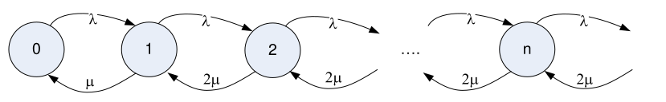
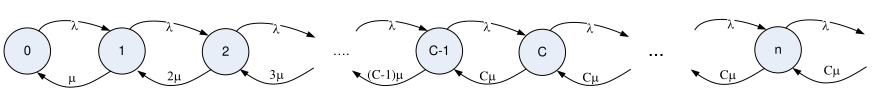
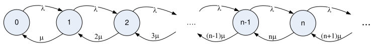
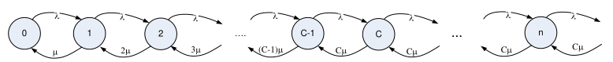
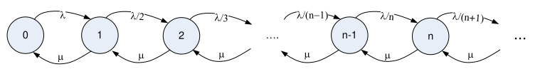
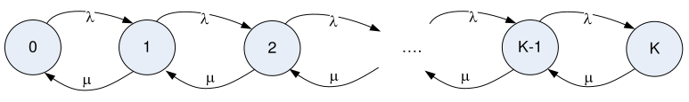
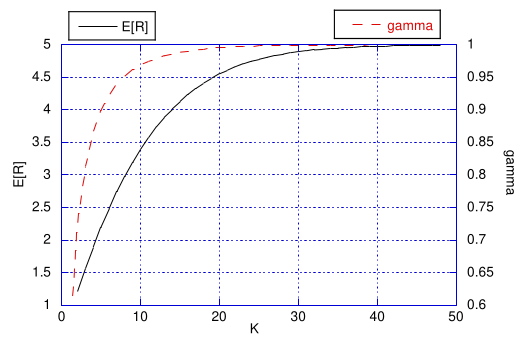

# 1. Index

<!--toc:start-->

- [1. Index](#1-index)
- [2. Queuing Theory](#2-queuing-theory)
- [3. MMC Systems](#3-mmc-systems)
  - [3.1. Global and Local Equilibrium Equations](#31-global-and-local-equilibrium-equations)
  - [3.2. Infinite Servers](#32-infinite-servers)
  - [3.3. Models, CTMCs and Performance Indexes](#33-models-ctmcs-and-performance-indexes)
    - [3.3.1. Exercise: Comparison of the Response Times](#331-exercise-comparison-of-the-response-times)
  - [3.4. Discouraged Arrivals](#34-discouraged-arrivals)
- [4. MM1K Systems](#4-mm1k-systems)
  - [4.1. Non Trivial Performance Indexes](#41-non-trivial-performance-indexes)
  - [4.2. Adding Queuing Space](#42-adding-queuing-space)
  <!--toc:end-->

# 2. Queuing Theory

In this section we will discuss **M/M/C and M/M/1/K Systems**,
as a continuation of what seen before:

1. [MM1 Systems](./Queuing%20Theory%20-%20MM1%20Systems)

> [!IMPORTANT]
> This chapter will make usage of many concepts we discussed in the previous chapter,
> hence it is strongly recommended to read it before proceeding.

# 3. MMC Systems

So far we discussed systems with **only one server**.

However, it is frequent to study cases where a single queue is drained by **more
than one server**, like:

- Airport check-in, where the single queue is served by several desks
- One queue of transactions waiting to be processed by several redundant disks
- A server farm, with requests being routed to the first idle server
- Networks with $C$ parallel links bundled together to increase the capacity

If the $C$ servers are **equivalent** (i.e., they have the same rate $\mu$)
and **everything else stays the same** (i.e., exponential arrivals, exponential
service times, infinite memory), then we call the system an **M/M/C**.

In an M/M/C system, an arriving job is sent to an **idle server** at random, if
one such server exists, otherwise it queues up.

To derive the **SS probabilities** for an M/M/C system, we first start with
$C = 2$ (M/M/2), and then we will generalize to an arbitrary value of $C$.

It is quite easy to derive the transition rates in this system, in fact:

- Arcs going to the **right** are the same (with a rate $\lambda n = \lambda$)
- Arcs going to the **left** will have to consider that (at least when $n \ge 2$)
  **both servers are busy**.

Assuming we are at time $t$, in a trajectory whose value is $N(t) = n \ge 2$,
both servers are busy, and a job may depart in the future from either of them.

> [!WARNING]
> As for the previous cases, we neglect the occurrence of **simultaneous
> events**, since it has a **negligible probability**.

The next downward transition in the trajectory will occur when **the smallest
of the two residual service times** is over.

Since both residual service times are **IID exponential with the same rate $\mu$**:

- The "residual" is immaterial, since exponential are memoryless
- The **minimum** of two IID exponential is an exponential with **double the rate**

Therefore, arcs going to the left, out of $n \ge 2$ states, will have a transition
rate equal to $2 \mu$.

Instead, the transition rate for $1 \to 0$ the fact that we have another node
being idle is **irrelevant**, meaning that we maintain the same transition rate
$\mu$.

Hence, we get a CTMC with:

$$
\begin{cases}
  \lambda_n = \lambda & n \ge 0 \\
  \mu_n = \begin{cases}
    \mu & n = 1 \\
    2\mu & n \ge 2
  \end{cases}
\end{cases}
$$

In this case, **service rates are load-dependent**.

## 3.1. Global and Local Equilibrium Equations

Given the above diagram, we can easily compute both **Global** and **Local**
equilibrium equations:

 Global Equilibrium Equations 

$$
\begin{align*}
  \lambda \cdot p_0 &= \mu \cdot p_1 \\
  (\lambda + \mu) \cdot p_1 &= \lambda \cdot p_0 + 2\mu \cdot p_2 \\
  (\lambda + 2\mu) \cdot p_n &= \lambda \cdot p_{n-1} + 2\mu \cdot p_{n+1} &&
n \ge 2
\end{align*}
$$

$$
\begin{align*}
  \lambda \cdot p_0 &= \mu \cdot p_1 \\
  \lambda \cdot p_n &= 2\mu \cdot p_{n+1} && n\ge 2
\end{align*}
$$

Before solving the above systems we generalize the above reasoning to
an **arbitrary number of servers** $C$, keeping in mind that:

- Arrival rates are constant
- Service rates will be $\mu_n = n \cdot \mu$ for $n < C$, and $\mu_n = C \cdot
\mu$ for $n \ge C$ (i.e., $\mu_n = \min{(C, n)} \cdot \mu$)

In order to compute the SS probabilities, we specialize the general formulas
we found before:

$$
\begin{cases}
  p_n = \displaystyle\prod_{i=0}^{n-1}\frac{\lambda_i}{\mu_{i+1}} \cdot p_0
& n \ge 1 \\
  \displaystyle\sum_{n=0}^{+\infty} p_n = 1 &
\end{cases}
$$

We define $u = \frac{\lambda}{\mu}$, and we can compute the first $C$ probabilities.

> [!CAUTION]
> As said before, $\frac{\lambda}{\mu}$ **in not the utilization in general**.  
> This is one of those cases. For this reason we don't denote it with $\rho$ but
> rather with $u$.

To write the above formulas we distinguish two cases: $n \le C$ and $n \ge C$.

In the first case we get:

$$
\begin{align*}
  p_n &= \frac{\lambda^n}{\mu \cdot 2 \mu \cdot 3 \mu \cdot \dots \cdot n \mu}
\cdot p_0 \\
  &= \left(\frac{\lambda}{\mu}\right)^n \cdot \frac{1}{n!}\cdot p_0
\end{align*}
$$

While in the second case:

$$
\begin{align*}
p_n &= \frac{\lambda^n}{(\mu \cdot 2 \mu \cdot 3 \mu \cdot \dots \cdot C \mu)
\cdot (C \mu)^{n - C}} \cdot p_0 \\
  &= \left(\frac{\lambda}{\mu}\right)^C \cdot \frac{1}{C!} \cdot
\left(\frac{\lambda}{C^{n - C}}\right)^{n-C} \cdot p_0 \\
  &= \frac{u^n}{C^{n-C}\cdot C!} \cdot p_0
\end{align*}
$$

The normalization condition becomes (recalling that we have to count $n = C$
only once):

$$
p_0 \cdot \left[ \sum_{n=0}^{C-1} \frac{u^n}{n!} +
  \sum_{n=C}^{+\infty} \frac{u^n}{C^{n-C} \cdot C!} \right] = 1
$$

The **first summation includes a finite number of terms**, hence it is always
finite.

This, the stability condition is the one under which **the second summation is finite**:

$$
\sum_{n=C}^{+\infty} \frac{u^n}{C^{n-C} \cdot C!} = \frac{u^C}{C!} \cdot
\sum_{n=C}^{+\infty} \left(\frac{u}{C}\right)^{n-C} = \frac{u^C}{C!} \cdot
\sum_{j=0}^{+\infty} \left(\frac{u}{C}\right)^j
$$

Which has a condition clearly equivalent to $u < C \Rightarrow \lambda < C\cdot
\mu$.

In this case, the **utilization of the system** is defined as:

$$
\rho = \frac{\lambda}{C \cdot \mu} = \frac{u}{C}
$$

Meaning that the stability condition is still $\rho < 1$.

This gives an interesting insight on stability, since all the matters is the
balance of the rates "**to the right**".

Under the above conditions the infinite sum can be rewritten as a **geometric series**
which converges to $\frac{1}{1 - \frac{\mu}{C}} = \frac{1}{1 - \rho}$, hence:

$$
\begin{align*}
  p_0 &= \frac{1}{\displaystyle\sum_{n=0}^{C-1} \frac{u^n}{n!} + \frac{u^C}{C!}
  \cdot \frac{1}{1 - \rho}} \\[3.5em]
  p_n &= \begin{cases}
    p_0 \cdot \frac{u^n}{n!} & n \le C \\
    p_0 \cdot \frac{u^C}{C^{n-C} \cdot C!} \cdot \rho^{n-C} & n \ge C
  \end{cases}
\end{align*}
$$

Now that we have SS probabilities, we can compute the **performance indexes**.

We start with $E[N_q]$ which is easier:

$$
\begin{align*}
  E[N_q] &= \sum_{n = C +1}^{+\infty}{(n - C) \cdot p_n} &&\\
    &= \sum_{n = C +1}^{+\infty}{(n - C) \cdot \frac{u^C}{C^{n-C} \cdot C!}\cdot
p_0} &&\\
    &= \frac{u^C}{C!} \cdot p_0 \cdot \sum_{n = C +1}^{+\infty}{(n - C) \cdot
\left(\frac{u}{C}\right)^{n-C}} &&\\
    &= \frac{u^C}{C!} \cdot p_0 \cdot \sum_{n = 1}^{+\infty}{n \cdot \rho^n} &&\\
    &= \frac{u^C}{C!} \cdot p_0 \cdot \frac{1}{1 - \rho}
\sum_{n = 1}^{+\infty}{n \cdot \rho^n \cdot (1- \rho)} &&
\text{Mean number of jobs in M/M/1}\\
    E[N_q] &= \frac{u^C}{C!} \cdot p_0 \cdot \frac{\rho}{(1 - \rho)^2} &&
\end{align*}
$$

From this, using Little's Law, we can compute $E[W]$:

$$
E[W] = \frac{E[N_q]}{\lambda} = \frac{u^C}{C!} \cdot p_0 \cdot
\frac{\rho}{(1 - \rho)^2} \cdot \frac{1}{\lambda}
$$

Then, we can compute $E[R]$ as:

$$
E[R] = E[W] + E[t_s] = \frac{u^C}{C!} \cdot p_0 \cdot
\frac{\rho}{(1 - \rho)^2} \cdot \frac{1}{\lambda} + \frac{1}{\mu}
$$

From this we can compute $E[N]$ as:

$$
E[N] = \lambda \cdot E[R] = \frac{u^C}{C!} \cdot p_0 \cdot
\frac{\rho}{(1 - \rho)^2} + u = E[N_q] + u = E[N_q] + C \cdot \rho
$$

From this we can say that the **mean number of jobs in the system** is equal
to the **mean number of jobs in the queue** plus the **mean number of jobs served
in the servers** or the **total utilization** of the system.

As for throughput, we can take advantage of the PASTA property $(r_n = p_n)$:

$$
\gamma = \sum_{n=1}^{+\infty}{\mu_n \cdot p_n} =
  \sum_{n=1}^{C}{n \cdot \mu \cdot p_n} +
  \sum_{n=C+1}^{+\infty}{C \cdot \mu \cdot p_n}
$$

The computation are not straightforward, but, for pretty obvious physical consideration,
the only possibility is that $\gamma = \lambda$, since the system is in a
**steady state**.

## 3.2. Infinite Servers

If we take the limit $C \to \infty$, we get a system with **infinite servers**,
which is called an **M/M/$\infty$**.

In this case, **every job** that arrives always find an available server, hence
there will be **no queuing**.

The CTMC is the following:

The local equilibrium equations become:

$$
p_{n+1} = \frac{u}{n+1} \cdot p_n
$$

Meaning that the SS probabilities:

$$
\begin{cases}
  p_n = \displaystyle\prod_{i=0}^{n-1} \frac{\lambda_i}{\mu_{i+1}} \cdot p_0
& n\ge 1 \\
  \displaystyle\sum_{n=0}^{+\infty} p_n = 1 &
\end{cases}
$$

In our case we have that $\lambda_i = \lambda$ and $\mu_i = i \cdot \mu$, hence:

$$
\begin{cases}
  p_n = \left(\frac{\lambda}{\mu}\right)^n \cdot \frac{1}{n!} \cdot p_0
&& n \ge 1 \\
  p_0 \cdot \sum_{n=0}^{+\infty} \frac{u^n}{n!} = p_0 \cdot e^{\lambda / \mu}
= 1 &&
\end{cases}
$$

Since the normalization condition is always satisfied, the system is **always stable**,
regardless of the value of $\lambda$ and $\mu$.

This means that $p_n = e^{-\lambda / \mu} \cdot \frac{u^n}{n!}$, which is a
**Poisson distribution**.

M/M/$\infty$ system is also called **delay centers**, since they model
cases when arrived jobs are **delayed** by a random exponential time
before being forwarded.

Being a Poisson Distribution, finding the metrics is straightforward:

- $E[N] = \lambda / \mu$
- $E[W] = 0$
- $E[R] = \frac{1}{\mu}$

## 3.3. Models, CTMCs and Performance Indexes

Consider two different systems:

- M/M/C system
- M/M/1 system with **load-dependent service-rate** $(\mu_n = \min(n, C) \cdot \mu)$
  (i.e., the service rate increases with the load, but caps at $C \cdot \mu$)

It is clear that both systems have the **same CTCM**, hence they will gave the
**same SS probabilities**.

Since they do, it will be $E\left[N^{(a)}\right] = E\left[N^{(b)}\right]$. By Little's Law,
since $\overline{\lambda^{(a)}} = \gamma^{(a)} = \gamma^{(b)} =
\overline{\lambda^{(b)}}$, also $E\left[R^{(a)}\right] = E\left[R^{(b)}\right]$.

This should imply that **all performance indexes** are the same, but this is
**not true**.

In fact we can compute the values of the mean number of queued jobs in the two
systems:

$$
\begin{align*}
  E\left[N_q^{(a)}\right] &= \sum_{n=C+1}^{+\infty}{(n - C) \cdot p_n} \\
  E\left[N_q^{(b)}\right] &= \sum_{n=2}^{+\infty}{(n - 1) \cdot p_n}
\end{align*}
$$

Hence, in general, $E\left[N_q^{(a)}\right] \neq E\left[N_q^{(b)}\right]$, and therefore
$E\left[W^{(a)}\right] \neq E\left[W^{(b)}\right]$ as well.

This is to remind that we can never be too careful around these systems, and
that not everything that we need can be found in the CTCM.

### 3.3.1. Exercise: Comparison of the Response Times

> Suppose we have to build a computer system that processes transactions which arrive
> at rate $\lambda$. We can buy a total computing power equal to $C \cdot \mu$,
> and are requested to choose between:
>
> 1. A system where the incoming traffic is split into $C$ Poisson processes,
>    each of which is sent to an M/M/1 system whose service rate is $\mu$ (load
>    balancing) with a probability of $\pi = 1/C$.
> 1. An M/M/C system, i.e., where a single queue exists and each of the
>    identical $C$ servers have a service rate equal to $\mu$.
> 1. An M/M/1 system with a more powerful server, whose service rate is
>    $C \cdot \mu$.
>
> Which of the three will yield the smallest $E[R]$? What is the rationale
> behind the answer?

The mean response time for the first system, keeping in mind that the load must
be split into $C$ servers, is:

$$
E[R]^{(1)} = \frac{1}{\mu - \lambda / C} = \frac{C}{C\cdot \mu - \lambda}
$$

In the third one we have that:

$$
E[R]^{(3)} = \frac{1}{C \cdot \mu - \lambda}
$$

We notice immediately that $E[R]^{(1)} = C \cdot E[R]^{(3)}$, hence the third
system is way better than the first one.

Without doing any computation, we can also say that the third system is **also
better than the first one** since:

- With a large number of jobs the two systems are equivalent
- With a low number of jobs, the third system will compute each job $C$ times faster
  whereas the second one will have idle servers, hence won't serve the
  equivalent of $C$ jobs in standard speed.

## 3.4. Discouraged Arrivals

Consider the (likely) case of a system where **the more jobs are in the queue,
the fewer will join**.

This happens, for instance, in museums or supermarkets, where the more people
are in line, the fewer will join.

A common model is one where the service rate is constant $\mu_n = \mu$ but
$\lambda_n = \frac{\lambda}{n+1}$, meaning that the **arrival rate decreases**
as the number of jobs in the system increases.

The CTMC is the following:

The local equilibrium equations are

$$
p_{n+1} = \frac{\lambda}{(n+1)\mu} \cdot p_n \to p_n = \frac{u^n}{n!} \cdot p_0
$$

Which are **the same as a delayed center**.

Hence we quickly get that:

1. The system is **always stable**, whatever the value of $\lambda$ and $\mu$ is
2. $p_n = e^{-\lambda/\mu} \cdot \frac{(\lambda/\mu)^n}{n!},\;n\ge 0$, meaning a
   **Poisson distribution** with mean $\lambda / \mu$.
3. $E[N] = \frac{\lambda}{\mu}$

The other indexes **will not be the same**.

As for the _Mean Response Time_ we have that in the delayed center case it is
$E[R] = \frac{1}{\mu}$, whereas in the discouraged arrival, which is a
**NON-PASTA**, we have to compute the mean response time as:

$$
\begin{align*}
  E[R] &= \frac{E[N]}{\overline{\lambda}} \\
    &= E[N]\cdot \left(\sum_{n=0}^{+\infty}{\lambda_n \cdot p_n}\right)^{-1} \\
    &= E[N] \cdot \left(\sum_{n=0}^{+\infty}{\frac{\lambda}{n+1} \cdot
e^{-\lambda/\mu} \cdot \frac{(\lambda/\mu)^n}{n!}}\right)^{-1} \\
    &= E[N] \cdot \mu \left(\sum_{n=0}^{+\infty}{\left(\frac{\lambda}{\mu}\right)^{n+1}
  \cdot \frac{1}{(n+1)!} \cdot e^{-\lambda/\mu}}\right)^{-1} \\
\end{align*}
$$

We can further simplify the above sum by changing the index of summation, however
we can also notice that the definition of throughput is more suitable:

$$
\overline{\lambda} = \gamma = \sum_{n=0}^{+\infty}{\mu_n \cdot p_n} = \mu \cdot
(1 - p_0) = \mu \cdot \left(1 - e^{-\lambda/\mu}\right)
$$

This means that:

$$
E[R] = \frac{E[N]}{\gamma} = \frac{\lambda / \mu}{\mu \cdot (1 -
e^{-\lambda/\mu})} = \frac{\lambda}{\mu^2 \cdot (1 - e^{-\lambda/\mu})}
$$

We can then compute the _Mean Waiting Time_ as:

$$
E[W] = E[R] - E[t_s] = E[R] - \frac{1}{\mu}
$$

Last, but not least, we can compute the _Mean Number of Jobs in the Queue_ as:

$$
E[N_q] = \overline{\lambda} \cdot E[W] = \gamma \cdot E[W] =
\mu \cdot \left(1 - e^{-\lambda/\mu}\right) \cdot E[W]
$$

Being a **NON-PASTA** system, we have that the number of arriving jobs seen
by the system is **different** from the number of jobs in the system:

$$
\begin{align*}
  r_n &= \frac{\lambda_n}{\overline{\lambda}} \cdot p_n \\
      &= \frac{\lambda}{n+1} \cdot \frac{1}{\mu \cdot \left(1 -
e^{-\lambda/\mu}\right)} \cdot \left(\frac{\lambda}{\mu}\right)^{n} \cdot
\frac{e^{-\lambda/\mu}}{n!} \\
      &= \frac{(\lambda / \mu)^{n+1}}{(n+1)!} \cdot
\frac{e^{-\lambda/\mu}}{1 - e^{-\lambda/\mu}} \\
    &= \frac{p_{n+1}}{1 - p_0}
\end{align*}
$$

# 4. MM1K Systems

As of now we have always assumed that the system has **infinite memory**,
meaning that the queue can grow indefinitely.

However, infinite queues are pure abstractions, since in real systems
**queues are always finite**, hence they have **_losses due of overflow_**.

This means, that, in general, the case that $\gamma < \lambda$ may be given,
since some of the jobs **will not enter the system**.

Call $K$ the _system memory_ (i.e., the maximum number of jobs
allowed in the system at any time), we call this type of system **M/M/1/K**.

When the system is in state $K$, the **queue is full**, and any further arrival
will be **dropped**.

In the hypothesis of $\lambda_n = \lambda$ and $\mu_n = \mu$, the CTMC will
be the following:

From the latter, we can easily infer that the local equilibrium equations are:

$$
\lambda \cdot p_n = \mu \cdot p_{n+1}, \quad 0 \le n \le K
$$

Hence, we will have:

$$
p_n = \left(\frac{\lambda}{\mu}\right)^n \cdot p_0 = u^n \cdot p_0, \quad
0 \le n \le K
$$

The normalization condition now involves a **_finite_ sum**, hence the system
**is always stable**, regardless of the values of $\lambda$ and $\mu$.

Calling $u = \frac{\lambda}{\mu}$, we have:

$$
\begin{cases}
  p_n = u^n \cdot p_0 & n \ge 0 \\
  p_0 \cdot \displaystyle\sum_{n=0}^{K} u^n = 1 &
\end{cases}
$$

However, we can now compute the sum, which is a **geometric series**:

$$
\sum_{n=0}^{K} u^n = \begin{cases}
  \frac{1 - u^{K+1}}{1 - u} & u \neq 1 \\
  K + 1 & u = 1
\end{cases}
$$

Thus:

$$
\begin{aligned}
  p_0 = \frac{1}{\sum_{n=0}^{K} u^n} &= \begin{cases}
    \frac{1 - u}{1 - u^{K+1}} & u \neq 1 \\
    \frac{1}{K + 1} & u = 1
  \end{cases} \\[2em]
  p_n &= \begin{cases}
    \frac{u^n \cdot (1 - u)}{1 - u^{K+1}} & u \neq 1 \\
    \frac{1}{K + 1} & u = 1
  \end{cases}
\end{aligned}
$$

Since the case $u = 1$ is trivial, we will focus on the case $u \neq 1$.

In particular, if $u < 1$, we would expect "low" states to be observed with more
probability that the "high" ones, and this is the case, since $p_n$ depends mainly
on $(1 - u^{K+1})^{-1}$, which is a **decreasing function** of $n$ being $u < 1$.

Instead, if $u > 1$ $p_n$ will be an **increasing function**, which is again
expectable for the same reason.

> [!NOTE]
> We can notice that if $k \to +\infty$ and $u < 1$, the denominator goes to

- $1$, hence, by calling $\rho = u$ we get the $p_n$ of **M/M/1** systems.

## 4.1. Non Trivial Performance Indexes

> [!NOTE]
> I won't put the full steps in these notes.  
> Please refer to the official documents on the professor's website to see the inner
> steps

We can start by computing the non-trivial performance indexes.

The first one is the _Mean Number of Jobs in the System_:

$$
E[N] = \sum_{n=0}^{K} n \cdot p_n = \cdots =
\frac{u}{1-u} - \frac{(K+1)u^{K+1}}{1 - u^{K+1}}
$$

Assuming $u < 1$, the above formula is similar to M/M/1 systems', but it has a negative
offset to \_compensate for the missing states.

Also in this case $\lim_{K \to +\infty} E[N] = \frac{u}{1 - u}$ which is in fact
what happens in a stable M/M/1 system.

On the other hand, if $u > 1$, as $K$ increases:

$$
E[N] = \frac{u}{1-u} - \frac{(K+1)u^{K+1}}{1 - u^{K+1}} =
  \frac{(K+1)}{1 - \frac{1}{u^{K+1}}} - \frac{u}{u-1} \approx K - \frac{1}{u-1}
$$

Hence, the number of jobs will be close to $K$ **in any case**.

Before computing the other indexes we have to understand whether our system
is **PASTA** or not.

This question has not a unique answer, since it depends **from where we are observing
the system**:

- Before we check for the fullness of the system **it is pasta**, since the arrival
  rate is constant and $\lambda$
- After the check it will be $\lambda_n$ where:
  $$
    \lambda_n = \begin{cases}
      \lambda & n < K \\
      0 & n = K
    \end{cases}
  $$

Knowing this, for us the system is a **PASTA system**.
Hence we can calculate a new index, called the **_blocking probability_** or
**_loss probability_** $p_L$ (i.e., the probability that an arriving job is dropped
because the system is full):

$$
p_L = p_K = \frac{1 - u}{1 - u^{K+1}} \cdot u^K
$$

Knowing this we can **dimension the queue size** $K$ based on the expected loss
probability given by the arrival and service rates.

As for **throughput**:

$$
\gamma = \overline{\lambda} = \begin{align*}
  \displaystyle\sum_{n=0}^{K} \lambda_n \cdot p_n &= \lambda(1 - p_L) \\
  \displaystyle\sum_{n=0}^{K} \mu_n \cdot p_n &= \lambda(1 - p_0) \\
\end{align*}
$$

## 4.2. Adding Queuing Space

We have discussed at the beginning that queues are there to increase the
utilization of a system. We can now corroborate the above observation with
numbers. Let us compute the **utilization** of an M/M/1/K as a function of $K$.

We have that:

$$
\rho(k) = 1 - p_0(K) = 1 - \frac{1-u}{1 - u^{K+1}} = u \cdot \frac{1 - u^K}{1 -
u^{K+1}}
$$

When $u< 1$, the above expression **increases** with $K$:

$$
p(\infty) = \lim_{K \to +\infty} \rho(K) = u = \frac{\lambda}{\mu}
$$

Hence, adding queueing **increases the system utilization** up to a maximum
value achieved when the _queue is infinite_.

For instance, a M/M/1/1 system (i.e., no buffer, just the job served by the server)
having $\frac{\lambda}{\mu} = 0.8$, can only achieve a utilization of:

$$
p(1) = 0.8 \cdot \frac{1 - 0.8^1}{1 - 0.8^2} = \approx 0.44
$$

This happens just because **jobs are not allowed to queue up**.

Moreover, the queue also **_increases the throughput_**:

$$
\gamma(K) = \mu \cdot (1 - p_0(K)) = \mu \cdot \rho(K)
$$

Again, this might look favorable, but it also means that **the response time _increases_**:

$$
E[R](K) = \frac{E[N](K)}{\gamma(K)} = \cdots =
\frac{u}{\mu(1-u)} - \frac{K\cdot u^{K+1}}{\lambda\cdot (1-u^K)}
$$

We can clearly see that:

$$
\lim_{K \to +\infty} E[R](K) = \frac{1}{\mu - \lambda}
$$

However, if we plot both $E[R]$ and $\gamma$ in the same graph:

<figure class="">

<figcaption>

It is $\lambda = 1$ and $\mu = 1.2$

</figcaption>
</figure>

When we add buffer space the _achieved utilization_ (or the _throughput_) **increases
faster** than the _response time_.

They both eventually reach their maximum value (i.e., the corresponding M/M/1’s),
but **the utilization increases sooner**.

This means that **the more buffer space we add**, the _smaller the return in utilization_
and _the higher the cost in response time_.

Beware that this discussion assumes that **occasionally losing some input is
not a problem**.

If this is not the case, our main concern should be to add buffer space until
the probability of losing a job is small enough.
