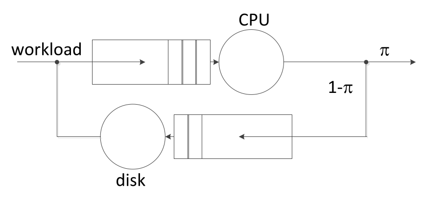
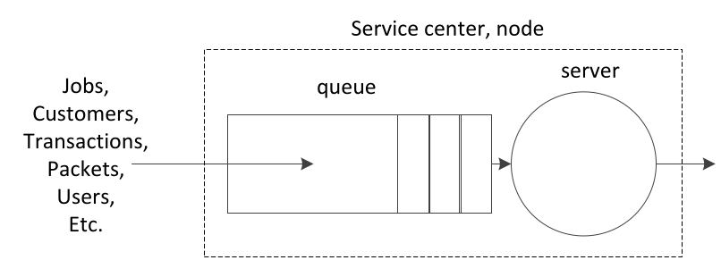
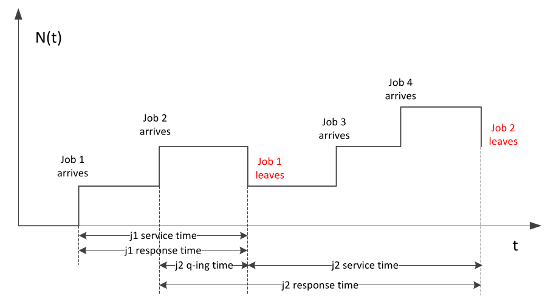
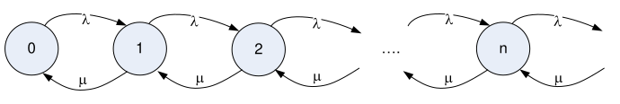
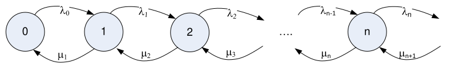
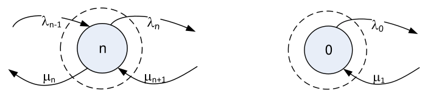
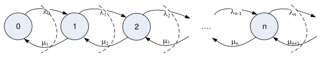
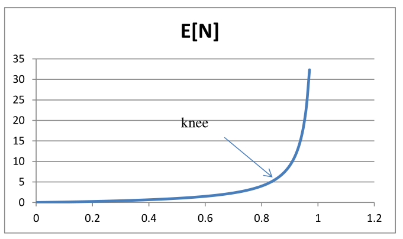
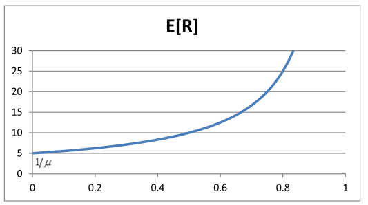

# 1. Index

<!--toc:start-->

- [1. Index](#1-index)
- [2. Queuing Theory](#2-queuing-theory)
  - [2.1. Analysis of Queuing Nodes in Isolation](#21-analysis-of-queuing-nodes-in-isolation)
    - [2.1.1. Birth-only process](#211-birth-only-process)
    - [2.1.2. Single Slot buffer](#212-single-slot-buffer)
    - [2.1.3. Steady State Analysis of Birth Death Processes](#213-steady-state-analysis-of-birth-death-processes)
  - [2.2. MM1 Systems](#22-mm1-systems)
    - [2.2.1. Example: Network Interface](#221-example-network-interface)
    - [2.2.2. Mean Performance Indexes](#222-mean-performance-indexes)
      - [2.2.2.1. Mean number of jobs in the queue](#2221-mean-number-of-jobs-in-the-queue)
      - [2.2.2.2. Mean Response Time](#2222-mean-response-time)
      - [2.2.2.3. Mean Waiting Time](#2223-mean-waiting-time)
      - [2.2.2.4. Throughput](#2224-throughput)
      <!--toc:end-->

# 2. Queuing Theory

**Queuing Theory** is an analytical technique to model systems
and get performance measures out of them.

It is based on the observation that most of the work in computer systems/networks
is performed by entities that **handle one job at a time**.

Thus, if there are many jobs requiring service, they will **queue up** in a _waiting
queue_, and will eventually be served by the entity.

Having a queue allows our system to **not reject jobs** when busy, but to just
**_delay_** them until they can be served.

If we were to use another paradigm, such as **reject-and-retry**, we would
increase the traffic in the system, and we would have idle times
between jobs.

Having the queue, **minimizes the idle time** of the entity, and **maximizing the
throughput**.

> [!NOTE]
> We typically assume that the queue works in a **First-In-First-Out (FIFO)**
> manner.  
> We will more commonly call it **First-Come-First-Served (FCFS)**, as it is more
> intuitive.

Given a packet of length $L$, and a server with a service rate of $C$, we define
its **service time** as $L \over C$.

Assume we are modeling the _output interface of a router_, with a line
whose speed is $C\;bps$.

The first packet arrives at time $t$, and has length $L_0$.

We can then compute the time it will leave the router as:

$$
  t^D_0 = t + \frac{L_0}{C}
$$

On the other hand, packet 4, will:

- Start being served $t_4^S = t + \frac{\sum_{i=0}^{3} L_i}{C}$
- Leave at time $t_4^D = t_4^S + \frac{L_4}{C} = t + \frac{\sum_{i=0}^{4} L_i}{C}$

Assuming that it arrives at time $t_4^A < t_4^S < t_4^D$.

We can compute its:

- **Queuing Time**: $t_4^Q = t_4^S - t_4^A$.
- **Response Time**: $t_4^R = t_4^D - t_4^A$.

In systems like this, typical question we can answer are:

- _What is the distribution of the number of packets in the queue (or in the system)?_
  This can be useful, for instance, to size the buffer, bounding the probability
  of dropping a packet due to a buffer overflow
- _What is the distribution of the response times?_
- _What happens if we change the link speed to $2C$?_
- How much do you need to increase the speed of the line if we want the $90^{th}$
  percentile of the response time to be less than $x$? This is also called
  **capacity planning**

In a system like this, most of the above questions can be answered once we define
**the workload**.

In this case, a workload is given by:

1. The **inter-arrival time** of the packets, which will be some _random variable_
1. The **service demand** (i.e., the time for which they keep the server busy).
   In the example of the router it is given by the packet lengths divided by a
   constant link speed.

We used a _router_ as an example, but the same reasoning can be applied to
any system that can be modeled as following:

- Workload arriving at a system and entering a queue
- A computational entity that serves the queued workload, one job at a time.
  It produces an output, and it can go:
  - With a **queuing probability** $\pi$ outside the system
  - With a **queuing probability** $1 - \pi$ back to a queue to be reserved.

If the probability $(1-\pi) = 0$, we call it a **queuing network**.
Whereas, if $(1-\pi) > 0$, we call it a **queuing network** of queuing network.

For such a system, we can answer questions like the ones above both
**separately** for each queue, and **globally** for the entire network.

In the latter case, we can also perform a **bottleneck analysis**, which means
to find which is the component that **limits the overall performance of the
system**.

Bottlenecks can be identified as the service center with **the highest utilization**,
which is defined as the **percentage of time for which a server is busy**.

Their identification is fundamental for understanding how to effectively
improve the performance of a system, allowing us to rightfully scale it
both horizontally and vertically.

The power of Queuing Theory (QT) is that we can almost always obtain
_at least_ **average performance metrics**, and very often in a **closed form**,
just by solving _few simple equations_.

In the simplest case, we can often obtain more detailed informations,
like the CDF of the response time or the distribution of the number of jobs in the
system, instead of just average values.

At the very least, we can use QT to **model systems** as _queuing networks_,
and then simulate their behaviour. This is possible because
QT is also a quite **abstract modeling paradigm**, which allows us to
describe a fragment of reality _at a very high level_ without going into
too many details.

This also comes with limitations, since it is susceptible to the risk
of **over-simplification**.

## 2.1. Analysis of Queuing Nodes in Isolation

Let's start with a simple example, often called
a **service center/node**: a _single queue_ with a _server_.

We need to **characterize the state of this system** at a given time $t$.

The way to characterize its state **depends on what we want to observe**.

For instance, if we are interested in the _number of jobs in the system_ at time
$t$ (also called the **backlog** at that time) $N(t)$:

<figure class="100">

<figcaption>

$N(t)$ is a _continuous-time, discrete-state_ **random (stochastic) process**.

</figcaption>
</figure>

Given different inter-arrival times of the jobs, the _trajectory_ (realization)
of $N(t)$ will be different.

To better study this argument, we will work on a system, often called
a **birth-death system**, which operates under the following assumptions:

- The **inter-arrival times** between jobs are **_IID exponentials_**, with a
  rate $\lambda$ (i.e., the _mean inter-arrival time_ is $1/\lambda$).
- The **service demands** are **_IID exponentials_**, with a rate $\mu$ (i.e.,
  the _mean service time_ is $1/\mu$).
- _Inter-arrival_ and _service demands_ are **independent**.
- The queue is **infinite** and **FCFS**.

In this kind of system we are interested in computing the **distribution
of the number of jobs in the system**.

> [!NOTE]
> Most of the things we will state from now on will not be proved in these
> notes.  
> If you are interested in the proofs, please refer to the official course's
> notes.  
> <small>(They are not required for the exam)</small>

To understand how our system will evolve over time, at a certain time $t_0$
we will need $N(t_0)$, the next arrival times and when the current job
will finish its service.

However, under the assumptions we make, $N(t)$ **describes the state of this
process entirely**, since _exponentials are memoryless_. This is also
called **Markov Property**:

> _"The future depends on the PRESENT only, not on the PAST"_

As a counterexample, considering a system where service times are **constant**,
$N(t)$ alone would not be a complete state characterization, since
the next departure time would depend by the last departure, thus we would need
that information also.

This mean we can setup a **state diagram** describing the evolution of such
a system in time:

<figure class="">

<figcaption>

This is sometimes called **transition-rate diagram** or,
more commonly, **continuous-time Markov chain (CTMC)**.

</figcaption>
</figure>

The _circles_ are the **system states at time** $t$, and the _arcs_ are the
**transitions** from one state to another.

$lambda$ and $\mu$ are **transitions rates** between adjacent states,
and we will **_always assume_** them **time-independent**.

However, they might be **state-dependent**, meaning that they might depend on the
current state of the system.

There are many practical examples of this:

- In some CPUs, the **clock frequency is varied** depending on the number of
  tasks to be executed to both save energy and increase performance when possible.
- When wanting to enter into a queue (e.g., to enter a museum), most people
  will be **less likely to enter** if the queue is long.

Therefore, it may be worth to use a different notation, $\lambda \to \lambda_n$
and $\mu \to \mu_n$, to indicate that the transition rates when the system
holds $n$ jobs.

<figure class="">

<figcaption>

The earlier CTMC was a special case of this one, when $\lambda_n = \lambda$ and
$\mu_n = \mu$ for all $n$.

</figcaption>
</figure>

The probability of **two simultaneous events**, in any combination, is **negligible**.
For this reason, there are only arcs **reaching out to the nearest neighbors**.

This types of system are quite easy to analyze.

Let's focus on one state $n > 0$, and fix a time $t$. We call $p_n(t)$ the
probability that there are $n$ jobs at time $t$:

$$
  p_n(t) = P\Set{N(t) = n}
$$

Circling that state, we can quickly write a **probability flow-balance equation**
involving that state, just by looking at the CTMC.

There is some probability that from the state we will "exit" the node, with
some **outgoing flow** probability, and some probability that we will "enter"
the node, with some **incoming flow** probability.

Their balance is the **variation in the flow of probability**.

$$
\underbrace{\frac{dp_n(t)}{dt}}_{\text{Variation of flow}} =
\underbrace{-(\lambda_n + \mu_n)\cdot p_n(t)}_\text{outgoing flow} +
\underbrace{\mu_{n+1}p_{n+1}(t) è \lambda_{n-1}\cdot p_{n-1}(t)}_{
  \text{incoming flow}}
$$

The complete system of equation, also including the edge-case of $n = 0$, is:

$$
\begin{cases}
  \frac{dp_n(t)}{dt} = -(\lambda_n + \mu_n)p_n(t) + \mu_{n+1}p_{n+1}(t) +
  \lambda_{n-1}p_{n-1}(t) &  n > 0 \\
  \frac{dp_0(t)}{dt} = -\lambda_0 p_0(t) + \mu_1 p_1(t) & n = 0
\end{cases}
$$

The above equations are called **Chapman-Kolmogorov’s equations**.

The evolution of such a system over time is **completely specified** once we solve
the CK system of (an infinite number of) differential equations.

Systems of differential equations can be solved once initial conditions are given
in the form of a PMF for the state at time $0$:

$$
\left(
  p_n(0)\; \forall n \quad \middle\vert \quad \sum_{n=0}^{+\infty} p_n(0) = 1
\right)
$$

A typical initial condition is $p_0(0) = 1, p_n(0) = 0$ for $n > 0$, i.e. the
system is _initially empty_.

In general, solving this systems is hard and not necessary for our purposes.

However, we now solve the CK system in two very simple cases.

### 2.1.1. Birth-only process

This can be as an instance of the general case, where $\mu_n = 0\;forall n$.

In the simples case $\lambda_n = \lambda\;forall n$:

$$
\begin{cases}
  \frac{dp_n(t)}{dt} = -\lambda p_n(t) + \lambda p_{n-1}(t) & n > 0 \\
  \frac{dp_0(t)}{dt} = -\lambda p_0(t) & n = 0
\end{cases}
$$

Assuming the initial conditions are $p_0(0) = 1, p_n(0) = 0$ for $n > 0$, we
can easily solve the equations:

- $n = 0: \frac{d}{dt}p_0(t) = -\lambda p_0(t) \Rightarrow p_0(t) =
  e^{-\lambda t}$
- $n = 1: \frac{d}{dt}p_1(t) = -\lambda p_1(t) + \lambda p_0(t) \Rightarrow
  p_1(t) = \lambda t e^{-\lambda t}$

By generalizing, we can find the general solution for $n \ge 0$:

$$
p_n = \frac{(\lambda t)^n}{n!} \cdot e^{-\lambda t} \qquad \forall n
$$

The above is a **Poisson distribution**, with a mean $\lambda t$.

This is why we normally call _"Poisson processes"_ those whose inter-arrival times
are IID exponentials.

Moreover, as **time increases** we get that $\displaystyle \lim_{t \to +\infty}
p_n(t) = 0$ for all $n$, meaning that the probability of having **exactly** $n$
jobs in the system will be **null**.

This should not surprise us, since in a _birth-only_ process, the number of jobs
in the system will **increase indefinitely**.

### 2.1.2. Single Slot buffer

It's a system with only two states:

- If a job arrives when the system is in state $0$, the state goes $0 \to 1$
- If a job arrives when the system is in state $1$, it is **discarded**
- When a job is served, the state goes $1 \to 0$

This is also called a **two-state birth-death process**, and it is another special
case of the general where $\lambda_0 = \lambda, \lambda_1 = 0, \mu_0 = 0,
\mu_1 = \mu$.

The CK equations are:

$$
\begin{cases}
  \frac{dp_1(t)}{dt} = -\mu p_1(t) + \lambda p_0(t) \\
  \frac{dp_0(t)}{dt} = -\lambda p_0(t) + \mu p_1(t)
\end{cases}
$$

By summing the two equations we get that $\frac{d}{dt}p_0(t) + \frac{d}{dt}p_1(t)
= 0$, which means that $p_0(t) + p_1(t) = const$, which is
obviously true with $const = 1$.

We can solve the system using standard techniques, and we get the following solution:

$$
\begin{cases}
  p_0(t) = \frac{\mu}{\lambda + \mu} + \left(p_0(0) - \frac{\mu}{\lambda + \mu}\right)
\cdot e^{-(\lambda + \mu)t} \\
  p_1(t) = \frac{\lambda}{\lambda + \mu} + \left(p_1(0) - \frac{\lambda}
{\lambda + \mu} \cdot \right) e^{-(\lambda + \mu)t}
\end{cases}
$$

These expressions describe the probability of being in either state as time
progresses.

They **do depend on the initial state**, with regards to $p_0(t) + p_1(t) = 1$.

If we let $t \to +\infty$, we get the **steady-state probabilities**:

$$
\begin{cases}
  p_0 := \displaystyle \lim_{t\to+\infty}p_0(t) = \frac{\mu}{\lambda + \mu} \\
  p_1 := \displaystyle \lim_{t\to+\infty}p_1(t) = \frac{\lambda}{\lambda + \mu}
\end{cases}
$$

At the **steady rate**, the probability of being in state $0$ or $1$ does
not depend on the initial state, and it is **independent of time**.
While $p_i(t)$, called the **transient probabilities**, do depend on
the _initial state_.

Depending on the initial conditions, the steady-state probability will be approached
from _below_ or _above_ depending if $p_0 \lg \frac{\mu}{\lambda + \mu}$.

If instead, $p_0(0) = \frac{\mu}{\lambda + \mu}$, then the system will
**be in the steady-state** $\forall t$.

If we were only interested in SS probabilities (i.e., the long-term behavior of
the system), we could have solved the problem using the very definition
of steady-state:

$$
\frac{dp_n(t)}{dt} = 0 \qquad \forall n
$$

Hence, under this hypothesis, the CK equations become:

$$
\begin{cases}
  0 = -\mu p_1 + \lambda p_0 \\
  0 = -\lambda p_0 + \mu p_1
\end{cases}
$$

Which consists of only two clearly **not independent** algebraic equations,
but we can discard one in favor of the _normalization condition_:

$$
\begin{CD}
  \begin{cases}
    0 = -\mu p_1 + \lambda p_0 \\
    p_0 + p_1 = 1 \\
  \end{cases}
  @>>>
  \begin{cases}
    p_0 = \frac{\mu}{\lambda + \mu} \\
    p_1 = \frac{\lambda}{\lambda + \mu}
  \end{cases}
\end{CD}
$$

### 2.1.3. Steady State Analysis of Birth Death Processes

The above example reveals that to compute the steady-state probabilities, we can
use two approaches:

1. The **complex one**, which consists in formulating the differential CK equations,
   solving the system in the form $p_n(t)$ and then getting the steady-state
   probabilities as $p_n = \lim_{t\to+\infty}p_n(t)$
2. The **simpler one**, which consists in formulating the CK equations under the
   steady-state assumption (i.e., $\frac{d}{dt}p_n(t) = 0$), and then solving
   the resulting algebraic system.

The first one has the slight advantage of giving us the **transient probabilities**
$p_n(t)$ as well, but these are normally uninteresting for our purposes, hence
we will use the second approach.

> [!WARNING]
> We cannot blindly apply the two approaches to any birth-death process, since it
> is not guaranteed that they will reach a steady-state.  
> The **hypothesis** that a steady-state exists **must always be tested
> _a posteriori_**.

The physical interpretation of "reaching a steady-state" is equivalent
to saying that the flow of probability coming and going from a state
is **balanced** or **null**.

Thus, the **outgoing and incoming flows _must balance each other_**:

$$
\begin{cases}
  (\lambda_n + \mu_n)p_n = \mu_{n+1}p_{n+1} + \lambda_{n-1}p_{n-1} & n > 0 \\
  \lambda_0 p_0 = \mu_1 p_1 & n = 0
\end{cases}
$$

This said, computing the SS probabilities is straughforward:

1. We draw the CTMC
2. We formulate the abve **steady-state equilibrium equations**
3. We add the **normalization condition** $\displaystyle \sum_{n=0}^{+\infty}
p_n = 1$

The solution of the resulting algebraic system can be computed quite easily,
starting from $n = 0$ and working our way up to increasing values of $n$:

$$
\begin{align*}
  p_1 &= \frac{\lambda_0}{\mu_1}p_0 \\
  p_2 &= \frac{\lambda_1}{\mu_2}p_1 = \frac{\lambda_1}{\mu_2}\frac{\lambda_0}
{\mu_1}p_0 \\
  &\vdots \\
  p_n &= \frac{\lambda_{n-1}}{\mu_n}p_{n-1} = \displaystyle \prod_{i=0}^{n-1}
\frac{\lambda_i}{\mu_{i+1}}p_0
\end{align*}
$$

In the end we can write our **general formula** for the SS probabilities:

$$
\begin{cases}
  p_n = \displaystyle \prod_{i=0}^{n-1} \frac{\lambda_i}{\mu_{i+1}}p_0 & n > 0 \\
  \displaystyle \sum_{n=0}^{+\infty} p_n = 1 \Rightarrow
  p_0 \left[ 1 + \displaystyle \sum_{n=1}^{+\infty}
\left(\displaystyle \prod_{i=0}^{n-1} \frac{\lambda_i}{\mu_{i+1}}\right) \right]
= 1 &
\end{cases}
$$

> [!WARNING]
> A **necessary and sufficient condition** for the system to admit a _steady-state_
> is that the **above sum be finite**

**If the sum is finite**, we can call the term between the square brackets $S$:

$$
\begin{cases}
  S = 1 + \displaystyle \sum_{n=1}^{+\infty} \left(\displaystyle
\prod_{i=0}^{n-1} \frac{\lambda_i}{\mu_{i+1}}\right) & \\
  p_0 = \frac{1}{S} & \\
  p_n = \frac{1}{S} \cdot \displaystyle \prod_{i=0}^{n-1}
\frac{\lambda_i}{\mu_{i+1}} & n > 0
\end{cases}
$$

Otherwise, we would get that $p_n = 0 \quad \forall n$.

> [!NOTE]
> The problem of **_stability_** only exists with systems with **an infinite number
> of states**.  
> In system with **finite states** (such as the single-slot buffer) the above sum
> would only include a **finite number of terms**, hence would always be finite.
>
> Therefore, only systems with **infinite states may not reach a steady state**.

The approach we have taken so far leads to the so-called **global equilibrium
equations**, consisting of equations that **balance the incoming and outgoing
flows** for each state.

However, this approach can be generalized to a more general and simpler one,
where we **choose arbitrary perimeters** around many states, and
balance them out.

For instance, **local equilibrium equations** are those written balancing
the flows through perimeters including **_all the states from $0$ to $n$
including_**:

$$
\begin{align*}
  \lambda_0 \cdot p_0 &= \mu_1 p_1 \\
  \lambda_1 \cdot p_1 &= \mu_2 p_2 \\
  &\vdots \\
  \lambda_{n} \cdot p_{n} &= \mu_{n+1} p_{n+1}
\end{align*}
$$

For which we get $p_n = \displaystyle \prod_{i=0}^{n-1} \frac{\lambda_i}{\mu_{i+1}}p_0$
even more quickly than before.

> [!TIP]
> **Global equations** are _always to write_. Meanwhile, **local equations** are
> easy to write only when _the CTCM is simple_, since when there are too many
> arcs they need to getting **overly complicated** and leading to **forgetting
> some flows**.

## 2.2. MM1 Systems

The simplest birth-death system is the **M/M/1 system**.

The latter is known as **Kendall's notation**, and it is a **standard notation**
to describe birth-death systems:

- The distribution of inter-arrival: **M** for _memoryless_, **D** for
  _deterministic_, **E** for _Erlang_, **G** for _Generic_, etc...
- The distribution of service times (same letters as above)
- The number of servers in the system

In our case we will have **memoryless inter-arrival and service times** handled
by **one server**.

If not specified otherwise, they assume, as we said before,
an _infinite FCFS disciplined queue_ and _infinite population from which
the arrivals are drawn_.

Assuming $\lambda_n = \lambda$ and $\mu_n = \mu$ for all $n$, we can compute the
generic birth-death processes as simply:

$$
p_n = \prod_{i=0}^{n-1} \frac{\lambda}{\mu} p_0 = \left(\frac{\lambda}{\mu}
\right)^n p_0
$$

Where we can call $\rho = \lambda / \mu$ the **utilization of the system**.

This allows us to write the normalization condition as:

$$
p_0 \cdot \left [ 1 + \sum_{n=1}^{+\infty}\left(\prod_{i=0}^{n-1} \frac{\lambda}
{\mu}\right) \right] = p_0 \cdot \left[ 1 + \sum_{n=1}^{+\infty} \rho^n \right]
= 1
$$

Hence, the **stability condition** will be $\rho < 1$, which makes
the infinite sum to $\frac{1}{1 - \rho}$.

Hence:

$$
\begin{align*}
  p_0 &= 1 - \rho \\
  p_n &= (1 - \rho) \cdot \rho^n
\end{align*}
$$

The first equation explains why we call $\rho$ the _utilization_: $p_0$ is
the **probability of our system being idle** (i.e., having no jobs), meaning
that $\rho = 1 - p_0$ will be the **probability of our system working**,
a.k.a. the **utilization**.

> [!WARNING]
> The utilization $\rho$ is equal to $\lambda / \mu$ **_ONLY IN THIS
> SYSTEM_**.  
> We will see later that in different systems it will assume different
> values.

The utilization **cannot grow beyond** $1$. The fact that $\rho < 1$ means
that $\lambda < \mu$, meaning that the _mean inter-arrival time_ $1 \over \lambda$
is **greater than** the _mean service time_ $1 \over \mu$. For this reason,
we call a system where $\rho < 1$ a **positive recurrent system**, where
arrivals will be slower than services.

When the opposite occurs $(\lambda > \mu)$, the systems accumulates
**more and more jobs** in the queue as times progresses, hence
$\displaystyle \lim_{t \to +\infty} p_n(t) = 0, \quad \forall n$.
We call a system where $\rho > 1$ a **transient system**, where arrivals will
be faster than services.

When $\lambda = \mu$ $(\rho = 1)$, we have a **null recurrent system**.
In this case the system is _not stable_ because it _may_ happen that
a **very large service time** occurs at least once (since
exponentials have a tail extending to infinity), which will cause the queue to grow
so large that it will never be able to empty again.

 

For a positive recurrent system, the distribution of the number of jobs in the
_steady-state_ is **geometric**: $p_n = (1 - \rho)\cdot \rho^n$, with a success
probability of $p = 1 - \rho$.

Therefore, it is easy to compute its mean and variance:

$$
\begin{align*}
  E[N] &= \displaystyle \sum_{n=0}^{+\infty}{n \cdot p_n} = \frac{\rho}{1 -
\rho} \\
  Var[N] &= \frac{\rho}{(1 - \rho)^2}
\end{align*}
$$

It is interesting to observe that $E[N]$ is a **function of the utilization $\rho$
only**, and it **does not depend** on the actual values of $\lambda$ and $\mu$.

This function is called the **_Kleinrock function_** (or _hockey-stick function_).

As shown in the figure on the right, it is practically **flat** until
$\rho \approx 0.5$, value for which it reaches $1$, and then exhibits
a **knee** with a vertical asymptote for $\rho \to 1$.

The typical behavior of systems under a varying workload is the following:

- **Low-load conditions** $(\rho < 0.5)$: the mean number of jobs in the system
  is below one. Meaning that, most of the time, the system is either _empty_
  or _serving the one and only job present_.
- **Average-load conditions** $(\rho \gtrsim 0.5)$: queueing starts to occur
  frequently.
- **High-load conditions** $(\rho \to 1)$: the system **saturates**, producing
  a huge increase in the number of jobs.

### 2.2.1. Example: Network Interface

> Suppose we have to **dimension a network interface** for our system.
>
> Its workload consists in packets whose length is exponentially distributed
> with a mean $1 \over \gamma$.  
> Packet inter-arrival times at the interface are exponential with a mean
> $1 \over \lambda$.
>
> Compute the line speed $C$ so that:
>
> 1. The mean backlog is $B$ packets.
> 2. The $95^{th}$ percentile of the backlog is $\Pi$ packets.

We can observe that this is an M/M/1 system, with arrival rate $\lambda$.

As for the service rate, we get that:

$$
E[t_s] = \frac{E[\text{lenght}]}{C} = \frac{1}{\mu}
$$

Hence, we get that $\mu = \gamma \cdot C$

We can easily answer the first question by observing that the
mean backlog is:

$$
\begin{align*}
  B &= E[N] = \frac{\rho}{1 - \rho} \\
  B &= \frac{\lambda/\mu}{ 1 - \lambda/\mu}
     = \frac{\lambda}{\mu - \lambda} \\
  B &= \frac{\lambda}{\gamma \cdot C - \lambda} \\
    &\Downarrow \\
  C &= \frac{\lambda \cdot (1 + B)}{\gamma B}
\end{align*}
$$

Note that this equation only holds if the system **does admit a steady state**,
hence $\rho = \lambda / (\gamma \cdot C) < 1$.

For the second question, we need to solve $P\Set{N \le \Pi} = 0.95$.

However, we get that:

$$
\begin{align*}
  P\Set{N \le x} &= \sum_{n=0}^x{p_n} \\
  &= \sum_{n=0}^{x} (1 - \rho) \cdot \rho^n \\
  &= (1 - \rho) \cdot \frac{1 - \rho^{x + 1}}{1 - \rho} \\
  &= 1 - \rho^{x + 1}
\end{align*}
$$

Therefore, the equation we need to solve is:

$$
\begin{align*}
  1 - \rho^{\Pi + 1} &= 0.95 \\
  \left(\frac{\lambda}{\gamma C}\right)^{\Pi + 1} &= \frac{1}{20} \\
  C^{\Pi + 1} &= 20 \cdot \left(\frac{\lambda}{\gamma}\right)^{\Pi + 1} \\
  C &= \sqrt[\Pi + 1]{20} \cdot \frac{\lambda}{\gamma}
\end{align*}
$$

### 2.2.2. Mean Performance Indexes

The important mean performance indexes in queuing systems are the
following:

1. **Mean number of jobs _in the system_** $E[N]$
1. **Mean number of jobs \_in the queue** $E[N_q]$
1. **Mean response time** $E[R]$
1. **Mean waiting/queueing time** $E[W]$
1. **Throughput**

The optimum would be to be able to compute the **distribution**
of all the above quantities.

However, this is only possible for simple enough systems. For
complex systems, we have to settle to the **mean values**.

One of the advantages is that **all these values are related to each other**,
as we will see, once we computed one of them, the rest can be computed with
simple algebraic operations.

We already discussed on how to compute $E[N]$ for an M/M/1 system, and we got that:

$$
E[N] = \frac{\rho}{1 - \rho} = \frac{\lambda}{\mu - \lambda}
$$

#### 2.2.2.1. Mean number of jobs in the queue

We move to analyzing RV $N_q$.

The latter takes the following values:

- $0$ with probability $p_0 + p_1$ (i.e., whenever we have one to no jobs running)
- $1$ with probability $p_2$ (i.e., whenever we have one job already running)
- $k \ge 1$ with probability $p_{k+1}$ (i.e., whenever we have one job already
  running, and $k-1$ jobs waiting in the queue)

From the above, we can compute the mean value:

$$
\begin{align*}
  E[N_q] &= \sum_{k=0}^{+\infty} k \cdot p_{k+1} \\
  &= 0 \cdot (p_0 + p_1) + \sum_{k=1}^{+\infty} k \cdot p_{k+1} \\
  &= \sum_{k=2}^{+\infty} (k - 1) \cdot p_k \\
  &= \sum{k = 1}^{+\infty} (k - 1) \cdot p_k \\
  &= \sum_{k=1}^{+\infty}{k \cdot p_k} - \sum_{k=1}^{+\infty}{p_k} \\
  &= E[N] - ( 1- p_0) \\
  &= E[N] - \rho
\end{align*}
$$

This result could have been obtained much more easily by observing that
**mean values are additive**, and that $\rho$ is the _server’s utilization_
(i.e., the **mean number of jobs in the server**).

Therefore, it must be $E[N_q] + \rho = E[N]$.

#### 2.2.2.2. Mean Response Time

The mean response time can be computed using a general result,
called **_Little's Law_**, which states that:

> Consider a system in a steady-state, such that **no jobs are created
> or destroyed within the system** and let $\overline{\lambda}$ its
> _mean arrival rate_.
>
> Then the mean response time is $E[R] = \frac{E[N]}{\overline{\lambda}}$.

An intuitive rationale behind this law is that if the system is in
a steady-state, when a job arrives, the number of jobs that it sees **ahead
of itself** is statistically equal to the number of jobs
it will **leave behind** on its departure $E[N]$.

> [!NOTE]
> This result works in the **most general conditions** since, it does
> not mention either the distribution of the arrival packets, nor
> how the system is structured internally.
>
> However, it only applies to **mean values**, and not distributions.

We can use this law to compute $E[R]$.

In a M/M/1 system it is:

$$
\overline{\lambda} = \sum_{n=0}^{+\infty} \lambda_n p_n
  = \lambda \sum_{n=0}^{+\infty} p_n
  = \lambda
$$

So it is easy to see that:

$$
E[R] = \frac{E[N]}{\lambda}
     = \frac{1}{\lambda} \cdot \frac{\rho}{1 - \rho}
     = \frac{1}{\mu} \cdot \frac{1}{1 - \rho}
     = \frac{1}{\mu - \lambda}
$$

#### 2.2.2.3. Mean Waiting Time

The mean waiting time can be computed by applying once again **Little's
Law**, but this time to **the queue at equilibrium**.

In this condition, the arrival and departure rates of the queue are equal
to $\lambda$, hence we can write:

$$
E[W] = \frac{E[N_q]}{\lambda} = \frac{E[N] - \rho}{\lambda} =
  E[R] - \frac{1}{\mu} = E[R] - E[t_s]
$$

#### 2.2.2.4. Throughput

In queueing systems, it is often required to compute the **throughput** $\gamma$
(i.e,m the number of jobs served per unit of time).

We can start with an intuitive approach:

- If $\gamma > \lambda$, it means our system serves more jobs then it is provided,
  meaning it creates them internally. This is not our case
- If $\gamma < \lambda$ it means that there are jobs that would indefinitely
  stay in the queue. However, since our system is FCFS by definition, this cannot
  be possible. The only case when it's possible is if we deal with _finite memory
  queues_, that rejects jobs when full.

Therefore, the only possibility is that $\gamma = \lambda$.

In any case the **formal definition** is the following:

$$
\gamma := \sum_{n=1}^{+\infty} \mu_n \cdot p_n
$$

From this definition, it is easy to see that:

$$
\gamma = \mu \cdot \sum_{n=1}^{+\infty} p_n = \mu \cdot (1 - p_0) = \mu \cdot \rho
= \lambda
$$
