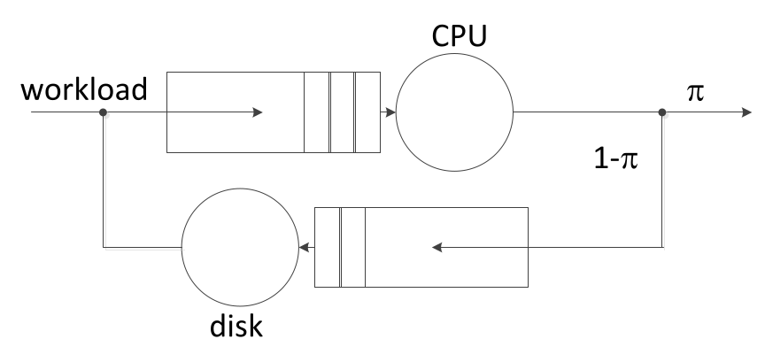
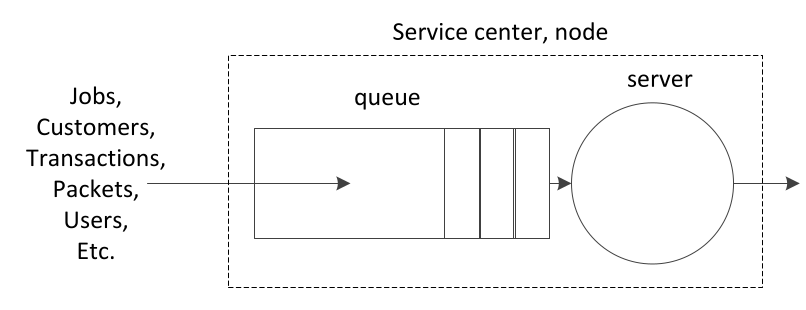
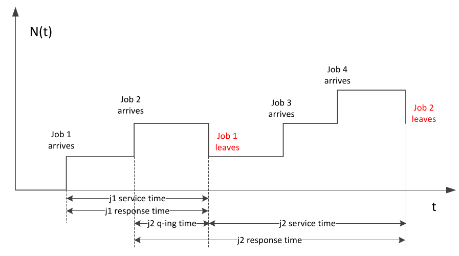

# 1. Index

<!--toc:start-->

- [1. Index](#1-index)
- [2. Queuing Theory](#2-queuing-theory)
  - [2.1. Analysis of Queuing Nodes in Isolation](#21-analysis-of-queuing-nodes-in-isolation)
  <!--toc:end-->

# 2. Queuing Theory

**Queuing Theory** is an analytical technique to model systems
and get performance measures out of them.

It is based on the observation that most of the work in computer systems/networks
is performed by entities that **handle one job at a time**.

Thus, if there are many jobs requiring service, they will **queue up** in a _waiting
queue_, and will eventually be served by the entity.

Having a queue allows our system to **not reject jobs** when busy, but to just
**_delay_** them until they can be served.

If we were to use another paradigm, such as **reject-and-retry**, we would
increase the traffic in the system, and we would have idle times
between jobs.

Having the queue, **minimizes the idle time** of the entity, and **maximizing the
throughput**.

> [!NOTE]
> We typically assume that the queue works in a **First-In-First-Out (FIFO)**
> manner.  
> We will more commonly call it **First-Come-First-Served (FCFS)**, as it is more
> intuitive.

Given a packet of length $L$, and a server with a service rate of $C$, we define
its **service time** as $L \over C$.

Assume we are modeling the _output interface of a router_, with a line
whose speed is $C\;bps$.

The first packet arrives at time $t$, and has length $L_0$.

We can then compute the time it will leave the router as:

$$
  t^D_0 = t + \frac{L_0}{C}
$$

On the other hand, packet 4, will:

- Start being served $t_4^S = t + \frac{\sum_{i=0}^{3} L_i}{C}$
- Leave at time $t_4^D = t_4^S + \frac{L_4}{C} = t + \frac{\sum_{i=0}^{4} L_i}{C}$

Assuming that it arrives at time $t_4^A < t_4^S < t_4^D$.

We can compute its:

- **Queuing Time**: $t_4^Q = t_4^S - t_4^A$.
- **Response Time**: $t_4^R = t_4^D - t_4^A$.

In systems like this, typical question we can answer are:

- _What is the distribution of the number of packets in the queue (or in the system)?_
  This can be useful, for instance, to size the buffer, bounding the probability
  of dropping a packet due to a buffer overflow
- _What is the distribution of the response times?_
- _What happens if we change the link speed to $2C$?_
- How much do you need to increase the speed of the line if we want the $90^{th}$
  percentile of the response time to be less than $x$? This is also called
  **capacity planning**

In a system like this, most of the above questions can be answered once we define
**the workload**.

In this case, a workload is given by:

1. The **inter-arrival time** of the packets, which will be some _random variable_
1. The **service demand** (i.e., the time for which they keep the server busy).
   In the example of the router it is given by the packet lengths divided by a
   constant link speed.

We used a _router_ as an example, but the same reasoning can be applied to
any system that can be modeled as following:

- Workload arriving at a system and entering a queue
- A computational entity that serves the queued workload, one job at a time.
  It produces an output, and it can go:
  - With a **queuing probability** $\pi$ outside the system
  - With a **queuing probability** $1 - \pi$ back to a queue to be reserved.

If the probability $(1-\pi) = 0$, we call it a **queuing network**.
Whereas, if $(1-\pi) > 0$, we call it a **queuing network** of queuing network.

For such a system, we can answer questions like the ones above both
**separately** for each queue, and **globally** for the entire network.

In the latter case, we can also perform a **bottleneck analysis**, which means
to find which is the component that **limits the overall performance of the
system**.

Bottlenecks can be identified as the service center with **the highest utilization**,
which is defined as the **percentage of time for which a server is busy**.

Their identification is fundamental for understanding how to effectively
improve the performance of a system, allowing us to rightfully scale it
both horizontally and vertically.

The power of Queuing Theory (QT) is that we can almost always obtain
_at least_ **average performance metrics**, and very often in a **closed form**,
just by solving _few simple equations_.

In the simplest case, we can often obtain more detailed informations,
like the CDF of the response time or the distribution of the number of jobs in the
system, instead of just average values.

At the very least, we can use QT to **model systems** as _queuing networks_,
and then simulate their behaviour. This is possible because
QT is also a quite **abstract modeling paradigm**, which allows us to
describe a fragment of reality _at a very high level_ without going into
too many details.

This also comes with limitations, since it is susceptible to the risk
of **over-simplification**.

## 2.1. Analysis of Queuing Nodes in Isolation

Let's start with a simple example, often called
a **service center/node**: a _single queue_ with a _server_.

We need to **characterize the state of this system** at a given time $t$.

The way to characterize its state **depends on what we want to observe**.

For instance, if we are interested in the _number of jobs in the system_ at time
$t$ (also called the **backlog** at that time) $N(t)$:

<figure class="100">

<figcaption>

$N(t)$ is a _continuous-time, discrete-state_ **random (stochastic) process**.

</figcaption>
</figure>

Given different inter-arrival times of the jobs, the _trajectory_ (realization)
of $N(t)$ will be different.

To better study this argument, we will work on a system, often called
a **birth-death system**, which operates under the following assumptions:

- The **inter-arrival times** between jobs are **_IID exponentials_**, with a
  rate $\lambda$ (i.e., the _mean inter-arrival time_ is $1/\lambda$).
- The **service demands** are **_IID exponentials_**, with a rate $\mu$ (i.e.,
  the _mean service time_ is $1/\mu$).
- _Inter-arrival_ and _service demands_ are **independent**.
- The queue is **infinite** and **FCFS**.

In this kind of system we are interested in computing the **distribution
of the number of jobs in the system**.

> [!NOTE]
> Most of the things we will state from now on will not be proved in these
> notes.  
> If you are interested in the proofs, please refer to the official course's notes.  
> <small>(They are not required for the exam)</small>

To understand how our system will evolve over time, at a certain time $t_0$
we will need $N(t_0)$, the next arrival times and when the current job
will finish its service.

However, under the assumptions we make, $N(t)$ **describes the state of this
process entirely**, since _exponentials are memoryless_.

As a counterexample, considering a system where service times are **constant**,
$N(t)$ alone would not be a complete state characterization, since
the next departure time would depend by the last departure, thus we would need
that information also.
