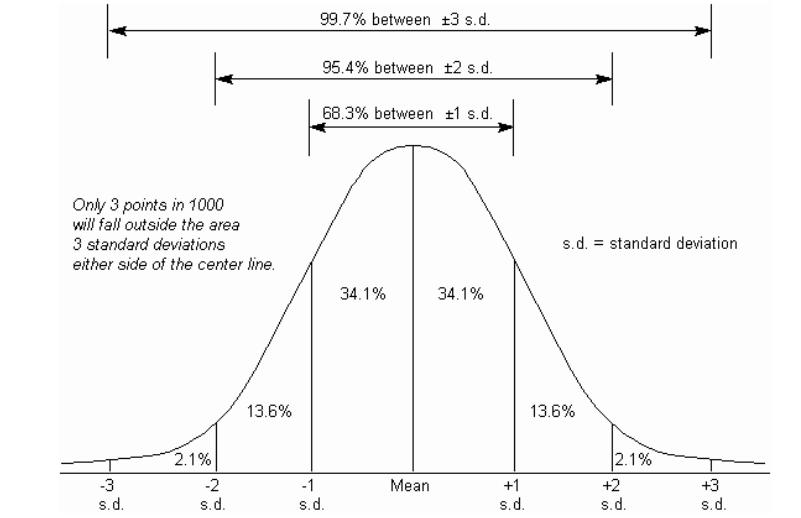
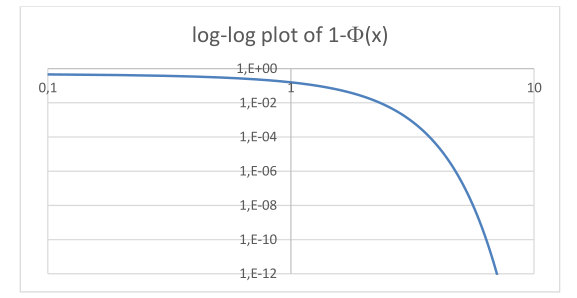
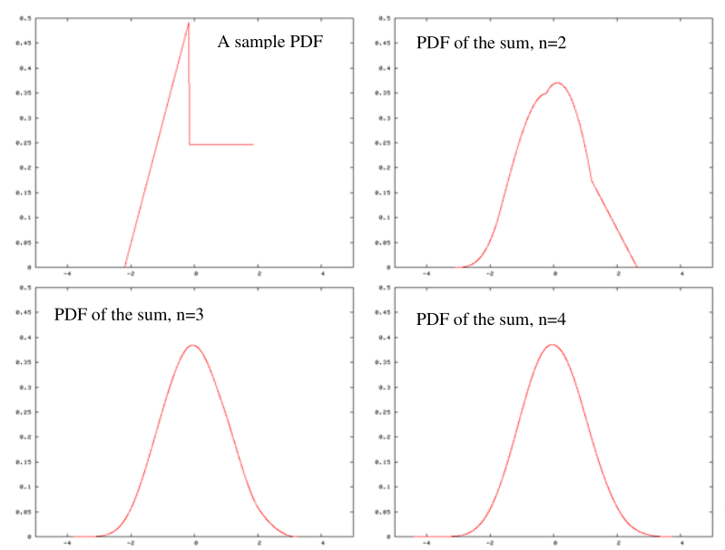
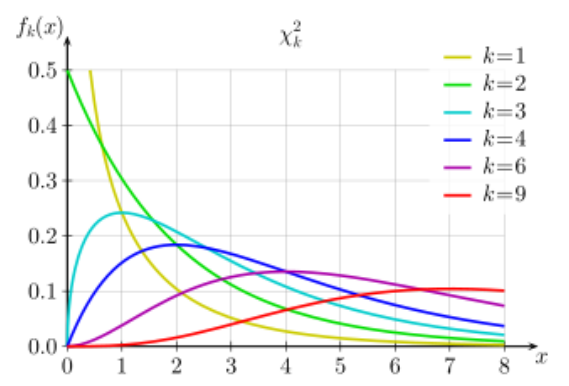
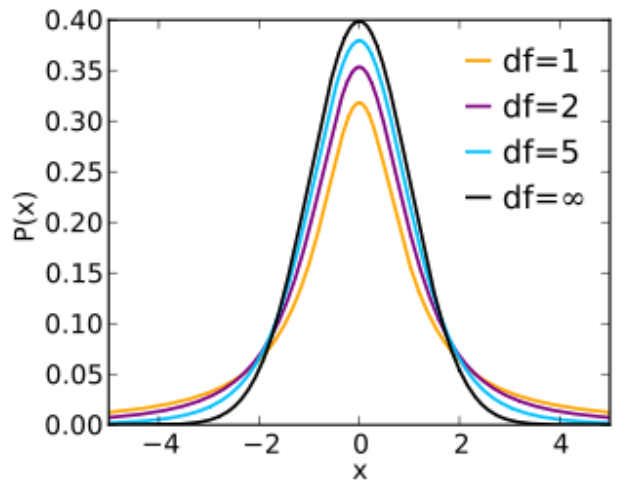
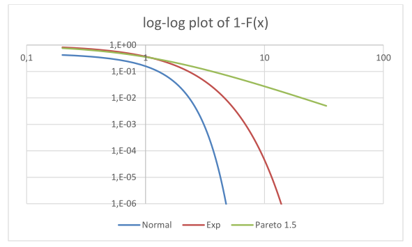

# 1. Index

<!--toc:start-->

- [1. Index](#1-index)
- [2. Special Continuous Random Variables](#2-special-continuous-random-variables)
  - [2.1. Uniform Distribution](#21-uniform-distribution)
  - [2.2. Exponential Distribution](#22-exponential-distribution)
    - [2.2.1. Example: lifetime of series components](#221-example-lifetime-of-series-components)
  - [2.3. Laplace-Stieltjes Transform](#23-laplace-stieltjes-transform)
    - [2.3.1. LST of the Exponential](#231-lst-of-the-exponential)
  - [2.4. Normal Distribution](#24-normal-distribution)
    - [2.4.1. SD Characteristics](#241-sd-characteristics)
      - [2.4.1.1. Exercise: Binary Messages](#2411-exercise-binary-messages)
      - [2.4.1.2. Exercise: Resistor and Dissipation](#2412-exercise-resistor-and-dissipation)
    - [2.4.2. Central Limit Theorem (CLT)](#242-central-limit-theorem-clt)
      - [2.4.2.1. Example: Class of Students](#2421-example-class-of-students)
  - [2.5. Percentiles](#25-percentiles)
  - [2.6. Chi-Square Distribution](#26-chi-square-distribution)
  - [2.7. Student's T Distribution](#27-students-t-distribution)
  - [2.8. Heavy-Tailed Distributions](#28-heavy-tailed-distributions)
    - [2.8.1. Preferential Attachment](#281-preferential-attachment)
    - [2.8.2. Pareto Distribution](#282-pareto-distribution)
    - [2.8.3. Properties of Heavy-Tailed](#283-properties-of-heavy-tailed)
      - [2.8.3.1. Memory Principle](#2831-memory-principle)
      - [2.8.3.2. Conspiracy and Catastrophic Events](#2832-conspiracy-and-catastrophic-events)
      - [2.8.3.3. Scale-Free Property](#2833-scale-free-property)
    - [2.8.4. Heavy-Tail in action: Load Balancing in an Internet ASs](#284-heavy-tail-in-action-load-balancing-in-an-internet-ass)
    <!--toc:end-->

# 2. Special Continuous Random Variables

Some RVs are often encountered in practice. This happens because they are **good
models of some aspect of reality**. For this reason, we gave them special names.

We start defining the most important _continuous_ RV.

## 2.1. Uniform Distribution

A **continuous** RV is said to be **Uniformly Distributed** $X \sim U(a, b)$ if
its PDF is **constant over an interval** $[a, b]$:

$$
f(x) = \begin{cases}
  \frac{1}{b-a} & a\le x\le b \\
  0 & \text{otherwise}
\end{cases}
$$

This kind of distribution models the case when _there is no particular preference
for one or another value_ within the interval.

We can easily compute the _mean value_:

$$
\begin{align*}
  E[X] &= \int_{-\infty}^{+\infty} x f(x) dx \\
    &= \int_{a}^{b} x \frac{1}{b-a} dx \\
    &= \frac{1}{b-a} \left[\frac{x^2}{2}\right]_a^b \\
    &= \frac{1}{b-a} \left(\frac{b^2 - a^2}{2}\right) \\
    &= \frac{1}{b-a} \left(\frac{(b-a)(b+a)}{2}\right) \\
    &= \frac{b+a}{2}
\end{align*}
$$

In other words, the mean value is the **midpoint of the interval**.

As for the _variance_, we have:

$$
\begin{align*}
  E[X^2] &= \int_{-\infty}^{+\infty} x^2 f(x) dx \\
    &= \int_{a}^{b} x^2 \frac{1}{b-a} dx \\
    &= \frac{1}{b-a} \left[\frac{x^3}{3}\right]_a^b \\
    &= \frac{1}{b-a} \left(\frac{b^3 - a^3}{3}\right) \\
    &= \frac{1}{b-a} \left(\frac{(b-a)(b^2 + ab + a^2)}{3}\right) \\
    &= \frac{b^2 + ab + a^2}{3}
\end{align*}
$$

Hence:

$$
\begin{align*}
  \operatorname*{Var}(X) &= E[X^2] - E[X]^2 \\
    &= \frac{b^2 + ab + a^2}{3} - \left(\frac{b+a}{2}\right)^2 \\
    &= \frac{4(b^2 + ab + a^2) - 3(b^2 + 2ab + a^2)}{12} \\
    &= \frac{b^2 - 2ab + a^2}{12} \\
    &= \frac{(b-a)^2}{12}
\end{align*}
$$

It it also easy to compute the CDF:

$$
F(x) = \int_a^{x}{ \frac{1}{b-a} dx } = \frac{x-a}{b-a} \quad a\le x\le b
$$

## 2.2. Exponential Distribution

A continuous RV is said to be **exponentially distributed** $X \sim Exp(\lambda)$:

$$
f(x) = \begin{cases}
  \lambda e^{-\lambda x} & x \ge 0 \\
  0 & x < 0
\end{cases}
$$

Where $\lambda$ is called the **rate parameter**.

One can easily compute the CDF:

$$
\begin{align*}
  F(x) &= \int_{-\infty}^{x} f(t) dt \\
    &= \int_{0}^{x} \lambda e^{-\lambda t} dt \\
    &= \left[-e^{-\lambda t}\right]_0^x \\
    &= 1 - e^{-\lambda x} \quad x\ge 0
\end{align*}
$$

This function approaches 1 as $x$ goes to infinity, meaning that the _exponential
variable_ can assume **arbitrarily large numbers** with some _non-zero probability_.

For this reason, this kind of distribution are good models of the **amount of time**
between events occurring at random.

We can compute the mean value as follows:

$$
\begin{align*}
  E[X] &= \int_{-\infty}^{+\infty} x f(x) dx \\
    &= \int_{0}^{+\infty} x \lambda e^{-\lambda x} dx \\
    &= \left[-x e^{-\lambda x}\right]_0^{+\infty} +
\int_{0}^{+\infty} e^{-\lambda x} dx \\
    &= 0 + \left[-\frac{1}{\lambda} e^{-\lambda x}\right]_0^{+\infty} \\
    &= 0 + 0 - (-\frac{1}{\lambda}) = \frac{1}{\lambda}
\end{align*}
$$

As for the variance, we have:

$$
\begin{CD}
\begin{aligned}
  E[X^2] &= \int_{-\infty}^{+\infty} x^2 f(x) dx \\
    &= \int_{0}^{+\infty} x^2 \lambda e^{-\lambda x} dx \\
    &= \left[-x^2 e^{-\lambda x}\right]_0^{+\infty} + 2 \int_{0}^{+\infty} x
e^{-\lambda x} dx \\
    &= 0 + 2 \cdot \frac{1}{\lambda} = \frac{2}{\lambda^2}
\end{aligned} \\
@VVV \\
\begin{aligned}
  \operatorname*{Var}(X) &= E[X^2] - E[X]^2 \\
    &= \frac{2}{\lambda^2} - \frac{1}{\lambda^2} \\
    &= \frac{1}{\lambda^2}
\end{aligned}
\end{CD}
$$

The exponential distribution benefits from two properties that make it very
useful in practice.

The first one is the following:

> Given $n$ **independent** exponential RVs $X_1, \dots, X_n$ whose rates are
> $\lambda_1, \dots, \lambda_n$, then the **minimum** of these RVs
> $Y = \min\Set{X_1, \dots, X_n}$ is also an **exponential RV** with rate
> $\lambda =\sum_{i=1}^{n}{\lambda_i}$.

This can be trivially proven:

$$
\begin{align*}
  P\Set{Y \ge a} &= P\Set{\min\Set{X_1, \dots, X_n} \ge a} \\
    &= P\Set{X_1 \ge a, \dots, X_n \ge a} \\
    &= P\Set{X_1 \ge a} \cdot ... \cdot P\Set{X_n \ge a} && \text{(independence)}\\
    &= \prod_{i=1}^{n} P\Set{X_i \ge a} \\
    &= \prod_{i=1}^{n} e^{-\lambda_i a} \\
    &= e^{-\sum_{i=1}^{n}{\lambda_i a}} = e^{-\lambda a}
\end{align*}
$$

Then, $F_Y(a) = 1 - e^{-\sum_{i=1}^{n}{\lambda_i a}}$.

The second property is the **memoryless property**:

> If $X \sim Exp(\lambda)$, then $\forall t,s \ge 0$ we have that:
>
> $$
>   P\Set{X \ge t + s \vert X \ge t} = P\Set{X \ge s}
> $$

Assuming we want to know whether a system with an exponential distributed
lifetime, that has already worked for $t$ hours, will work for $s$ more hours.

This property tells us that knowing that the system has already worked for $t$ hours
**does not change the probability** that it will work for $s$ more hours.

Formally:

$$
\begin{align*}
  P\Set{X \ge t + s \vert X \ge t} &= \frac{P\Set{X \ge t + s, X \ge t}}
{P\Set{X > T}} \\
  &= \frac{P\Set{X \ge t + s}}{P\Set{X \ge t}} \\
  &= \frac{e^{-\lambda (t+s)}}{e^{-\lambda t}} \\
  &= e^{-\lambda s} = P\Set{X \ge s}
\end{align*}
$$

The exponential distribution is the **only memoryless continuous
distribution**, much like the _geometric distribution_ is the only memoryless
discrete distribution.

However, the similarity between the two distributions extends further:

> If $X$ is an _exponential RV_ with a rate $\lambda > 0$, then $Y = \lfloor X \rfloor$
> is a _geometric RV_ with parameter $p = 1 - e^{-\lambda}$.

In fact:

$$
\begin{align*}
  p_Y(k) = P\Set{Y = k} &= P\Set{k \le X < k+1} \\
    &= F_X(k+1) - F_X(k) \\
    &= (1 - e^{-\lambda (k+1)}) - (1 - e^{-\lambda k}) \\
    &= e^{-\lambda k} - e^{-\lambda (k+1)} \\
    &= e^{-\lambda k} (1 - e^{-\lambda}) \\
    &= (1 - p)^{k} p
\end{align*}
$$

### 2.2.1. Example: lifetime of series components

> Given three subsystems in series $S1$, $S2$ and $S3$, whose lifetimes are
> _independent exponential RVs_ with rates $\lambda_i$.
>
> Which is the probability that this system works at time $t$.

This system will stop working when the first subsystem fails, hence:

$$
\begin{align*}
  P\Set{S \text{ works at time } t} &= P\Set{X_1 > t, X_2 > t, X_3 > t} \\
    &= P\Set{\min(X_i) > t} \\
    &= 1 - F_{min}(t) \\
    &= e^{-(\lambda_1 + \lambda_2 + \lambda_3) t}
\end{align*}
$$

## 2.3. Laplace-Stieltjes Transform

The **Laplace-Stieltjes Transform** (LST) is a _generalization_ that mirrors the
concept of the PGF for _continuous RVs_.

Given a PDF $f(t)$, it is defined as:

$$
  L(s) = E[e^{-st}] = \int_{-\infty}^{+\infty}{e^{-st}\cdot f(t)\;dt}\qquad
s \in \Complex
$$

This converges as long as $Re(s) \ge 0$.

This transform has two noteworthy properties.

The first one is **Normalization**:

$$
L(0) = \int_{-\infty}^{+\infty}{f(t)\;dt} = 1
$$

The second one is called **Central Moments**.
It is easy to see that if we search for the expectation of $f(t)$:

$$
  E[X] = \int_{-\infty}^{+\infty}{t\cdot f(t)\;dt} = -L'(0)
$$

We can extend this property to the _n-th central moment_:

$$
  E[X^n] = \int_{-\infty}^{+\infty}{t^n\cdot f(t)\;dt} = (-1)^n L^{(n)}(0)
$$

From this properties we can compute the variance:

$$
\sigma^2 = L''(0) - [-L'(0)]^2
$$

On top of these properties, the LST holds the same properties of the PGF:

- **Univocity**: $\forall t \quad f_X(t) = f_Y(t) \Leftrightarrow
L_X(s) = L_Y(s) \quad \forall s$
- **Convolution**: $X_1,\dots, X_n$ independent RVs with LSTs
  $L_1(s),\dots,L_n(s)$, then
  $S = \sum_i^n X_i$ has LST $L_S(s) = \prod_i^n L_i(s)$

The proof of the convolution property is immediate:

$$
\begin{align*}
  L_S(s) &= E[e^{-sS}] = E[e^{-s(X_1 + \dots + X_n)}] \\
    &= E[e^{-sX_1}e^{-sX_2}\dots e^{-sX_n}] \\
    &= E[e^{-sX_1}]E[e^{-sX_2}]\dots E[e^{-sX_n}] \\
    &= L_1(s)\cdot L_2(s)\cdot \dots \cdot L_n(s)
\end{align*}
$$

### 2.3.1. LST of the Exponential

The LST of the exponential distribution is one of the most straightforward to compute:

$$
\begin{align*}
  L(s) &= \int_{-\infty}^{+\infty}{e^{-st}\cdot f(t)\;dt} \\
    &= \int_{0}^{+\infty}{e^{-st}\cdot \lambda e^{-\lambda t}\;dt} \\
    &= \lambda \int_{0}^{+\infty}{e^{-(s+\lambda)t}\;dt} \\
    &= \lambda \left[-\frac{1}{s+\lambda} e^{-(s+\lambda)t}\right]_0^{+\infty} \\
    &= \frac{\lambda}{s + \lambda}
\end{align*}
$$

From this we can easily obtain the first and second derivatives:

$$
\begin{align*}
  L'(s) &= -\frac{\lambda}{(s + \lambda)^2} \\
  L''(s) &= \frac{2\lambda}{(s + \lambda)^3}
\end{align*}
$$

From these we can compute the mean and variance:

$$
\begin{align*}
  E[X] &= -L'(0) = \frac{1}{\lambda} \\
  \operatorname*{Var}(X) &= L''(0) - [-L'(0)]^2 = \frac{2}{\lambda^2} -
\frac{1}{\lambda^2} = \frac{1}{\lambda^2}
\end{align*}
$$

Exactly the same results we obtained using the PDF, but with the advantage of not
needing to perform _integration by parts_.

## 2.4. Normal Distribution

A **Normal** or **Gaussian** distribution is a **continuous** RV $X \sim
\mathcal{N}(\mu, \sigma^2)$ with the following PDF:

$$
  f(x) = \frac{1}{\sqrt{2\pi}\cdot \sigma} \cdot e^{-\frac{(x-\mu)^2}{2\sigma^2}}\qquad
\sigma > 0
$$

This PDF taxes on its **maximum value** exactly when:

$$
  x = \mu = \frac{1}{\sqrt{2\pi} \cdot \sigma} \approx \frac{0.4}{\sigma}
$$

This function is obviously **_symmetric around_** $\mu$, hence it is also its
_mean value_.

Instead, the higher $\sigma$ is, the _smaller the peak_ and _heavier the tails_.
Beware that due to the _normalization property_ of PDFs, the area under the curve
must always equal to one. Hence we know that $\sigma$ has something to do with
_how much values are dispersed around the mean_.

We will give for granted that $\sigma$, called **Standard Deviation** is indeed
the **square root of the variance** $\sigma^2$.

This function has two inflection points, which are located at:

$$
\begin{align*}
  \frac{\partial^2}{\partial x^2} \left(
\frac{1}{\sqrt{2\pi}\cdot \sigma} \cdot e^{-\frac{(x-\mu)^2}{2\sigma^2}}
\right) &= 0 \\
  \frac{(x-\mu)^2}{\sigma^4} - \frac{1}{\sigma^2} &= 0 \\
  (x-\mu)^2 - \sigma^2 &= 0 \\
  x - \mu &= \pm \sigma \\
\end{align*}
$$

Meaning that they are located exactly one standard deviation away from the mean.

Given $X \sim \mathcal{N}(\mu, \sigma^2)$, it is very difficult to compute
$P\Set{X \in [a,b]}$, since when trying to compute the CDF we notice that
**there is no closed form CDF for the normal distribution**.

The computation can only be done _numerically_ or by using _tables_. This would
imply the need of \_very large amount of information for any couple $(\mu, \sigma^2)$.

Thanks to some symmetries, we can limit our computation to the couple $(\mu = 0,
\sigma^2 = 1)$:

$$
\large
\begin{align*}
  F(a) &= \int_{-\infty}^{a} \frac{1}{\sqrt{2\pi}} e^{-\frac{x^2}{2}}\;dx
&& z = \frac{x-\mu}{\sigma}\\
  &= \int_{-\infty}^{\frac{a-\mu}{\sigma}} \frac{1}{\sqrt{2\pi}}
e^{-\frac{z^2}{2}}\sigma \;dz \\[1em]
  &= \int_{-\infty}^{\frac{a-\mu}{\sigma}} \frac{1}{\sqrt{2\pi}}
e^{-\frac{z^2}{2}}\;dz \\[1em]
  &= \Phi(\frac{a-\mu}{\sigma})
\end{align*}
$$

We call this $Z \sim \mathcal{N}(0,1)$ the **Standard Normal Distribution**.

We can just compute numerically a fine-grained set of values for $\Phi(\frac{a-\mu}{b})$
and store them in a table, which is what is done in practice.

Moreover, the funcion $\Phi(z)$:

- $\Phi(0) = \frac{1}{2}$
- $\Phi(-z) = P\Set{Z \le -a} = P\Set{Z \ge a} = 1 - \Phi(z)$

Hence, we only need to tabulate the values for **positive values of $z$**.

### 2.4.1. SD Characteristics

The interesting thing about the normal distribution is that it **declines very steeply**.

Only $4.5\%$ of values are located more than $2$ standard deviations away from
the mean, and only $0.3\%$ of values are located are more than $3$.

This means we can **limit to calculate probabilities** in the interval $(0, 5]$.

This is supported by looking at a _log-log plot_ of the **right tail** of the standard
normal.

<figure class="">

<figcaption>

The plot of $1 - \Phi(x)$, i.e. the number of $sigma$ away from $\mu$.

</figcaption>
</figure>

This means that in a _normal stan_ (i.e. where things are modeled as
Normal RVs) phenomena have a **well defined scale**.
The probability of having out-of-scale phenomena further that a bunch of $\sigma$
away from the mean is **negligible**.

Another noteworthy property of the normal distribution is the following:

> Given $n$ **independent normal RVs** $X_1, \dots, X_n$, defining
> $Y = \sum_{i = 1}^n X_i$:
>
> 1. $Y$ itself is a **Normal RV**
> 2. $\mu_Y = \sum_{i = 1}^n \mu_i$ &emsp;(does not require hypothesis)
> 3. $\sigma^2_Y = \sum_{i = 1}^n \sigma^2_i$ &emsp; (due to independence)

#### 2.4.1.1. Exercise: Binary Messages

> A binary message traverses a channel affected by _standard normal noise_.
> To make the transmission more robust, we transmit either `+2` (`1`) or `-2` (`0`)
> and decode `1` if the received signal is above `0.5` and `0` if below.
>
> Compute the conditional error probability for either transmission $(P\Set{0
> \vert 1}, > P\Set{1 \vert 0}$.

Calling $R$ the noise, we have that $R \sim \mathcal{N}(0,1)$.

From this we can calculate:

$$
\begin{matrix}
\begin{align*}
  P\Set{0 \vert 1} &= P\Set{2 + R < 0.5} \\
  &= P\Set{R < -1.5} \\
  &= P\Set{R > 1.5} \\
  &= 1 - \Phi(1.5) \approx 0.0668
\end{align*} & &
\begin{align*}
  P\Set{1 \vert 0} &= P\Set{-2 + R > 0.5} \\
  &= P\Set{R > 2.5} \\
  &= 1 - \Phi(2.5) \approx 0.0062
\end{align*}
\end{matrix}
$$

#### 2.4.1.2. Exercise: Resistor and Dissipation

> The power dissipated by a resistor is given by $W = \frac{V^2}{c}$, where
> $V$ is the tension. Assume that $c = 3$ and $V \sim \mathcal{N}(6, 1)$.
>
> Compute $E[W]$ and $P\Set{W > 120}$.

The mean value is straightforward:

$$
E[W] = E[3V^2] = 3E[V^2] = 3(\sigma^2_V + \mu_V^2) = 3(1 + 36) = 111
$$

As for the probability, we have:

$$
P\Set{W > 120} = P\Set{3\frac{V^2} > 120} = P\Set{V > 2\sqrt{10}} +
  P\Set{V < -2\sqrt{10}}
$$

Note that $-2 \sqrt{10} \approx -6 \rArr 12\sigma$ away from the mean value.
Thus, its contribution is negligible, and we can limit ourselves to compute
the first term:

$$
\begin{align*}
P\Set{V > 2\sqrt{10}} &= P\Set{\frac{V -6}{1} > 2\sqrt{10}} \\
&= 1 - \Phi\left(\frac{2\sqrt{10} - 6}{1}\right) \\
&\approx 1 - \Phi(0.324555) \approx 1 - 0.6279 = 0.3721
\end{align*}
$$

### 2.4.2. Central Limit Theorem (CLT)

We use **Normal Distribution** because it is perfect to describe **large populations**.

This is supported by one of the most important results in probability theory,
the **_Central Limit Theorem_**:

> Given $n$ iid RVs $X_i$ having **finite** _mean_ $\mu$ and **finite** _variance_
> $\sigma^2$, _whatever their distribution is_ the sum $S = \sum_{i=1}^n X_i$
> will have:
>
> - $\mu_s = n \cdot \mu$
> - $\sigma_s^2 = n \cdot \sigma^2$
> - for **large** $n\;\;(n \ge 30)$, it is **approximately normal**
>   $S \sim \mathcal{N}(n\mu, n\sigma^2)$
>
>   $$
>     P\Set{\frac{\sum_{i=1}^n{X_i} - n\mu}{\sigma \sqrt{n}} \le x} \approx \Phi(x)
>   $$

The larger $n$ is, the more similar to a normal distribution the sum becomes,
**whatever the original distributions of the** $X_i$ is.

Moreover, if the distribution are "tame" enough, the sum converges to a normal
RV **for small values** of $n$.

An alternative way to state the CLT is the following:

> Define the _sample mean_ RV $M = \frac{1}{n} \sum_{i=1}^n X_i$.
> Then:
>
> - $E[M] = \frac{n \cdot \mu}{n} = \mu$
> - $\sigma_M^2 = \frac{n \sigma^2}{n^2} = \frac{\sigma^2}{n}$
> - $M \sim \mathcal{N}(\mu, \frac{\sigma^2}{n})$ for large $n$.

This formulation highlights the fact increasing the number of samples
**reduces the variance** of the sample mean, making things look more deterministic
towards the _true mean_ $\mu$.

One instance where the CLT can be put to good use it to **approximate the binomial
distribution** $B(n, p)$ with a normal distribution.

We know that binomial RV is none other than the sum of $n$
independent Bernoulli RVs, each with mean $p$ and variance $p(1-p)$.

Hence, if $n$ is large enough, we can apply the CLT.

In fact, we had already noticed that the binomial has a _mean value_ $\mu =
n \cdot p$ and $\sigma^2 = n \cdot p \cdot (1-p)$, which is exactly what the
CLT predicts.

If $n$ is large, then the binomial can be approximated by a normal distribution:

$$
P\Set{\frac{X - n \cdot p}{\sqrt{n \cdot p \cdot (1-p)}} \le x} \approx \Phi(x)
$$

Thus, we can approximate the binomial distribution in two ways:

1. **Poisson RV** when $n$ is large and $p$ is small
2. **Normal RV** when $n \cdot p \cdot (1-p) > 10$

#### 2.4.2.1. Example: Class of Students

> The ideal size of a first-year class at a college is $150$ students. The college,
> knowing that on average only $30\%$ of those accepted will actually attend,
> uses a policy of approving the application of $450$ students.
>
> Compute the probability that more than $150$ students will attend.

Let $X$ denote the number of students that attend, and assuming that each accepted
applicant will _independently attend_, it follows that $X$ is a binomial RV
with $n = 450$ and $p = 0.3$.

We cannot use the binomial distribution directly, since $n$ is too large.

Instead, we can use its approximation.

We are not in a position to use **Poisson approximation**, since $p$ is not small
enough.

However $n \cdot p \cdot (1-p) = 450 \cdot 0.3 \cdot 0.7 = 94.5\gg 10$, hence we
can expect the Gaussian approximation to be good enough.

Calling $Y \sim \mathcal{N}(np, np(1-p)$ the Normal RV that approximates the binomial,
its mean value is $np = 450 \cdot 0.3 = 135$ and its variance is $np(1-p) = 94.5$.

When working with it we notice that while $X$ is _discrete_, $Y$ is _continuous_.

To allow us to work with $Y$ we perform a **Continuity Correction**:

$$
P\Set{X = i} \Leftrightarrow P\Set{i - 0.5 < Y < i + 0.5}
$$

Hence, we have to compute the required probability as:

$$
P\Set{X \ge 151} = P\Set{151 \le X \le 450} = P\Set{150.5 < Y < 450.5}
$$

To perform calculations we _standardize_ the variable $Y$:

$$
\begin{align*}
P\Set{150.5 < Y < 450.5} &=
P\Set{\frac{150.5 - np}{\sqrt{np(1-p)}} < \frac{Y - np}{\sqrt{np(1-p)}}
< \frac{450.5 - np}{\sqrt{np(1-p)}}} \\
  &= P\Set{1.59 < Z < 32.5} && 32.5 \text{ is so far that it can be neglected} \\
  &= P\Set{1.59 < Z} \\
  &= 1 - \Phi(1.59) \approx 1 - 0.9441\\
  &= 0.0559 \approx 0.06
\end{align*}
$$

Meaning that only $6\%$ of the time more than $150$ students will attend,
which is a reasonable risk.

The exact binomial probability is $0.0566$, which is very close to the approximation.

If we had instead used the **Poisson approximation**,
we would have obtained $0.093$, which is far off the mark.

## 2.5. Percentiles

We define a $(1-\alpha)$ **percentile** $z_\alpha$ as the value for which
$P\Set{X > z_\alpha} = \alpha$ (or $P\Set{X \le z_\alpha} = 1 - \alpha$).

For instance, in _Normal RV_ $z_{0.01}$ is the value for with the **residual
tail** of the distribution has an area of $0.01$.

Percentiles are useful in several computations:

- **Median** $(1-\alpha) = 0.5 \Leftrightarrow z_{0.5}$
- **First Quartile** $(1-\alpha) = 0.25 \Leftrightarrow z_{0.75}$
- **Third Quartile** $(1-\alpha) = 0.75 \Leftrightarrow z_{0.25}$
- **High Confidence Interval** $(1-\alpha) = k \in \Set{0.90, 0.95, 0.98, 0.99,
  0.999} \Leftrightarrow z_{1-k}$

A synonym for percentile is **quantile**: the _90th percentile_ $z_{0.10}$ is also
called the **0.9 quantile**.

They are commonly used in _confidence intervals_ and _hypothesis testing_.

For example, by saying that a _confidence interval_ is $z_{0.02}$, we mean
that the RV will lay within the interval $[-z_{0.01}, z_{0.01}]$ with a
probability of $0.98$.

## 2.6. Chi-Square Distribution

Normal RVs are so important that some RVs which are derived from them have
been given names of their own.

Assuming $Z_1, \dots, Z_k$ are **independent standard normal RVs**, then the RV
defined as the sum of their squares is called a **Chi-Square RV** with $k$
**_degrees of freedom_**:

$$
  X = \sum_{i=1}^{k} Z_i^2 \qquad X \sim \chi_k^2
$$

The expression of the PDF is rather complex and not particularly interesting,
meanwhile the CDF is only known **numerically**.

The shape of the PDF in the figure on the right shows us that when $k = 1,2$ the
PDF is monotonically decreasing, while for $k \ge 3$ it starts exhibiting a peak,
which grows to the right as $k$ grows larger.

It is also clear that for a suitably large $k$, the **chi-square approaches a normal
RV**, because of the CLT.

For this distribution, the _mean value_ is $E[X] = k$ and the _variance_ is
$\operatorname*{Var}(X) = 2k$.

## 2.7. Student's T Distribution

Assuming $Z \sim \mathcal{N}(0,1)$ and $X \sim \chi_n^2$ are **independent** RVs,
we can _define_ the **Student's T distribution with $n$ degrees of freedom**:

$$
T_n = \frac{Z}{\sqrt{\frac{\chi_n^2}{n}}}
$$

Looking at the denominator, we can say that $\chi_n^2 \over n$ is a RV with
_mean value_ $1$ and _variance_ $2 \over n$.
This means that, as $n$ grows larger, the denominator **becomes a constant** of
value $1$.

This means that:

$$
\lim_{n\to \infty} T_n = Z \sim \mathcal{N}(0,1)
$$

As the image on the right shows, we do not need a very large $n$ for the
distribution to be very close to a standard normal distribution, but a
$n > 30$ is more than enough to consider $T \sim \mathcal{N}(0,1)$.

In any case, we have that:

- **Mean Value**: $E[T_n] = 0$ for $n > 1$
- **Variance**: $\operatorname*{Var}(T_n) = \frac{n}{n-2}$ for $n > 2$

These last results confirms that $T \sim \mathcal{N}(0,1)$ for large $n$.

Notably, we can find **high percentiles** $t_{\alpha, n}$ of the Student's T distribution,
which are used in _confidence intervals_ and _hypothesis testing_.

In fact, the value $t_{\alpha, n}$, for which $P\Set{T_n > t_{\alpha, n}} = \alpha$,
is a number that **decreases with** $n$.

In general it is an **upper bound** of the _percentile_ $z_\alpha$ of the
standard normal distribution, and it approaches it when $n$ grows larger.

## 2.8. Heavy-Tailed Distributions

We define a **heavy tailed distribution** one whose _(right) tail_ **_decays
slower than an exponential_**.

The main consequence of these kind of distributions is that "very large" values
(with respect to the mean) are still unlikely, but **not vanishingly unlikely**
(_negligible_).

The most common Heavy Tail (HT) definition is the **Sub-exponential Distribution's
definition**:

$$
\forall \lambda > 0, \quad
\lim_{x\to \infty} e^{\lambda x} (1 - F(x)) = \infty
$$

_Sub-exponential distributions_ are a subset of heavy-tailed distributions:

$$
  SubEx \subset LongT \subset HT
$$

However, most HT TVs of interest are _sub-exponential_, so we will use the collective
name HT and forget about the distinction (we are not mathematicians).

To be fair, we already encountered a HT distribution: the **Pareto distribution**.

$$
f(x) = \begin{cases}
  0 & x \le 100 \\
  \frac{100}{x^2} & x > 100
\end{cases}
$$

In this case we have:

$$
F(x) = \int_{100}^x{\frac{100}{y^2}\;dy} =
\left[-\frac{100}{y}\right]_{100}^x = 1 - \frac{100}{x}
$$

Since:

$$
\lim_{x\to \infty} e^{\lambda x} (1 - F(x)) =
  \lim_{x\to \infty} e^{\lambda x} \frac{100}{x} = \infty
$$

This is a **Heavy-Tailed distribution**.

HT distribution are just **everywhere** in real life. This is a problem
for us simple humans, because we "want" things to be "Normal". A possible
explanation of this is that we are _evolutionarily_ adapted to deal with
Normal(ish) phenomena, like _physical phenomena_.

However, **information** and **social phenomena**, which have appeared only
very recently in our evolutionary history, often exhibit HT behavior.

We saw how if we sum _iid light-tailed RVs_ we get a _Normal RV_ (CLT),
however if we multiply _iid light-tailed RVs_ we get a _Heavy-Tailed RV_.
This is exactly why HT RVs appear so often is that they are the **natural
outcome of _multiplicative processes_**.

_Multiplicative processes_ appear whenever something **grows proportionally
to its size**, like _interest rates_, _population size_, _information_,
_preferential attachment_, etc.

### 2.8.1. Preferential Attachment

**Preferential attachment** (or _rich-get-richer principle_) is a phenomenon that
appears in _social networks_ and _information networks_.

Consider a set of YouTube videos. Their popularity is measured by the number
of views they have, and the more popular a video is, the more likely it is to
be recommended to other users.

Therefore, the probability that a _new_ user watches a video is skewed towards the
most popular videos, which will become even more popular.

It is possible to see this phenomena by opening the home page of YouTube and
see that most of the recommended videos are in the order of _millions of
views_, while the mean value of all the YouTube videos is in the order of _thousands_.

This kind of behaviour is unthinkable in a _Normal world_, where the
probability of having a video with a number of views that is _thousands of
times larger than the mean_ is _vanishingly small_.

Preferential attachment explains the HT distribution of many phenomena, such as:

- **Internet connectivity**: the number of connections of an Autonomous System
  is typically an HT. If we are a _new Internet Service Provider_, and we want to
  select a good backbone provider, we are more likely to choose a well-connected
  one, rather than building our own small one.
- **Size of cities**: The more people live in a city, the better the opportunities
  and services are likely to be, which is something that _attracts even more people_.
- **Income distribution**: in a free-market society the more money you have, the
  more you can invest into making more money. Since investment returns are
  _multiplicative_, you will get _higher returns_, and the phenomenon is
  self-sustaining.

Several quantities related to **Computer Engineering** follow HT distributions:

- **Lifetime of Unix Processes**: the longer a process has been running,
  the more likely it is to keep running.
- **Number of packets in IP flows**: it is the so-called _mice-and-elephants_ phenomenon,
  where most flows are _mice_ (few packets, like DNS queries), but a few flows are
  _elephants_ (millions of packets).
- **Social-Network Phenomena**: for example the number of followers or the
  number often likes of a user. This is the reason why _influencers_ exist.

### 2.8.2. Pareto Distribution

The general form of the Pareto distribution is:

$$
\begin{align*}
F(X) &= 1 - \left(\frac{x_m}{x}\right)^\alpha
f(X) &= \frac{\alpha(x_m)^\alpha}{x^{\alpha + 1}}
\end{align*}
$$

With $x_m > 0$, $\alpha > 0$ and $x \ge x_m$.

It is easy to calculate the _mean value_:

When $\alpha \le 2$ the **variance is infinite**, and if $\alpha \le 1$ also
the **mean is infinite**.

### 2.8.3. Properties of Heavy-Tailed

HT distributions have some _peculiar characteristics_ that sets them apart from
_light-tailed distributions_.

#### 2.8.3.1. Memory Principle

The first one is the **Memory Principle**.

We saw how:

- _Exponential RVs_: $P\Set{X > s + t \vert X > t} = P\Set{X > s}\to$ the
  passage of time is **irrelevant** to the happening of events.
- _Light-Tailed RVs_: $P\Set{X > s + t \vert X > t} < P\Set{X > s}\to$ the more
  time it passes, the **more likely** it is for an event to happen.

For HT RVs we have the opposite:

$$
\large
P\Set{X > s + t \vert X > t} > P\Set{X > s}
$$

Meaning that the **more time it passes**, the **lower the chances** for it
to happen become.

We can check this property with a _Pareto RV_:

$$
P\Set{X > s + t \vert X > t} = \frac{P\Set{X > s + t}}{P\Set{X > t}}
  = \frac{\left(\frac{x_m}{s+t}\right)^\alpha}{\left(\frac{x_m}{t}
\right)^\alpha} = \left(\frac{t}{s+t}\right)^\alpha
$$

When $t$ is large, we the above expression **converges to** $1$, meaning
that an event which did not happen for a long time $t$, is certain to never
happen even if we wait more time $s$.

#### 2.8.3.2. Conspiracy and Catastrophic Events

If we have a _very large value_ for the **sum of light-tailed RVs**, it is
likely to be a **Conspiracy**, meaning that all the RVs will have a
_similar large value_.

An example could be if we know that in a room there are 10 people, and we know that
the average height is $2m$.

It is more reasonable to assume that all the people are _tall_ (like a
basketball team) rather than thinking to have a $4\;m$ tall person in the room with
9 average-height people.

With **heavy-tailed RVs**, in the same case we are more prone to talk
about a **Catastrophic Event**, meaning that it is more probable for just **one
of the RVs** to have a _very large value_, while the others are _small_.

An example could be if we know that in a room there are 10 people, and we know that
the average _net-worth_ is $2B$€. It is more reasonable to assume that one
person is a billionaire, while the others are _poor_, rather than thinking
that all the people are _moderately-rich_.

In numbers this property can be formulated as:

$$
\lim_{x\to\infty} \frac{P\Set{X_1 + \cdots + X_n  > x}}
{P\Set{\max{(X_1, \dots, X_n)} > x}} = 1
$$

#### 2.8.3.3. Scale-Free Property

With LT RVs the _mean value_ is a good representative of a typical observation.

Instead, for HT RVs it is quite hard to tell what the "typical" scale is,
since the possible values are likely to span several orders of magnitude, since
very large values are uncommon, but **not vanishingly unlikely**.

Making a `log-log` plot of the PDFs of a _Normal_, an _Exponential_ and a
_Pareto_ distribution, we can see that the first two decay _way faster than
any power law_, while the Pareto distribution decays _exactly as a power law_.

### 2.8.4. Heavy-Tail in action: Load Balancing in an Internet ASs

It has been observed that the size of TCP flows in an Internet Autonomous System
is **heavy-tailed**.

This means that there are:

- **Many mice**: insignificant flows, like DNS queries, which transmit few bytes.
- **Very few elephants**: significant flows, like video streaming, which transmit
  millions of bytes that make bulk of the traffic.

To load balance this kind of traffic we first keep in mind that _re-routing a flow
has a cost_, so we have to find the _ideal way to do it_.

A _cheap and effective_ scheme would be to **reroute some of the elephants**, since
it is:

- **Effective**: by moving one _elephant_ we move a large portion of the traffic
- **Cheap** since we have few _elephants_, there will be very _few rerouting decisions_
  will need to be made.

The problem now is to **identify the elephants**.

To do so we can **rely on the memory principle**:

1. We start to think every packet is a mice, and keep trace of a (empirical) threshold
2. If, after the threshold, a packet is still being transmitted, we can assume it
   is an elephant
3. We re-route the packet.

If instead things were _Normal_, all packtes would be approximately the same size,
so the answer would be to reroute half the traffic.
