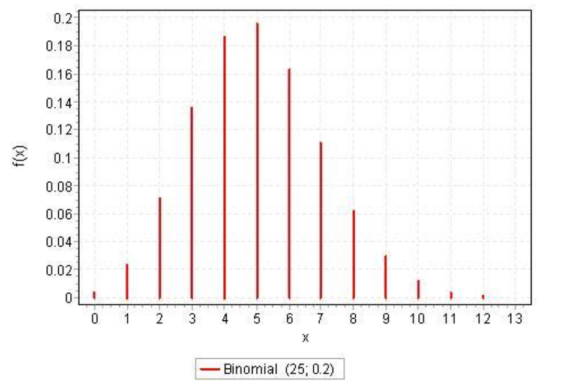
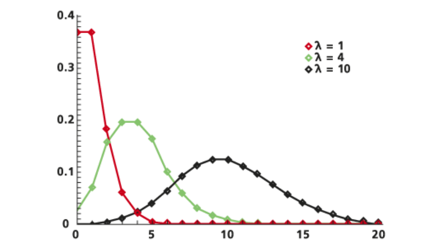

# 1. Index

- [1. Index](#1-index)
- [2. Special Random Variables](#2-special-random-variables)
  - [2.1. Discrete Random Variables](#21-discrete-random-variables)
    - [2.1.1. Bernoulli Distribution](#211-bernoulli-distribution)
    - [2.1.2. Binomial Distribution](#212-binomial-distribution)
    - [2.1.3. Poisson Distribution](#213-poisson-distribution)
      - [2.1.3.1. Exercise: Accidents in a Motorway](#2131-exercise-accidents-in-a-motorway)
    - [2.1.4. Geometric Distribution](#214-geometric-distribution)

# 2. Special Random Variables

Some RVs are often encountered in practice. This happens because they are **good
models of some aspect of reality**. For this reason, we gave them special names.

## 2.1. Discrete Random Variables

### 2.1.1. Bernoulli Distribution

A Bernoullian RV is a **discrete** RV which is equal to $1$ with probability $p$
(_success_) and equal to $0$ with probability $(1-p)$ (_failure_).

It is the same thing as an **indicator variable** for an event with probability
$p$.

As we have already seen in previous chapters, its parameter are:

- **Mean Value**: $E[X] = p$
- **Variance**: $Var(X) = p(1-p)$

Which shows that the **maximum uncertainty** occurs when $p = \frac{1}{2}$.

### 2.1.2. Binomial Distribution

Its obtained from the _Bernoulli distribution_, and represents the **number of
successes in $n$ repeated trials in independent conditions**, each with
probability $p$ of success.

Thus, a binomial RV is a **discrete** RV, characterized by two parameters: $n$
and $p$.

Computing its PMF is rather simple:

$$
  p(i) = P\Set{X = i} = \binom{n}{i} p^i (1-p)^{n-i}
$$

The fact that this is a PMF is confirmed by the **normalization condition**:

$$
\sum_{i=0}^n{p(i)} = \sum_{i=0}^{n} \binom{n}{i} p^i (1-p)^{n-i}
= (p + (1-p))^n = 1
$$

To compute the mean and variance, we can use the **linearity of expectation** observing
that it is just the **sum of $n$ independent Bernoulli RVs**:

- **Mean Value**: $E[X] = E\left[\sum_i^n{X_i}\right] = \sum_i^n{E[X]} = n
\cdot p$
- **Variance**: $Var(X) = Var\left[\sum_i^n{X_i}\right] = \sum_i^n{Var[X]} = n
\cdot p(1-p)$

In the graph on the right we can see an example of what a binomial
distribution looks like.

The following observations can be made:

- It takes on _positive_ values between $0$ and $n$.
- It is **symmetric** only if $p = \frac{1}{2}$, otherwise it is **skewed**.
- It has its **maximum** at $i = \lfloor np \rfloor$.

<figure class="60">

<figcaption>

Binomial Distribution with $n = 25$ and $p = 0.2$.

</figcaption>
</figure>

A property of binomial variables is the following:

> If $X \sim Bin(n, p)$ and $Y \sim Bin(m, p)$ are **independent**, then
> $X + Y \sim Bin(n + m, p)$.

This property becomes obvious if we remember that the binomial counts
the number of successes in the _sum of the trials_.

### 2.1.3. Poisson Distribution

A **discrete RV** is said to be **Poissonian** with parameter $\lambda$ if its
PMF is given by:

$$
p(i) = P\Set{X = i} = \frac{\lambda^i}{i!}\cdot e^{-\lambda}, \quad
\forall i \ge 0
$$

We can check that this is a PMF by verifying the **normalization condition**:

$$
\sum_{i=0}^{\infty}{p(i)} = \sum_{i=0}^{\infty} \frac{\lambda^i}{i!}\cdot e^{-\lambda}
= e^{-\lambda} \sum_{i=0}^{\infty} \frac{\lambda^i}{i!}
= e^{-\lambda} \cdot e^{\lambda} = 1
$$

Therefore, a Poissonian RV can assume _arbitrarily large values_, but it will
**go to zero** as $i$ increases.

We can compute first the _mean value_:

$$
\begin{align*}
  E[X] &= \sum_{i=0}^{+\infty}{i \cdot \left(e^{\lambda}\cdot
\frac{\lambda^i}{i!} \right)} \\
    &= \sum_{i=1}^{+\infty}{\frac{\lambda^i}{(i-1)!} \cdot e^{-\lambda}} \\
    &= e^{-\lambda} \cdot \lambda \cdot \sum_{i=1}^{+\infty}{\cancel{i} \cdot
\frac{\lambda^{i-1}}{\cancel{i}(i-1)!}} \\
    &= e^{-\lambda} \cdot \lambda \cdot
\sum_{i=0}^{+\infty}{\frac{\lambda^i}{i!}} \\
    &= e^{-\lambda} \cdot \lambda \cdot e^{\lambda} = \lambda
\end{align*}
$$

Therefore, the parameter $\lambda$ is the **mean value** of the Poissonian RV.

Now, for the **variance** we can just apply the formula
$\operatorname*{Var}(X) = E[X^2] - \mu^2 = E[X^2] - \lambda^2$.
Let's compute $E[X^2]$:

$$
\begin{align*}
  E[X^2] &= \sum_{i=0}^{+\infty}{i^2 \cdot \left(e^{\lambda}\cdot
\frac{\lambda^i}{i!} \right)} \\
  &= e^{-\lambda} \cdot \lambda \cdot \sum_{i=1}^{+\infty}
{\frac{i^2 \cdot \lambda^{i-1}}{(i-1)!}} \\
  &= e^{-\lambda} \cdot \lambda \cdot \sum_{j=0}^{+\infty}
{(j+1) \cdot \frac{\lambda^j}{j!}} \\
  &= e^{-\lambda} \cdot \lambda \cdot \left[
\sum_{j=0}^{+\infty}{j \cdot \frac{\lambda^j}{j!}} +
\sum_{j=0}^{+\infty}{\frac{\lambda^j}{j!}}
\right] \\
  &= e^{-\lambda} \cdot \lambda \cdot [e^\lambda \cdot \lambda + e^{\lambda}] \\
  &= \lambda^2 + \lambda
\end{align*}
$$

Therefore, the **variance** is: $\operatorname*{Var}(X) = E[X^2] - \lambda^2 = \lambda$.

Hence, both the **mean** and **variance** of a Poissonian RV are equal to $\lambda$.

To find out what a Poissonian distribution looks like, we know that:

- $\lim_{i \to +\infty} p(i) = 0$
- $p(0) = e^{-\lambda}$
- If $\lambda \le 1$, then $p(0) > p(1) > p(2) > ...$ and the distribution is **decreasing**.
- If $\lambda > 1$, then $p(0) < p(1) < ... < p(\lfloor \lambda \rfloor)$ and
  the distribution is **increasing** until it reaches its **maximum** at
  $i = \lfloor \lambda \rfloor$.

In any case the distribution is **skewed**, and its right tail extends to infinity.

Physically, the Poissonian variable approximates rather well a **binomial
variable** when:

- $n$ is large
- $p$ is small
- $\lambda = n \cdot p$

In other words, when we want to count occurence of **unlikely events** in a
**large number of independent repeated trials**, like the number of _typos_ in
the page of a book, the number of 100-year-old in a large population, ...

Even though the binomial distribution would work just fine, using Poisson is
**more economical** from a computational standpoint.

The proof for this affirmation is as follows:

$$
\begin{align*}
  P{X = i} &= \binom{n}{i} p^i (1-p)^{n-i} \\
  &= \frac{n\cdot (n-1) \cdot ... \cdot (n-i+1)}{i!} \cdot
\left(\frac{\lambda}{n}\right)^i \cdot
\frac{(1 - \lambda/n)^n}{(1-\lambda/n)^i} \\
  &= \frac{n\cdot (n-1) \cdot ... \cdot (n-i+1)}{n^i} \cdot
\frac{\lambda^i}{i!} \cdot \frac{(1 - \lambda/n)^n}{(1-\lambda/n)^i} \\
\end{align*}
$$

Now, as $n$ is large we can approximate:

$$
\begin{align*}
  \frac{n\cdot (n-1) \cdot ... \cdot (n-i+1)}{n^i} &\approx 1 \\
  (1 - \lambda/n)^n &\approx e^{-\lambda} \\
  (1 - \lambda/n)^i &\approx 1
\end{align*}
$$

Hence, we get that $P\Set{X = i} \approx \frac{\lambda^i}{i!} \cdot e^{-\lambda}$,
which is a Poisson PMF.

An important property of Poissonian RVs is the following:

> Take two independent Poissonian RVs $X_1 \sim
> \operatorname*{poisson}(\lambda_1)$ and $X_2 \sim
> \operatorname*{poisson}(\lambda_2)$. Then, the sum $X = X_1 + X_2$ is also a
> Poissonian RV with parameter $\lambda = \lambda_1 + \lambda_2$.

The proof is as follows:

$$
\begin{align*}
  p(k) &= P\Set{X_1 + X_2 = k} \\
  &= \sum_{i=0}^{k} P\Set{X_1 = i, X_2 = k-i} \\
  &= \sum_{i=0}^{k} P\Set{X_1 = i} \cdot P\Set{X_2 = k-i} && \text{(independence)}\\
  &= \sum_{i=0}^{k} \left[\frac{\lambda_1^i}{i!} \cdot e^{-\lambda_1} \cdot
  \frac{\lambda_2^{k-i}}{(k-i)!} \cdot e^{-\lambda_2}\right]
&& \text{(we can multiply both num and div by ) k!} \\
  &= \frac{e^{-(\lambda_1 + \lambda_2)}}{k!} \cdot \sum_{i=0}^{k} \left[
\frac{\lambda_1^i}{i!} \cdot \frac{\lambda_2^{k-i}}{(k-i)!} \cdot k!
\right] \\
  &= \frac{e^{-(\lambda_1 + \lambda_2)}}{k!} \cdot \sum_{i=0}^{k} \left[
\binom{k}{i} \cdot \lambda_1^i \cdot \lambda_2^{k-i} \right] \\
  &= \frac{(\lambda_1 + \lambda_2)^k}{k!} \cdot e^{-(\lambda_1 + \lambda_2)}
  && (\lambda = \lambda_1 + \lambda_2) \\
  &= \frac{\lambda^k}{k!} \cdot e^{-\lambda}
\end{align*}
$$

#### 2.1.3.1. Exercise: Accidents in a Motorway

> The average number of weekly accidents on a motorway segment is equal to 3.
> What is the probability that there will be at _least one_ accident next week?

It is reasonable to think that:

- There are many cars on the segment every week
- The probability of an accident is small

If we knew both the number of cars and the probability of an accident, we could
(theoretically) use a binomial RV, but since we don't know them, we can reasonably
model the problem using a Poissonian RV with a mean value of $\lambda = 3$.

Hence:

$$
\begin{align*}
  P\Set{X \ge 1} &= 1 - P\Set{X = 0} \\
  &= 1 - \frac{3^0}{0!} \cdot e^{-3} \\
  &= 1 - e^{-3} \approx 0.95
\end{align*}
$$

### 2.1.4. Geometric Distribution

The geometric distribution is a **discrete** RV which counts the number of
**failures before the first success** in a repeated trial experiment.

Therefore, it takes values in $[0, +\infty)$ and both its _mean value_ and
_variance_ must depend on the trial success probability $p$.

Given this definition, it's easy to see that $P\Set{X = 0} = p$, since we need
to have one successful trial in order to have 0 failures.

Moving forward:

$$
\begin{align*}
  P\Set{X = 1} &= (1-p) \cdot p \\
  P\Set{X = 2} &= (1-p)^2 \cdot p \\
    &\vdots \\
  P\Set{X = k} &= (1-p)^k \cdot p
\end{align*}
$$

Therefore, the PMF is a _decreasing sequence_, which **decays exponentially**
as $k$ increases.

As far as the CDF is concerned, we can compute it as follows:

$$
\begin{align*}
  F(k) &= P\Set{X \le k} \\
  &= \sum_{i=0}^{k} (1-p)^i \cdot p \\
  &= p \cdot \frac{1 - (1-p)^{k+1}}{1 - (1-p)} \\
  &= 1 - (1-p)^{k+1}
\end{align*}
$$

If instead we use another definition of the geometric distribution, which **counts
the number of trials until the first success**, then:

$$
\begin{align*}
  p(k) = P\Set{X = k} &= (1-p)^{k-1} \cdot p & k \ge 1 \\
  F(k) = P\Set{X \le k} &= 1 - (1-p)^k & k \ge 1
\end{align*}
$$

Computing the moments is not too easy, but (for the counting failures definition)
we have:

$$
\begin{align*}
  E[X] &= \sum_{k=0}^{+\infty} k \cdot (1-p)^k \cdot p \\
  &= p \cdot (1-p) \sum_{k=1}^{+\infty} \frac{\partial}{\partial p}
\left[-(1-p)^k\right] \\
  &= - p \cdot (1 - p) \cdot \frac{\partial}{\partial p} \sum_{k=1}^{+\infty}
(1-p)^k \\
  &= - p \cdot (1 - p) \cdot \frac{\partial}{\partial p} \left[\frac{1}{p} - 1
\right] \\
  &= \frac{1 - p}{p}
\end{align*}
$$

We will later show that the variance is equal to $\delta^2 = \frac{1 -
p}{p^2}$, using a different approach.

Apart from the moments, we must pay attention to a very important property of
the geometric distribution: it's the only distribution to be **memoryless**.

Assuming the "failure" definition, the _memoryless property_ means that:

$$
\large
P\Set{X \ge n + m \vert X \le n} = P\Set{X \ge m}
$$

To understand it better, assume that our experiment (e.g., getting "heads" out
of a coin flip) has failed $n$ times. We ask what the probability is that it
will fail $m$ more times. Clearly, since coin flips are **independent trials**,
knowing the past doesn't add anything to the future.

Therefore, the answer is the same as if we had just started the experiment,
because the previous failures do not affect the future ones.

Formally, we can prove it:

$$
\begin{align*}
  P\Set{X \ge n + m \vert X \ge n} &= \frac{P\Set{X \ge n + m, X \ge n}}
{P\Set{X \ge n}} \\
    &= \frac{P\Set{X \ge n + m}}{P\Set{X \ge n}} \\
    &= \frac{1 - P\Set{X \le n + m - 1}}{1 - P\Set{X \le n - 1}} \\
    &= \frac{1 - \left[1 - (1-p)^{n+m}\right]}{1 - \left[1 - (1-p)^n\right]} \\
    &= (1-p)^m = P\Set{X \ge m}
\end{align*}
$$

However, we must be careful by the _memoryless property_ as **it is not true**
that:

$$
  P\Set{X \ge n + m \vert X \le n} = P\Set{X \ge m}
$$

This could only be true id $\Set{X \le n}$ and $\Set{X \ge n}$ were independent,
which they are not.
