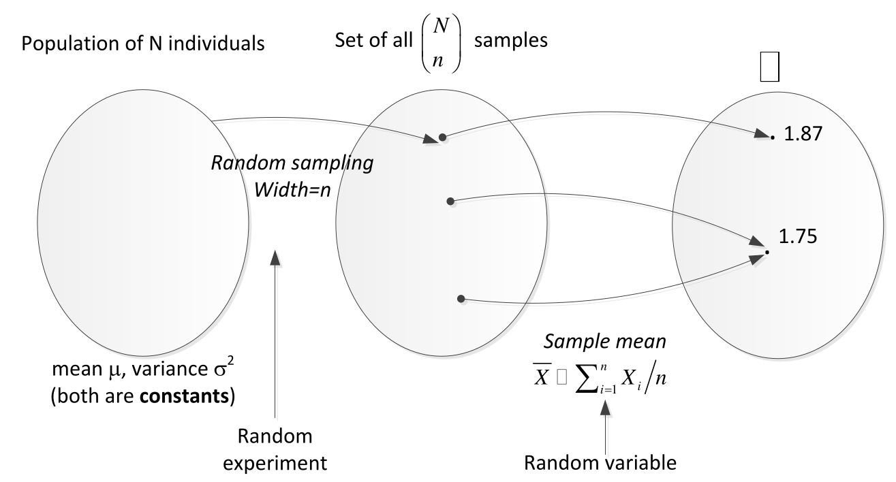
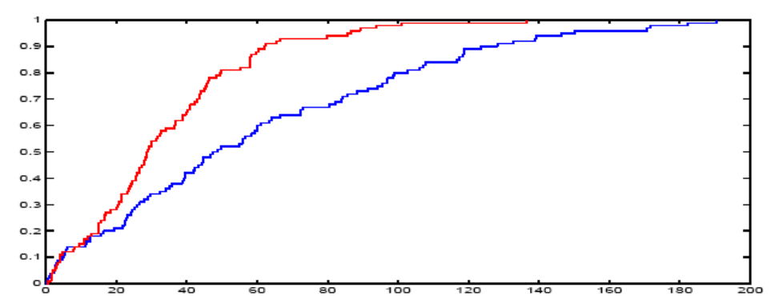
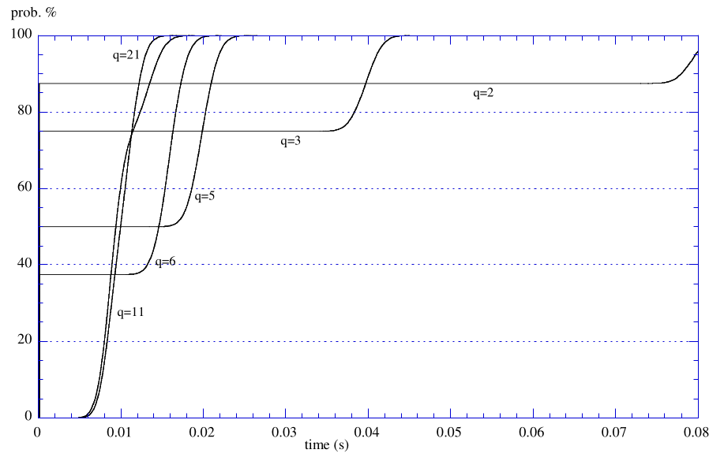
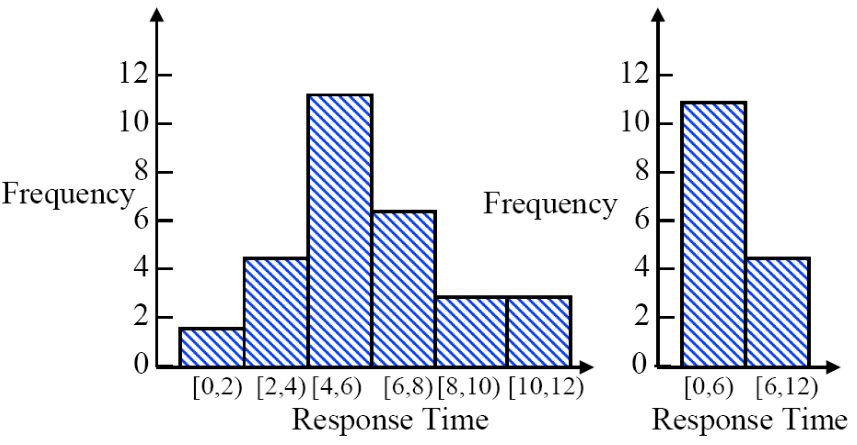
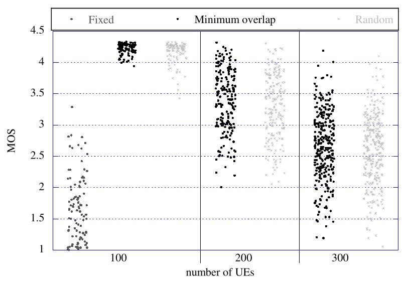
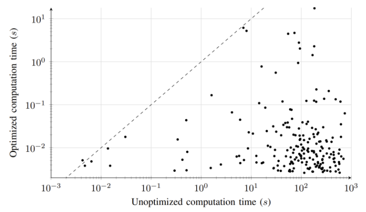
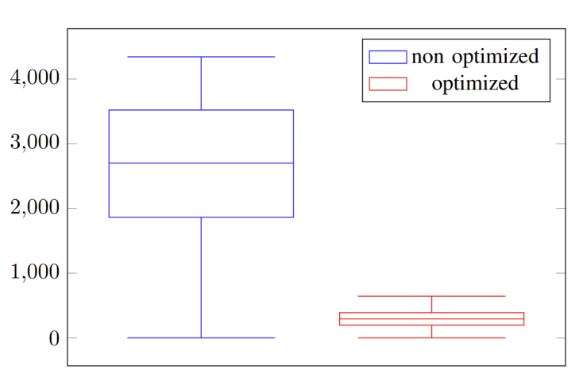
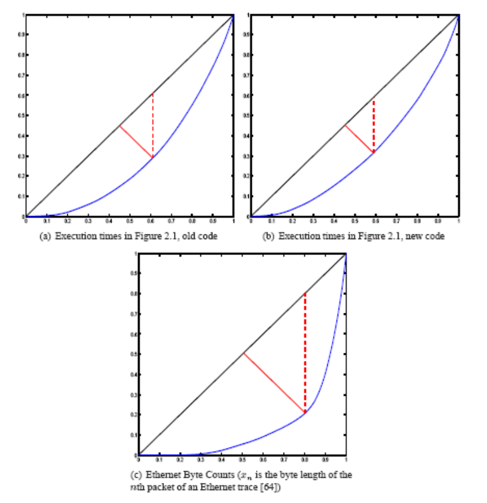
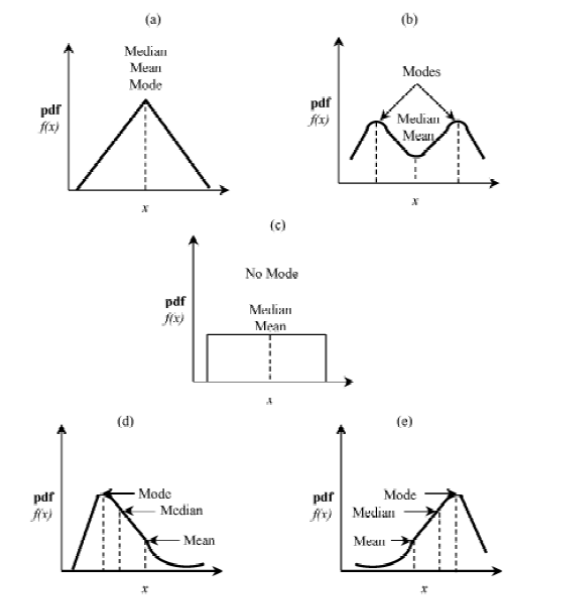

# 1. Index

<!--toc:start-->

- [1. Index](#1-index)
- [2. Statistics](#2-statistics)
  - [2.1. Random Sampling](#21-random-sampling)
  - [2.2. Data Presentation](#22-data-presentation)
    - [2.2.1. Empirical CDF](#221-empirical-cdf)
    - [2.2.2. Histograms](#222-histograms)
    - [2.2.3. Scatter Plots](#223-scatter-plots)
    - [2.2.4. Box Plots](#224-box-plots)
  - [2.3. Lorenz Curves](#23-lorenz-curves)
  - [2.4. Summarizing Data](#24-summarizing-data)
    - [2.4.1. Indexes of Central Tendencies](#241-indexes-of-central-tendencies)
      - [2.4.1.1. Sample Mean](#2411-sample-mean)
      - [2.4.1.2. Sample Median](#2412-sample-median)
      - [2.4.1.3. Sample Mode](#2413-sample-mode)
      - [2.4.1.4. Usage](#2414-usage)
  - [2.5. Indexes of Dispersion](#25-indexes-of-dispersion)
    - [2.5.1. Range](#251-range)
    - [2.5.2. Sample Variance](#252-sample-variance)
    - [2.5.3. Sample Standard Deviation and Sample Coefficient of Variation](#253-sample-standard-deviation-and-sample-coefficient-of-variation)
    <!--toc:end-->

# 2. Statistics

Statistics is the science by which probability results are **inferred from experimental
data**.

While in _probability theory_ data are modeled after some probability model,
in statistics the following concepts are of _key importance_:

- **Population**: it's the _set of individuals_ on which we want to infer statistics.
  The information regarding it are called **parameters**. They are _constants_ and
  _unknown_.
- **Sample**: it is a (possibly very small) **subset of a population**. We typically
  measure a sample and try to _infer properties of the whole population_ from it.
  The information we extract are called **statistics**, and they are expected
  to be true with some approximation.

For instance, the **sample mean** is a statistic that estimates the
**population mean**.

We must pay attention on a small detail:

- **Parameters** are **_constants_**
- **Statistics** are **_random variables_**

Our typical task is to **estimate parameters** through **statistics**.

## 2.1. Random Sampling

We call a **random sampling** of $n$ elements taken from a population of
$N$ elements, a set such that every one of the $\binom{N}{n}$ subsets of
cardinality $n$ are equally likely to represent it.

Thus, sampling is a **random experiment**, since we cannot predict the outcome in
advance.

In general we make the assumption that the measure whose parameters we want to
estimate **does exists**.

Specifically, that measure will have a CDF, meaning the **elements of a sample**
represent **IID RVs** according to that CDF.

This last assumption is <strong><em><u>fundamental</u></em></strong>. From now on
we will work assuming that the hypothesis is true, and then verify it with the data
we collect, keeping in mind that the output we measure is just a _sample of all
the possible outcomes_.

This last detail rises a problem: the observed statistics are due to **structural
properties** or is it just **randomness**.

We will see that there are ways to _quantify_ the effect on randomness, but we must
know that **we cannot say anything with certainty**, unless $n = N$.

## 2.2. Data Presentation

Assume we have a **sample width** $n$ (number of sample) IID RVs
$X_i$, $1 \le i \le n$, called **observations**.

There are several ways to **visualize these data**.

Before showing those ways, we have to remember that visualization is just a
**tool that aids us to understand how the system works**, and not all methods
are **equally suited** to smoothly describe the system.

Thus, we review here a **set of alternatives**.

### 2.2.1. Empirical CDF

The ECDF can be obtained as a function of $x$ by plotting:

$$
  F(x) = \frac{1}{n} \sum_{i=1}^{n} 1_{X_i \le x}
$$

Therefore $F(x)$ is a **staircase function** that shows the _proportion of data
that does not exceed value_ $x$.

Operatively, the way to compute ECDF is to sort the observation in **ascending order**
such that $X_{(1)} = \min{X_i}$, $X_{(i)} \le X_{(i+1)}$ and $X_{(n)} = \max{X_i}$.

If we are instead dealing with a **continuous distribution** we can interpolate
the ECDF so that it look "smooth":

$$
F(x) = \begin{cases}
  0 & x < X_{(1)} \\
  \frac{i -1}{n-1} + \frac{x - X_{(i)}}{(n-1) \cdot \left(X_{(i+1)} - X_{(i)}
\right)} & X_{(i)} \le x < X_{(i+1)} \\
  1 & x \ge X_{(n)}
\end{cases}
$$

The formula states that the vertical axis is divided into $n - 1$ portions, and
the ECDF grows _linearly_ between two consecutive observations.

ECDF are typically useful because they can be compared to each other.

Taking two alternative designs $A$ and $B$, like in the image on the right.

If the ECDF of the metric we are interested in is always _above_ in $A$, then:

- If _lower is better_ (e.g., a delay), then $A$ is better than $B$
- If **higher is better** (e.g., a throughput), then $B$ is better than $A$

<figure class="100">

<figcaption>

$A$ is the _red_ line, $B$ is the _blue_.

</figcaption>
</figure>

If the curvatures intersect at some point, then we cannot easily make conclusions.
However, if the intersection is at the **top** or at the **bottom**, we can make
some inferences, like we did in the example, noting that in certain regions
the behaviour could be worse.

In any case we can get some information out of the ECDF:

The graph on the right visualizes the ECFG of a delay for various values of a parameter
$q$.

We can see how \_increasing $q$ has three main effects:

- It **decreases** the _Lower Bound_ of the delay, which is the **minimum
  delay** we can expect.
- **It**

### 2.2.2. Histograms

Histograms, or _bar charts_ are a way to obtain **empirical PDFs** from the sample.

The algorithm is as follows:

1. Select a **bucket width** of $\Delta$ (i.e, the range within which observations
   are considered to be in the same bucket).
2. Initialize all buckets to zero.
3. For each observation $X_i$, we add $1$ to the bucket $\left\lfloor
   \frac{X_i}{\Delta} \right\rfloor$.

The problem with histogram is that they are **highly dependant on how we choose**
$\Delta$.

This means that, at the two extremes, we could have:

- $\Delta$ too small: zero or one observation per bucket. This produces what is
  called a _Comb-Like Histogram_. To observe this shape is enough to select on a
  sample of $n$ $\Delta \approx \frac{X_{(n)} - X_{(1)}}{n}$
- $\Delta$ too large: all observations will fall in one/two buckets. This produces
  what we call a _Blob-Like Histogram_.

In both cases, we can't get anything useful out of it.

Changing $\Delta$ can produce **drastic changes** in the histogram, making
the EPDF look **extremely different**.

<figure class="100">

<figcaption>

From the second graph we might think that it behaves like an
exponential distribution, but the first graph shows that it is not the case.

</figcaption>
</figure>

In books we usually find the _rule of thumb_: the average number of elements
per bucket should be around $5$ for the histogram to be useful.

However, a more valuable advice is to **try different values of $\Delta$**
and measure the average elements per _non-empty bucket_.
In the end, we will use the one with the **best trade-off** between _compactness_
and _accuracy_, for with the histogram looks "smooth".

In any case we should always avoid for **very different values** to fall in
the same bucket.

For example, if we know from the _problem knowledge_ that a mean delay time is around
$5\;\mu s$ when working normally, but $9.5\;\mu s$ when the it is overloaded,
we should avoid a $\Delta \ge 5$, that would put the two values in the same bucket.

The same applies when plotting **discrete RVs** histograms, with the advantage
that we already know a _unit_.

When comparing two systems using histograms remember to:

- **Use the same bucket width** $\Delta$ for both histograms
- Ensure that they both have the same _sample width_ $n$, or **normalize
  the ordinates** toe the respective sample width, otherwise comparisons will be
  impossible.

### 2.2.3. Scatter Plots

A simple, but not always effective way to show a sample of IID RVs, is to use a
**scatter plot**.

The are mono-dimensional plot where _points_ (or _markers_) are scattered
along a given horizontal span at the _proper height_.

The advantage of this method is that it naturally shows where statistics are
placed (e.g, sample mean, sample variance, etc.), making it easy to identify
**clusters**.

For instance, they could be used to figure out $\Delta$ values for histograms.

The plot on the right plots the _Mean Opinion Sore_, with three different
schemes, with an increasing number of users.

We can immediately see that:

- _Fixed_ scheme is a lot worse than the other two
- _Increasing the number of users_ lowers the average score, but increases the variance
- _Minimum Overlap_ and _Random_ scheme are more or less equivalent.

We can also make comparisons using scatter plots.

In this case the graph become _bi-dimensional_, with each point being identified
as a set of coordinates $(x, y)$, where $x$ is the value of the metric for
system $A$ and $y$ for system $B$.

This is similar to the ECDF comparison, but the advantage of this method is that
we can compare **instance by instance**, and not just the _overall distribution_.

Another advantage is that scatter plots are able to easily compare instance of
_very different order of magnitudes_ by using logarithmic scales.

Incidently, there is an additional bonus: by measuring a one-axis-distance between
a point and the bisector $\vert y_i - x_i \vert$, we can easily see the
_order of magnitude_ of the optimisation.

### 2.2.4. Box Plots

Also called _box and whiskers_, they are a way to visualize the
**distribution of a sample**.

They consist in plotting:

- A **box** whose edges are in the $1^{st}$ and $3^{rd}$ **quartiles** ($25^{th}$
  and $75^{th}$ _percentiles_). We call them $Q_1$ and $Q_3$ respectively.
- A **line** representing the **median** (i.e., the $2^{nd}$ quartile, or $50^{th}$
  percentile) of the sample.
- Two **whiskers** that extend from the box representing something different
  according to different conventions.

Common practices for the _whiskers_ are:

- **Maximum** and **Minimum** values of the sample (i.e., $X_{(n)}$ and $X_{(1)}$)
- The $2^{nd}$ and $98^{th}$ percentiles of the sample
- The lowest datum still within $1.5 \cdot (Q_3 - Q_1)$ of the lower quartile, and
  the highest datum still within $1.5 \cdot (Q_3 - Q_1)$ of the upper quartile.
  Where $Q_3 - Q_1$ is called the **interquartile range** (IQR).

## 2.3. Lorenz Curves

All the plots we described until now can be used to compare alternatives.

However, sometimes it is useful to access the **variability** of a sample, i.e.
how _dispersed_ a sample is.

This can happen for several reasons, but in general we might want for the output
of a system to be **perfectly regular**.

For instance, we would expect all customers making the same request to a web server
to observe, statistically speaking, the same performance (i.e., the same response
time).

The ideal situation would then be that every customer experiences **the same response
time**.

This will not happen in practice, because of several causes (e.g, queuing of
near-simultaneous requests, disk swaps, different TCP congestion windows for
different connections, cache hits/misses, etc.) that will affect different customers
in a different way.

We would then like to quantify how **unfair** our system is, by quantifying
the **variability** of the output.

A good way to do so is to plot a **_Lorenz Curve_**.

Before explaining how to plot it, it is fundamental to remember that this plot
<strong><em><u>only works with non-negative RVs</u></em></strong>.

That said, the **Lorenz Curve** is defined as follows:

1. Sort the sample and get the **ordered statistics** $X_{(1)} \le X_{(2)} \le \ldots
\le X_{(n)}$.
2. Compute the **sum total of the sample**: $T = \sum_{i=1}^{n} X_{(i)}$.
3. Plot the points as follows:
   $$
     \left(\frac{i}{n}, \frac{\sum_{i=1}^{j} X_{(i)}}{T}\right), \quad 1 \le j
   \le n
   $$
4. Interpolate the points assuming $(0, 0)$ as the **first point of the curve**.

Obviously, the last point of the curve will be $(1, 1)$.

After plotting the curve, we can make some assumptions based on its shape:

- If all the values were _equal_, the LC would be the **bisector of the first
  quadrant**. This is called the **line of maximum fairness**, and should be
  plotted for reference.
- If $T = X(n)$ and all the other values are _null_, then the LC follows the
  x-axis until point $\left(1 − \frac{1}{n}, 0\right)$, and then goes up to
  point $(1,1)$. Therefore, the x-axis and the vertical line passing through
  $(1,0)$ are a **lower bound** for the LC. They are called the **line of
  maximum unfairness**, and should be plotted as a reference too.

Note that this plot allows us to compare two alternatives **as for variability**,
but tells us nothing about other metrics (e.g., average, maximum, etc.).

## 2.4. Summarizing Data

Quite often we are requested to provide **as few numbers as possible** to describe
the performance of a system.

This is useful, for instance, for comparisons, as well as for ease of storage.

### 2.4.1. Indexes of Central Tendencies

Three popular alternatives are to specify one of the **Three Indexes of Central
Tendencies**: _sample mean_, _median_ and _mode_.

#### 2.4.1.1. Sample Mean

We define the **sample mean** as:

$$
\overline{X} = \frac{1}{n} \sum_{i=1}^{n} X_i
$$

$\overline{X}$ is itself a **random variable** that estimates the **population mean**
$\mu$.

Thus, it has itself a _mean_ and a _variance_ (we suppose $X_i$ to be IID):

- $E[\overline{X}] = \frac{1}{n} \cdot E[\sum_{i=1}^n{X_i}] = \frac{1}{n}
  \cdot n \cdot E[X_i] = \mu$
- $\operatorname*{Var}(\overline{X}) = \operatorname*{Var}\left(\frac{1}{n}
\sum_{i=1}^{n} X_i\right) = \frac{1}{n^2} \cdot n \cdot \sigma^2 =
\frac{\sigma^2}{n}$

These results are compliant with the CLT: with a larger the sample
$\overline{X} \sim \mathcal{N}(\mu, \frac{\sigma^2}{n})$. (if $X_i$ are not
_heavy-tailed RVs_).

If we extend the sample width even more, the more $\overline{X}$ _will
converges_ to a
RV equal to the population mean $\mu$ with **no variance**.

Of course, if $X_i$ were normal from the beginning, $\overline{X}$ would be
normal for any sample width $n$.

Therefore, **at least** for _large values_ of $n$ it is:

$$
\frac{\overline{X} - \mu}{\sigma / \sqrt{n}} \sim \mathcal{N}(0, 1)
$$

#### 2.4.1.2. Sample Median

The **sample median** is obtained from the **ordered statistics**
$\left(X_{(1)}, X_{(2)}, \ldots, X_{(n)}\right)$ as follows:

- If $n$ is _odd_, then observation $X_{(\lceil n/2 \rceil)}$ is the median.
- If $n$ is _even_, then the median is the average of the two middle observations
  $X_{(n/2)}$ and $X_{(n/2 + 1)}$.

#### 2.4.1.3. Sample Mode

The **sample mode** is the values that **_appears most frequently_** in the
sample, i.e. the value with the _highest probability_.

It should not be estimated directly on a sample, but should be sampled on a
**histogram**, as the _midpoint of the bucket_ with the highest number of observations.

Keep in mind that the sample mode is the only one of the three that **may not
be unique**.

#### 2.4.1.4. Usage

The question that now rises is which of the three indexes is the best to use.

In general, like everything, it **depends on the distribution of the sample**.

Common sense says that:

- If the distribution is _symmetric_, the _mean_ and the _median_ are **the same**
- _Mode_ may not be unique
- _Mean_ is **additive**, while the others aren't

Maybe on of the most important observation is that the _sample mean_ is
**sensitive to outliers**. If we have a _small_ sample, then _few outliers_ (e.g.,
garbage collection or network congestion) can _drastically change_ it, while the
median and mode are **very robust** to outliers.

This means that if the distribution is **very skewed** (or has a _long tail_)
the median will be _more representative_ of the sample than the mean.

This is easy to prove.
Suppose we have a sample of $n$ observations, whose sample mean is $\overline{X}$.
If $n$ is _off_, meaning the sample median is $X_{0.5} = X_{(\lceil n/2 \rceil)}$.

Assuming we add to the sample one more observation, whose value is $O$.

The new mean will become:

$$
\overline{X}' = \frac{n \cdot \overline{X} + O}{n + 1}
$$

Now, if the two _addenda_ are comparable (e.g., small sample, or large $O$), the
mean **can change significantly**.

On the other hand the new median becomes:

$$
X'_{0.5} = \begin{cases}
  \frac{X_{(\lceil n/2 \rceil)} + X_{(\lceil n/2 \rceil + 1)}}{2} = X_{0.5} +
\frac{X_{(\lceil n/2 \rceil + 1)} - X_{(\lceil n/2 \rceil)}}{2}
& O \ge X_{0.5}  \\
  \frac{X_{(\lceil n/2 \rceil -1)} + X_{(\lceil n/2 \rceil)}}{2} = X_{0.5} -
\frac{X_{(\lceil n/2 \rceil)} - X_{(\lceil n/2 \rceil -1)}}{2}
& O \le X_{0.5} \\
\end{cases}
$$

We can see that $O$ **does not appear** in the final result, hence the median is
_unaffected_ by the magnitude of it.

## 2.5. Indexes of Dispersion

As for the indexes of central tendencies we have seen so far, there are alternatives
for **Indexes of Dispersion** too.

The most common are **range**, **sample variance**, **sample standard deviation**,
**sample coefficient of variation**, <strong>10th and 90
thpercentiles</strong>, **semi-interquartile range**,
**mean absolute deviation** and **Lorenz Curve Gap**.

### 2.5.1. Range

The **range** is the _difference between the maximum and minimum_ of the sample
$X_{(n)} - X_{(i)}$.

This value **should not be used**, **_unless_** there is reason to believe that
the RV we are sampling is **bounded**, and we need to estimate those bounds.

Otherwise, the range will tell us nothing significant since it will:

- Be equal to a very large outlier minus zero (non-zero variables)
- Be unstable, as it will keep growing with $n$
- Reveal nothing about what happens between the extremes

### 2.5.2. Sample Variance

The **sample variance** is defined as:

$$
S^2 = \frac{1}{n-1} \cdot \sum_{i=1}^n{\left(X_i - \overline{X}\right)^2}
$$

It is provable that $S^2$ is a RV as well, but for our sake we can just take
this information as true without proof.

We just need to know that with this definition $E[S^2] = \sigma^2$.

The reason for the $(n-1)$ instead of $n$ at the denominator is that **only**
$\mathbf{n - 1}$ of the differences $\left(X_i - \overline{X}\right)$ are independent,
while the $n$-th one depends on the others.

For this reason, it is normally said that the **number of degrees of freedom for
the variance** is $n-1$ for a sample of $n$.

### 2.5.3. Sample Standard Deviation and Sample Coefficient of Variation

The **Sample Standard Deviation** is of course defined as the **square root of the
sample variance** $S$.

It is also common to use the **Sample Coefficient of Variation (CoV)**:

$$
C = \frac{S}{\overline{X}}
$$

This can be expected to approximate the **population CoV**:

$$
\chi = \frac{\sigma}{\mu}
$$

Note that this is only meaningful for **non-negative RVs** with well-defined unit
(mass, length, etc.).
In those cases it is also called **ratio-scale measures** since it makes sense to
take ratios of measures.

For these, the CoV is bounded by $0 \le C \le \sqrt{n-1}$.

These are cases of distribution in which **variance is infinite**, meaning for
**heavy-tailed distributions**. <small>(Note that all infinite variance
RVs are HT, but not all HT RVs have infinite variance)</small>

We can observe these RVs more frequently that we might expect, and for those
there is a risk that the CoV will increase indefinitely with $n$, making
comparison through the CoV meaningless.

An interesting fact is that the $CoV$ for an exponential RV should be equal to $1$,
regardless of the value of $\lambda$.

The CoV is normally used with **Continuous distributions**, and its homologous for
**non-negative discrete distributions** is the **Sample Index of Dispersion (IoD)**
(often called **Lexis Ratio**).

The IoD is defined as $L = \frac{S^2}{\overline{X}}$, which approximates the
population IoD $\Lambda = \frac{\sigma^2}{\mu}$.

We can easily check that the IoD is:

- $L = 1$ for a **Poisson RV**
- $L = (1 - p) < 1$ for a **Binomial RV**
- $L = \frac{1}{p} > 1$ for a **Geometric RV**

Note that both CoV and IoD tend to be **unstable** if the sample mean is
_close to zero_.
