# 1. Index

<!--toc:start-->

- [1. Index](#1-index)
- [2. Statistics](#2-statistics)
  - [2.1. Random Sampling](#21-random-sampling)
  - [2.2. Data Presentation](#22-data-presentation)
    - [2.2.1. Empirical CDF](#221-empirical-cdf)
    - [2.2.2. Histograms](#222-histograms)
    - [2.2.3. Scatter Plots](#223-scatter-plots)
    - [2.2.4. Box Plots](#224-box-plots)
  - [2.3. Lorenz Curves](#23-lorenz-curves)
  - [2.4. Summarizing Data](#24-summarizing-data)
    - [2.4.1. Indexes of Central Tendencies](#241-indexes-of-central-tendencies)
      - [2.4.1.1. Sample Mean](#2411-sample-mean)
      - [2.4.1.2. Sample Median](#2412-sample-median)
      - [2.4.1.3. Sample Mode](#2413-sample-mode)
      - [2.4.1.4. Usage](#2414-usage)
  - [2.5. Indexes of Dispersion](#25-indexes-of-dispersion)
    - [2.5.1. Range](#251-range)
    - [2.5.2. Sample Variance](#252-sample-variance)
    - [2.5.3. Sample Standard Deviation and Sample Coefficient of Variation](#253-sample-standard-deviation-and-sample-coefficient-of-variation)
    - [2.5.4. Sample Percentiles](#254-sample-percentiles)
    - [2.5.5. Semi-Interquartile Range and Lorenz Curve Gap](#255-semi-interquartile-range-and-lorenz-curve-gap)
    - [2.5.6. Using the correct index](#256-using-the-correct-index)
  - [2.6. Fitting a Distribution](#26-fitting-a-distribution)
    - [2.6.1. QQ Plots](#261-qq-plots)
    - [2.6.2. Example: Normally Distributed Sample](#262-example-normally-distributed-sample)
    - [2.6.3. Algebraic Tests](#263-algebraic-tests)
  - [2.7. Confidence Intervals](#27-confidence-intervals)
    - [2.7.1. Computing Confidence Intervals](#271-computing-confidence-intervals)
      - [2.7.1.1. Population Mean](#2711-population-mean)
        - [2.7.1.1.1. Exercise: Signal and Noise](#27111-exercise-signal-and-noise)
      - [2.7.1.2. Paired Experiments](#2712-paired-experiments)
        - [2.7.1.2.1. Example: Paired Experiments](#27121-example-paired-experiments)
        <!--toc:end-->

# 2. Statistics

Statistics is the science by which probability results are **inferred from experimental
data**.

While in _probability theory_ data are modeled after some probability model,
in statistics the following concepts are of _key importance_:

- **Population**: it's the _set of individuals_ on which we want to infer statistics.
  The information regarding it are called **parameters**. They are _constants_ and
  _unknown_.
- **Sample**: it is a (possibly very small) **subset of a population**. We typically
  measure a sample and try to _infer properties of the whole population_ from it.
  The information we extract are called **statistics**, and they are expected
  to be true with some approximation.

For instance, the **sample mean** is a statistic that estimates the
**population mean**.

We must pay attention on a small detail:

- **Parameters** are **_constants_**
- **Statistics** are **_random variables_**

Our typical task is to **estimate parameters** through **statistics**.

## 2.1. Random Sampling

We call a **random sampling** of $n$ elements taken from a population of
$N$ elements, a set such that every one of the $\binom{N}{n}$ subsets of
cardinality $n$ are equally likely to represent it.

Thus, sampling is a **random experiment**, since we cannot predict the outcome in
advance.

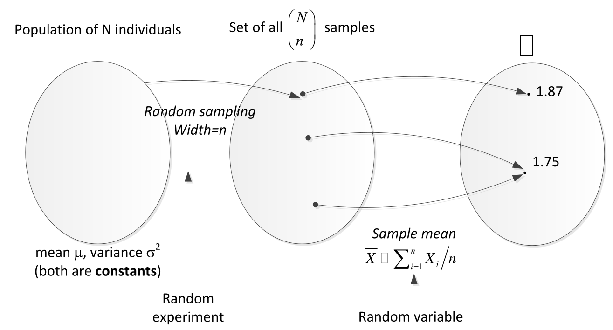

In general we make the assumption that the measure whose parameters we want to
estimate **does exists**.

Specifically, that measure will have a CDF, meaning the **elements of a sample**
represent **IID RVs** according to that CDF.

This last assumption is <strong><em><u>fundamental</u></em></strong>. From now on
we will work assuming that the hypothesis is true, and then verify it with the data
we collect, keeping in mind that the output we measure is just a _sample of all
the possible outcomes_.

This last detail rises a problem: the observed statistics are due to **structural
properties** or is it just **randomness**.

We will see that there are ways to _quantify_ the effect on randomness, but we must
know that **we cannot say anything with certainty**, unless $n = N$.

## 2.2. Data Presentation

Assume we have a **sample width** $n$ (number of sample) IID RVs
$X_i$, $1 \le i \le n$, called **observations**.

There are several ways to **visualize these data**.

Before showing those ways, we have to remember that visualization is just a
**tool that aids us to understand how the system works**, and not all methods
are **equally suited** to smoothly describe the system.

Thus, we review here a **set of alternatives**.

### 2.2.1. Empirical CDF

The ECDF can be obtained as a function of $x$ by plotting:

$$
  F(x) = \frac{1}{n} \sum_{i=1}^{n} 1_{X_i \le x}
$$

Therefore $F(x)$ is a **staircase function** that shows the _proportion of data
that does not exceed value_ $x$.

Operatively, the way to compute ECDF is to sort the observation in **ascending order**
such that $X_{(1)} = \min{X_i}$, $X_{(i)} \le X_{(i+1)}$ and $X_{(n)} = \max{X_i}$.

If we are instead dealing with a **continuous distribution** we can interpolate
the ECDF so that it look "smooth":

$$
F(x) = \begin{cases}
  0 & x < X_{(1)} \\
  \frac{i -1}{n-1} + \frac{x - X_{(i)}}{(n-1) \cdot \left(X_{(i+1)} - X_{(i)}
\right)} & X_{(i)} \le x < X_{(i+1)} \\
  1 & x \ge X_{(n)}
\end{cases}
$$

The formula states that the vertical axis is divided into $n - 1$ portions, and
the ECDF grows _linearly_ between two consecutive observations.

ECDF are typically useful because they can be compared to each other.

Taking two alternative designs $A$ and $B$, like in the image on the right.

If the ECDF of the metric we are interested in is always _above_ in $A$, then:

- If _lower is better_ (e.g., a delay), then $A$ is better than $B$
- If **higher is better** (e.g., a throughput), then $B$ is better than $A$

<figure class="100">
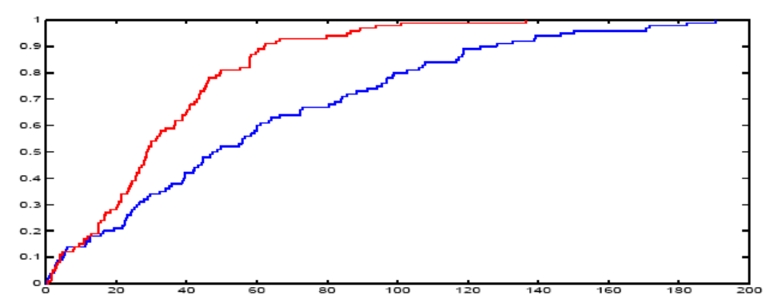
<figcaption>

$A$ is the _red_ line, $B$ is the _blue_.

</figcaption>
</figure>

If the curvatures intersect at some point, then we cannot easily make conclusions.
However, if the intersection is at the **top** or at the **bottom**, we can make
some inferences, like we did in the example, noting that in certain regions
the behaviour could be worse.

In any case we can get some information out of the ECDF:

The graph on the right visualizes the ECFG of a delay for various values of a parameter
$q$.

We can see how \_increasing $q$ has three main effects:

- It **decreases** the _Lower Bound_ of the delay, which is the **minimum
  delay** we can expect.
- It **increases** the _variance_ of the delay

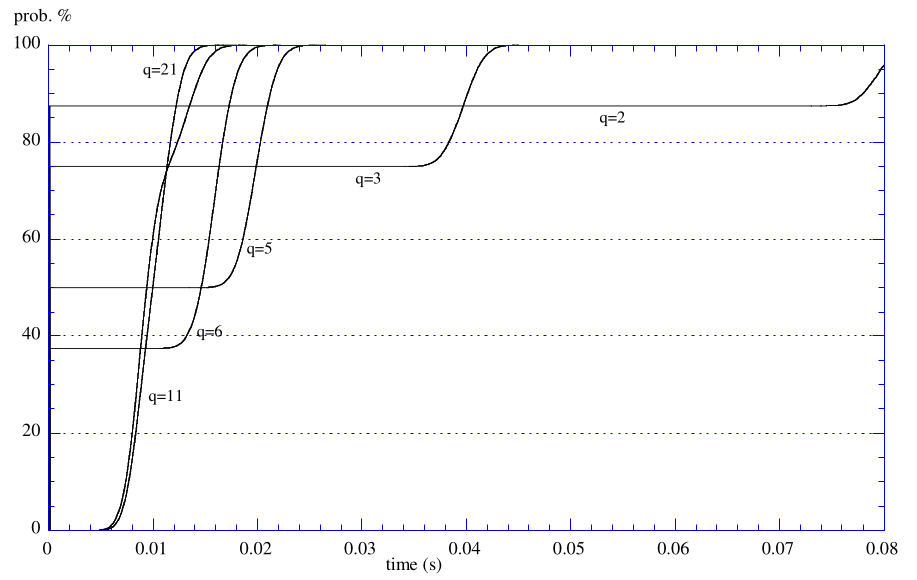

### 2.2.2. Histograms

Histograms, or _bar charts_ are a way to obtain **empirical PDFs** from the sample.

The algorithm is as follows:

1. Select a **bucket width** of $\Delta$ (i.e, the range within which observations
   are considered to be in the same bucket).
2. Initialize all buckets to zero.
3. For each observation $X_i$, we add $1$ to the bucket $\left\lfloor
   \frac{X_i}{\Delta} \right\rfloor$.

The problem with histogram is that they are **highly dependant on how we choose**
$\Delta$.

This means that, at the two extremes, we could have:

- $\Delta$ too small: zero or one observation per bucket. This produces what is
  called a _Comb-Like Histogram_. To observe this shape is enough to select on a
  sample of $n$ $\Delta \approx \frac{X_{(n)} - X_{(1)}}{n}$
- $\Delta$ too large: all observations will fall in one/two buckets. This produces
  what we call a _Blob-Like Histogram_.

In both cases, we can't get anything useful out of it.

Changing $\Delta$ can produce **drastic changes** in the histogram, making
the EPDF look **extremely different**.

<figure class="100">
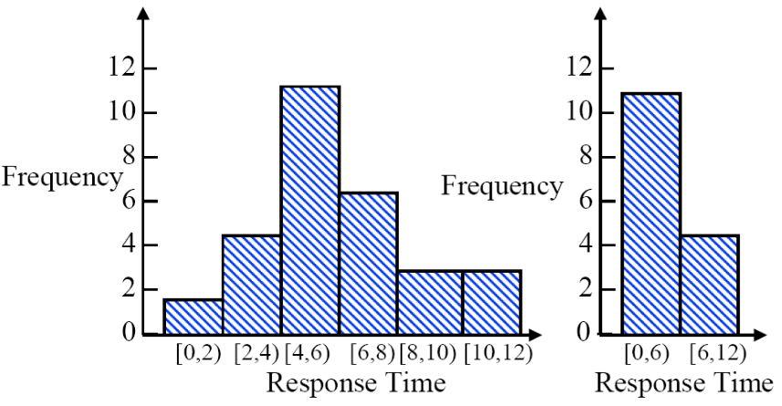
<figcaption>

From the second graph we might think that it behaves like an
exponential distribution, but the first graph shows that it is not the case.

</figcaption>
</figure>

In books we usually find the _rule of thumb_: the average number of elements
per bucket should be around $5$ for the histogram to be useful.

However, a more valuable advice is to **try different values of $\Delta$**
and measure the average elements per _non-empty bucket_.
In the end, we will use the one with the **best trade-off** between _compactness_
and _accuracy_, for with the histogram looks "smooth".

In any case we should always avoid for **very different values** to fall in
the same bucket.

For example, if we know from the _problem knowledge_ that a mean delay time is around
$5\;\mu s$ when working normally, but $9.5\;\mu s$ when the it is overloaded,
we should avoid a $\Delta \ge 5$, that would put the two values in the same bucket.

The same applies when plotting **discrete RVs** histograms, with the advantage
that we already know a _unit_.

When comparing two systems using histograms remember to:

- **Use the same bucket width** $\Delta$ for both histograms
- Ensure that they both have the same _sample width_ $n$, or **normalize
  the ordinates** toe the respective sample width, otherwise comparisons will be
  impossible.

### 2.2.3. Scatter Plots

A simple, but not always effective way to show a sample of IID RVs, is to use a
**scatter plot**.

The are mono-dimensional plot where _points_ (or _markers_) are scattered
along a given horizontal span at the _proper height_.

The advantage of this method is that it naturally shows where statistics are
placed (e.g, sample mean, sample variance, etc.), making it easy to identify
**clusters**.

For instance, they could be used to figure out $\Delta$ values for histograms.

The plot on the right plots the _Mean Opinion Sore_, with three different
schemes, with an increasing number of users.

We can immediately see that:

- _Fixed_ scheme is a lot worse than the other two
- _Increasing the number of users_ lowers the average score, but increases the variance
- _Minimum Overlap_ and _Random_ scheme are more or less equivalent.

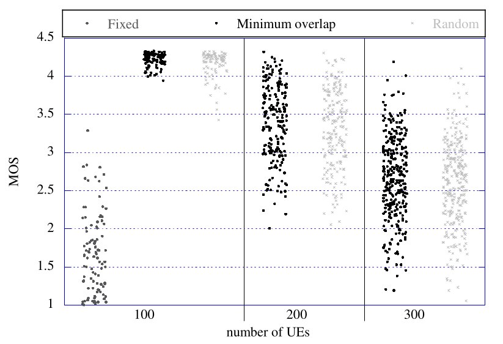

We can also make comparisons using scatter plots.

In this case the graph become _bi-dimensional_, with each point being identified
as a set of coordinates $(x, y)$, where $x$ is the value of the metric for
system $A$ and $y$ for system $B$.

This is similar to the ECDF comparison, but the advantage of this method is that
we can compare **instance by instance**, and not just the _overall distribution_.

Another advantage is that scatter plots are able to easily compare instance of
_very different order of magnitudes_ by using logarithmic scales.

Incidently, there is an additional bonus: by measuring a one-axis-distance between
a point and the bisector $\vert y_i - x_i \vert$, we can easily see the
_order of magnitude_ of the optimisation.

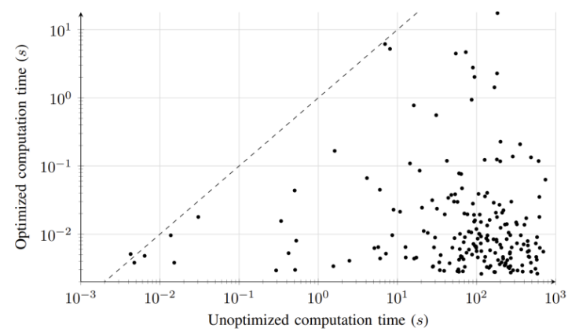

### 2.2.4. Box Plots

Also called _box and whiskers_, they are a way to visualize the
**distribution of a sample**.

They consist in plotting:

- A **box** whose edges are in the $1^{st}$ and $3^{rd}$ **quartiles** ($25^{th}$
  and $75^{th}$ _percentiles_). We call them $Q_1$ and $Q_3$ respectively.
- A **line** representing the **median** (i.e., the $2^{nd}$ quartile, or $50^{th}$
  percentile) of the sample.
- Two **whiskers** that extend from the box representing something different
  according to different conventions.

Common practices for the _whiskers_ are:

- **Maximum** and **Minimum** values of the sample (i.e., $X_{(n)}$ and $X_{(1)}$)
- The $2^{nd}$ and $98^{th}$ percentiles of the sample
- The lowest datum still within $1.5 \cdot (Q_3 - Q_1)$ of the lower quartile, and
  the highest datum still within $1.5 \cdot (Q_3 - Q_1)$ of the upper quartile.
  Where $Q_3 - Q_1$ is called the **interquartile range** (IQR).

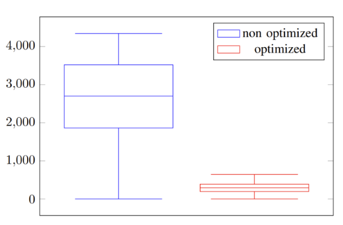

## 2.3. Lorenz Curves

All the plots we described until now can be used to compare alternatives.

However, sometimes it is useful to access the **variability** of a sample, i.e.
how _dispersed_ a sample is.

This can happen for several reasons, but in general we might want for the output
of a system to be **perfectly regular**.

For instance, we would expect all customers making the same request to a web server
to observe, statistically speaking, the same performance (i.e., the same response
time).

The ideal situation would then be that every customer experiences **the same response
time**.

This will not happen in practice, because of several causes (e.g, queuing of
near-simultaneous requests, disk swaps, different TCP congestion windows for
different connections, cache hits/misses, etc.) that will affect different customers
in a different way.

We would then like to quantify how **unfair** our system is, by quantifying
the **variability** of the output.

A good way to do so is to plot a **_Lorenz Curve_**.

Before explaining how to plot it, it is fundamental to remember that this plot
<strong><em><u>only works with non-negative RVs</u></em></strong>.

That said, the **Lorenz Curve** is defined as follows:

1. Sort the sample and get the **ordered statistics** $X_{(1)} \le X_{(2)} \le \ldots
\le X_{(n)}$.
2. Compute the **sum total of the sample**: $T = \sum_{i=1}^{n} X_{(i)}$.
3. Plot the points as follows:
   $$
     \left(\frac{i}{n}, \frac{\sum_{i=1}^{j} X_{(i)}}{T}\right), \quad 1 \le j
   \le n
   $$
4. Interpolate the points assuming $(0, 0)$ as the **first point of the curve**.

Obviously, the last point of the curve will be $(1, 1)$.

After plotting the curve, we can make some assumptions based on its shape:

- If all the values were _equal_, the LC would be the **bisector of the first
  quadrant**. This is called the **line of maximum fairness**, and should be
  plotted for reference.
- If $T = X(n)$ and all the other values are _null_, then the LC follows the
  x-axis until point $\left(1 − \frac{1}{n}, 0\right)$, and then goes up to
  point $(1,1)$. Therefore, the x-axis and the vertical line passing through
  $(1,0)$ are a **lower bound** for the LC. They are called the **line of
  maximum unfairness**, and should be plotted as a reference too.

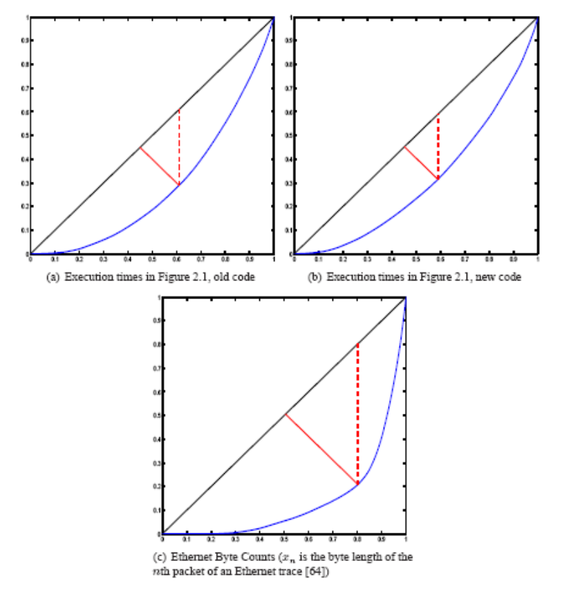

Note that this plot allows us to compare two alternatives **as for variability**,
but tells us nothing about other metrics (e.g., average, maximum, etc.).

## 2.4. Summarizing Data

Quite often we are requested to provide **as few numbers as possible** to describe
the performance of a system.

This is useful, for instance, for comparisons, as well as for ease of storage.

### 2.4.1. Indexes of Central Tendencies

Three popular alternatives are to specify one of the **Three Indexes of Central
Tendencies**: _sample mean_, _median_ and _mode_.

#### 2.4.1.1. Sample Mean

We define the **sample mean** as:

$$
\overline{X} = \frac{1}{n} \sum_{i=1}^{n} X_i
$$

$\overline{X}$ is itself a **random variable** that estimates the **population mean**
$\mu$.

Thus, it has itself a _mean_ and a _variance_ (we suppose $X_i$ to be IID):

- $E[\overline{X}] = \frac{1}{n} \cdot E[\sum_{i=1}^n{X_i}] = \frac{1}{n}
  \cdot n \cdot E[X_i] = \mu$
- $\operatorname*{Var}(\overline{X}) = \operatorname*{Var}\left(\frac{1}{n}
\sum_{i=1}^{n} X_i\right) = \frac{1}{n^2} \cdot n \cdot \sigma^2 =
\frac{\sigma^2}{n}$

These results are compliant with the CLT: with a larger the sample
$\overline{X} \sim \mathcal{N}(\mu, \frac{\sigma^2}{n})$. (if $X_i$ are not
_heavy-tailed RVs_).

If we extend the sample width even more, the more $\overline{X}$ _will
converges_ to a
RV equal to the population mean $\mu$ with **no variance**.

Of course, if $X_i$ were normal from the beginning, $\overline{X}$ would be
normal for any sample width $n$.

Therefore, **at least** for _large values_ of $n$ it is:

$$
\frac{\overline{X} - \mu}{\sigma / \sqrt{n}} \sim \mathcal{N}(0, 1)
$$

#### 2.4.1.2. Sample Median

The **sample median** is obtained from the **ordered statistics**
$\left(X_{(1)}, X_{(2)}, \ldots, X_{(n)}\right)$ as follows:

- If $n$ is _odd_, then observation $X_{(\lceil n/2 \rceil)}$ is the median.
- If $n$ is _even_, then the median is the average of the two middle observations
  $X_{(n/2)}$ and $X_{(n/2 + 1)}$.

#### 2.4.1.3. Sample Mode

The **sample mode** is the values that **_appears most frequently_** in the
sample, i.e. the value with the _highest probability_.

It should not be estimated directly on a sample, but should be sampled on a
**histogram**, as the _midpoint of the bucket_ with the highest number of observations.

Keep in mind that the sample mode is the only one of the three that **may not
be unique**.

#### 2.4.1.4. Usage

The question that now rises is which of the three indexes is the best to use.

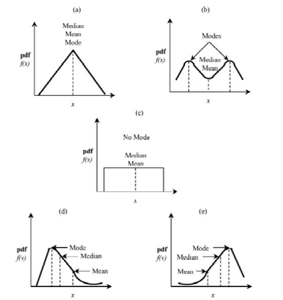

In general, like everything, it **depends on the distribution of the sample**.

Common sense says that:

- If the distribution is _symmetric_, the _mean_ and the _median_ are **the same**
- _Mode_ may not be unique
- _Mean_ is **additive**, while the others aren't

Maybe on of the most important observation is that the _sample mean_ is
**sensitive to outliers**. If we have a _small_ sample, then _few outliers_ (e.g.,
garbage collection or network congestion) can _drastically change_ it, while the
median and mode are **very robust** to outliers.

This means that if the distribution is **very skewed** (or has a _long tail_)
the median will be _more representative_ of the sample than the mean.

This is easy to prove.
Suppose we have a sample of $n$ observations, whose sample mean is $\overline{X}$.
If $n$ is _off_, meaning the sample median is $X_{0.5} = X_{(\lceil n/2 \rceil)}$.

Assuming we add to the sample one more observation, whose value is $O$.

The new mean will become:

$$
\overline{X}' = \frac{n \cdot \overline{X} + O}{n + 1}
$$

Now, if the two _addenda_ are comparable (e.g., small sample, or large $O$), the
mean **can change significantly**.

On the other hand the new median becomes:

$$
\large
X'_{0.5} = \begin{cases}
  \frac{X_{(\lceil n/2 \rceil)} + X_{(\lceil n/2 \rceil + 1)}}{2} = X_{0.5} +
\frac{X_{(\lceil n/2 \rceil + 1)} - X_{(\lceil n/2 \rceil)}}{2}
& O \ge X_{0.5}  \\
  \frac{X_{(\lceil n/2 \rceil -1)} + X_{(\lceil n/2 \rceil)}}{2} = X_{0.5} -
\frac{X_{(\lceil n/2 \rceil)} - X_{(\lceil n/2 \rceil -1)}}{2}
& O \le X_{0.5} \\
\end{cases}
$$

We can see that $O$ **does not appear** in the final result, hence the median is
_unaffected_ by the magnitude of it.

## 2.5. Indexes of Dispersion

As for the indexes of central tendencies we have seen so far, there are alternatives
for **Indexes of Dispersion** too.

The most common are **range**, **sample variance**, **sample standard deviation**,
**sample coefficient of variation**, <strong>10th and 90
thpercentiles</strong>, **semi-interquartile range**,
**mean absolute deviation** and **Lorenz Curve Gap**.

### 2.5.1. Range

The **range** is the _difference between the maximum and minimum_ of the sample
$X_{(n)} - X_{(i)}$.

This value **should not be used**, **_unless_** there is reason to believe that
the RV we are sampling is **bounded**, and we need to estimate those bounds.

Otherwise, the range will tell us nothing significant since it will:

- Be equal to a very large outlier minus zero (non-zero variables)
- Be unstable, as it will keep growing with $n$
- Reveal nothing about what happens between the extremes

### 2.5.2. Sample Variance

The **sample variance** is defined as:

$$
S^2 = \frac{1}{n-1} \cdot \sum_{i=1}^n{\left(X_i - \overline{X}\right)^2}
$$

It is provable that $S^2$ is a RV as well, but for our sake we can just take
this information as true without proof.

We just need to know that with this definition $E[S^2] = \sigma^2$.

The reason for the $(n-1)$ instead of $n$ at the denominator is that **only**
$\mathbf{n - 1}$ of the differences $\left(X_i - \overline{X}\right)$ are independent,
while the $n$-th one depends on the others.

For this reason, it is normally said that the **number of degrees of freedom for
the variance** is $n-1$ for a sample of $n$.

### 2.5.3. Sample Standard Deviation and Sample Coefficient of Variation

The **Sample Standard Deviation** is of course defined as the **square root of the
sample variance** $S$.

It is also common to use the **Sample Coefficient of Variation (CoV)**:

$$
C = \frac{S}{\overline{X}}
$$

This can be expected to approximate the **population CoV**:

$$
\chi = \frac{\sigma}{\mu}
$$

Note that this is only meaningful for **non-negative RVs** with well-defined unit
(mass, length, etc.).
In those cases it is also called **ratio-scale measures** since it makes sense to
take ratios of measures.

For these, the CoV is bounded by $0 \le C \le \sqrt{n-1}$.

These are cases of distribution in which **variance is infinite**, meaning for
**heavy-tailed distributions**.

> [!NOTE]
> All infinite variance RVs are HT, but not all HT RVs have infinite variance

We can observe these RVs more frequently that we might expect, and for those
there is a risk that the CoV will increase indefinitely with $n$, making
comparison through the CoV meaningless.

An interesting fact is that the $CoV$ for an exponential RV should be equal to $1$,
regardless of the value of $\lambda$.

The CoV is normally used with **Continuous distributions**, and its homologous for
**non-negative discrete distributions** is the **Sample Index of Dispersion (IoD)**
(often called **Lexis Ratio**).

The IoD is defined as $L = \frac{S^2}{\overline{X}}$, which approximates the
population IoD $\Lambda = \frac{\sigma^2}{\mu}$.

We can easily check that the IoD is:

- $L = 1$ for a **Poisson RV**
- $L = (1 - p) < 1$ for a **Binomial RV**
- $L = \frac{1}{p} > 1$ for a **Geometric RV**

Note that both CoV and IoD tend to be **unstable** if the sample mean is
_close to zero_.

### 2.5.4. Sample Percentiles

**Sample Percentiles** (or **quantiles**) can be computed from the _ordered statistics_.

Strangely enough, there is **no standard way** to compute percentiles, but rather
three or four different ways that whose results **agree when the sample is large**.

However, on small samples, we can observe significant differences.

For the following examples, we will consider a sample of 5 $X_{(1)}, X_{(2)},
X_{(3)}, X_{(4)}, X_{(5)}$.

We can readily state that the 20-th percentile is $X_{(1)}$, but it is hard to
understand what the 35-th percentile would be.

To solve this problem, as we said before, there are several methods:

- **Next Higher**: on a sample of $n$, looking for the $p$-quantile we take
  $X_{\left(\lceil n \cdot p \rceil\right)}$.
- **Linear Interpolation**: on a sample of $n$, looking for the $p$-quantile we
  make some linear interpolation between the two adjacent values, and then
  we calculate on the point we want. In this case, for the 35-th percentile
  we would interpolate between $X_{(1)}$ and $X_{(2)}$.

The problems with this approach is that if we consider $X_{(1)}$ as the 20-th
percentiles means that $X_{(5)}$ will be the 100-th percentile, aka the
biggest value of our distribution, which is a bold claim.

On the other end, considering $X_{(5)}$ as the 80-th percentile means that
$X_{(1)}$ will be the 0-th percentile, aka the smallest value of our distribution,
which is also a bold claim.

The correct procedure is then to consider the range of the ordered statistics
and **divide it in** $n$ **consecutive buckets** of equal width.

Each ordered statistic will represent the **mid-point** of each bucket.

| Ordered Statistic |  Bucket  | Midpoint |
| :---------------: | :------: | :------: |
|     $X_{(1)}$     |  0 - 20  |    10    |
|     $X_{(2)}$     | 20 - 40  |    30    |
|     $X_{(3)}$     | 40 - 60  |    50    |
|     $X_{(4)}$     | 60 - 80  |    70    |
|     $X_{(5)}$     | 80 - 100 |    90    |

In other words, having a sample of $n = 5$ means having the 10-th, 30-th, 50-th,
70-th and 90-th percentiles.

This is equivalent of using the following formula:

$$
  X_{(j)} \to \frac{j - 0.5}{n}
$$

### 2.5.5. Semi-Interquartile Range and Lorenz Curve Gap

The **semi-interquartile range** is defined as half the box height in a box plot:

$$
  \text{semi-IQR} = \frac{Q_3 - Q_1}{2}
$$

Le **Lorenz Curve Gap** is defined as the _maximum vertical distance_ between the
bisector and the LC:

$$
LCG = \max_{0 \le j \le n} \left(\frac{j}{n} -
\sum_{i=1}^{j} \frac{X_{(i)}}{n} \cdot \overline{X}
\right) = \frac{1}{2\overline{X}} \cdot
\frac{\sum_{i=1}{n} \vert X_i - \overline{X} \vert}{n}
$$

Where the second term $\left(\frac{1}{n} \cdot \sum_{i=1}{n} \vert X_i -
\overline{X} \vert\right)$, is called **Mean Absolute Deviation (MAD)**, and
is a measure of the _average distance_.

The LCG, like the CoV, normalizes a measure of variability to an _index of
central tendency_, making it **dimensionless** and allowing for **comparison**
between different samples.

### 2.5.6. Using the correct index

With indexes of dispersion, its important to know when to use one or the other.

Summarizing our alternatives, we can say that:

- **Robustness to outliers**: range is the most vulnerable. Variance and STD may
  also be affected by them, while IQR is almost insensitive.
- **Bounded Variables**: range may be the best choice.
- **Symmetric and Unimodal Variables**: variance (or STD, CoV) may be a good choice,
  unless the distribution has **heavy-tails**, in which case the LCG is preferable.
- **Highly Skewed and Likely outliers**: percentiles and IQR are the best choice.

## 2.6. Fitting a Distribution

A good way to summarize a sample is to state from **what distribution it is
(likely to be) sampled**.

For instance, sayng that our sample ha a mean of $13$ and variance $48$ says
**considerably less** that saying it is $\sim U(1, 25)$.

The problem is how to choose the theoretical distribution our sample should fit.

Quite often, the choice is **not entirely wild**, since we can have a rough
idea of the underlying phenomena that generated the sample.

If, instead, we have **absolutely no idea**, we can always start by using
simple tricks:

- **Compute statistics**: meaning computing **sample mean, median, variance
  and CoV**. For instance, if $\overline{X} \approx X_{0.5}$ then there is a
  good chance we are dealing with a symmetric distribution. Instead, if they are
  significantly different, we will know that our distribution is skewed.
  **CoV**/**IoD** can also be useful. For instance, in an _exponential distribution_
  the CoV is $1$.
- **Draw histograms**: it will allow us to **estimate PDF** or **PMF**. Some
  of them have a easily recognizable shape (the exponential, the Normal, the
  uniform, etc.), while others are more difficult to identify.

What we must avoid doing is to **compare the ECDF with the one of a theoretical
distribution**, since most **CDFs have an S shape**.

Once we have selected one or few candidates, the easiest way to test whether our
distribution fits the theoretical one is to make a **visual test using QQ-plots**.

### 2.6.1. QQ Plots

QQ-plots are a way to compare **quantiles** of two distributions:

- **X-axis**: quantiles of the "theoretical" distribution $t_{(1-i)}$
- **Y-axis**: quantiles of the "sample" distribution $q_{(1-i)}$

Thus every point is $\left(t_{(1-i)}, q_{(1-i)}\right)$, where $i$ is the _quantile
level_.

The visual test is the following: If the QQ-plot is **approximately a straight
line**, then the two distributions are _similar_, meaning out theoretical distribution
is **consistent with our sample data**.

We already know how to evaluate the ordinates of the points, since we have
already seen how to easily compute **sample quantiles**:

$$
  X_{(j)} \to \frac{j - 0.5}{n}
$$

If the theoretical distribution has an **invertible CDF**, then its quantiles can
be computed quite easily too.

In fact, since $p = F(x)$, then $t_{(1-i)} = F^{-1}(i)$.

For example, the $i$-quantile of an $Exp(\lambda)$ is obtained by solving:

$$
i = 1 - e^{-\lambda \cdot t_{(1-i)}} \quad \rArr \quad
t_{(1-i)} = -\frac{\log{(1-i)}}{\lambda}
$$

Instead, if the CDF is **not known in a closed form** (e.g., the Normal one), then
we can still obtain its quantiles from **tables**.

For the **Standard Normal Distribution**, a good approximation often used in
practice is the following:

$$
t_{1-i} \approx 4.91 \cdot \left(i^{0.14} - (1-i)^{0.14}\right)
$$

Of course, if we are dealing with a _non-standard Normal_ $F \sim \mathcal{N}(\mu,
\sigma)$, we can use the _standardization_ trick:

$$
t_{1-i}' = \mu + \sigma \cdot t_{i}
$$

Interestingly enough, QQ plots often don't even need to know the **parameters of
the theoretical distribution**. This is true every time the effect of the parameter
is just to **rescale or offset the quantiles**.

In this case, assuming a _default value_ will still give us a straight like,
just with a different slope and/or offset.

This is not important for us, since the only thing we look for is **the linear pattern**.

### 2.6.2. Example: Normally Distributed Sample

> Consider the following sample of $8$, and check if it is normally distributed

 

|  j  | Quantile number | ord. Stat | normal q |
| :-: | :-------------: | :-------: | :------: |
|  1  |     0.0625      |   -0.19   |  -1.535  |
|  2  |     0.1875      |   -0.14   |  -0.885  |
|  3  |     0.3125      |   -0.09   |  -0.487  |
|  4  |     0.4375      |   -0.04   |  -0.157  |
|  5  |     0.5625      |   0.04    |  0.157   |
|  6  |     0.6875      |   0.09    |  0.487   |
|  7  |     0.8125      |   0.14    |  0.885   |
|  8  |     0.9375      |   0.19    |  1.535   |

 

The first thing is to compute the ordered statistic and assign them quantiles
$\frac{j - 0.5}{n}$.

Then we use the formula seen before to compute the quantiles of the standard
Normal.

Finally, we plot the points $\left(t_{(1-i)}, q_{(1-i)}\right)$ and check if they
show good linearity.

The regression analysis (done automatically by Excel) computes the means to be (almost)
null, and the standard deviation to be around $0.1369$.

<figure class="40">
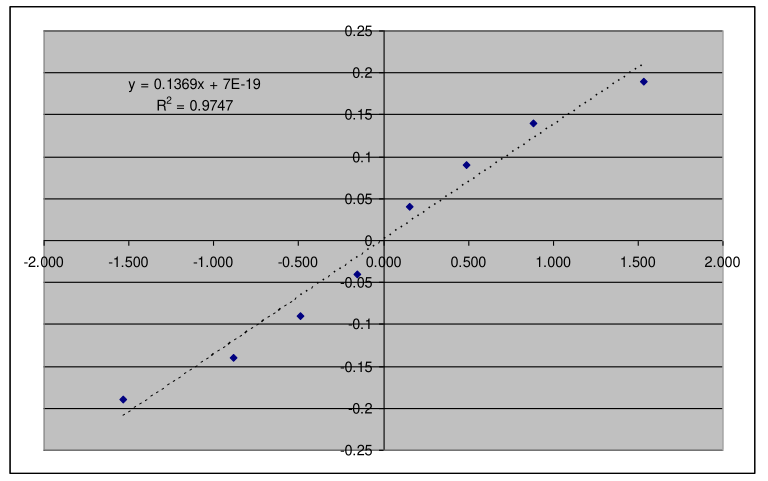
<figcaption>

Excel also gives a value $0 \le R^2 \le 1$ which indicates how well the points fit
a straight line.  
In this case, $R^2 = 0.9747$.

</figcaption>
</figure>

If we had not taken the middle point of the buckets as our quantiles, but
instead the _upper end of he bucket_ (i.e, $j/n$), the quantiles would be:

 

|  j  | Quantile number | ord. Stat | normal q |
| :-: | :-------------: | :-------: | :------: |
|  1  |      0.125      |   -0.19   |  -1.535  |
|  2  |      0.25       |   -0.14   |  -0.885  |
|  3  |      0.375      |   -0.09   |  -0.487  |
|  4  |       0.5       |   -0.04   |  -0.157  |
|  5  |      0.625      |   0.04    |  0.157   |
|  6  |      0.75       |   0.09    |  0.487   |
|  7  |      0.875      |   0.14    |  0.885   |
|  8  |        1        |   0.19    |  1.535   |

 

With the plot that becomes like this:

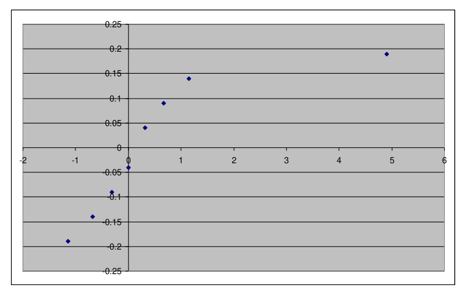

We could also encounter different outcomes.

For example, when comparing to a Normal distribution, we could get a **S shape**,
which is a typical case with **_shorter tails_**.

This might happen often, since in many cases the variables are bounded, while
the Normal has infinite tails.

If this happens, a good next step is to test for a **Uniform Distribution**.

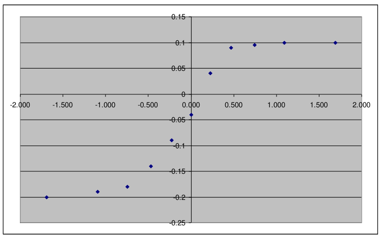

Instead, if the tails of the Normal QQ plot go **up and down** there is a
chance that a distribution with **heavier tails** may yield a better fit
(e.g., log-normal or Pareto).

As a counter-proof we could check the original sample of 8 to check if it matches
a **Uniform Distribution**.

We might as well assume $U(0,1)$ since we already ascertained this changes nothing.

The QQ plot is as follows:

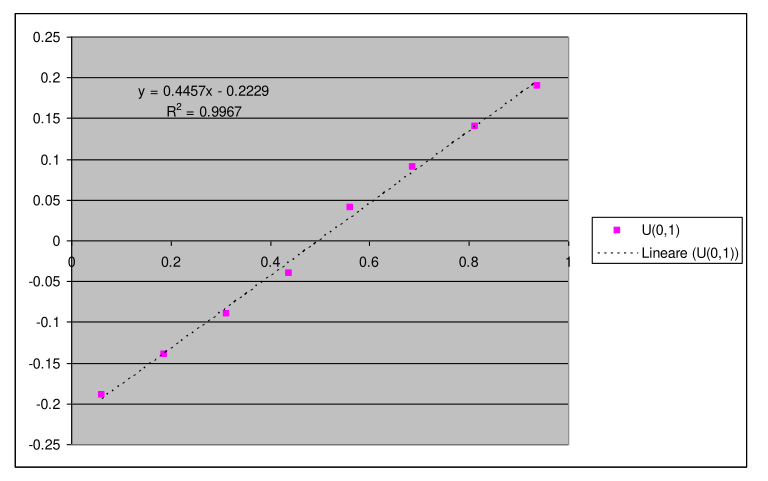

Now we notice that our sample shows **almost perfect linearity**.

This means that our sample could equally well have been taken from:

- $\mathcal{N}(0, 0.13)$
- $U(-0.203, +0.203)$

The main goal becomes to discriminate between the two samples.

In this case the solution is simple: **get a larger sample**, since eight points
will fit to almost everything.

### 2.6.3. Algebraic Tests

To assert whether or not data from a sample match a given distribution there
are also _tests relying on algebra_.

The most well-known are:

- **Chi-Square Test**
- **Kolmogorov-Smirnov Test**

They are **not easy to use** and they require _a lot of hypotheses_ and _practice_
to be able to interpret the results.

Moreover, these require the **matching theoretical distribution to be _entirely
specified_**, meaning that we need to know the parameters of the distribution
we want to test against.

## 2.7. Confidence Intervals

As part of the **scientific method** we are duty-bound to **_show the accuracy of
a measurement_** whenever we produce one.

We can **lie blatantly** by _omitting to state the accuracy_ of a measurement.

Especially when we are dealing with **random variables and samples**, we never
know how much of the result we are claiming is due to **luck** (i.e., a
_particularly lucky sample_).

Assume for example that we get two samples of the same measure from
two systems $A$ and $B$, and we compute the mean for both, let it be $\overline{X}_A$
and $\overline{X}_B$.

Suppose, we find $\overline{X}_A > \overline{X}_B$, since the sample means
estimate the _population mean_, we can conclude that **system A performs
better than B**.

However, if we manipulate our data, we can obtain that the interval where we are
extracting our samples are very different, for example by inserting a 95% confidence
interval just for one of the two systems, using data too variable or sample
too small).

By doing so, the **accuracy** of our statistic and our conclusion simply **do not
hold anymore**.

Instead, if the two samples are taken from both 95% confidence intervals, we
can be **95% sure** that the _true population mean_ follows our claim.

> [!IMPORTANT]
> Every statistic taken from a sample is itself a **random variable**.  
> Therefore, its accuracy must be **_always_** _quantified_ and reported in the
> form of a **confidence interval**.

### 2.7.1. Computing Confidence Intervals

We define $[l, h]$ a **confidence interval** for parameter $\beta$ at level
$(1-\alpha)$ if:

$$
P\Set{l \le \beta \le h} \ge (1-\alpha)
$$

A **confidence interval** at level $(1-\alpha)$ is an interval where we have
_a probability of at least_ $(1-\alpha)$ to find the parameter we are estimating
using our sample statistics.

The value $(1-\alpha)$ is called the **confidence level** of the interval, and
it is typically values such as $90\%, 95\%, 98\%, 99\%$.

Confidence intervals are computed differently from a sample of IID RVs, depending
on what parameter we want to estimate.

We will see two different methods, one for the **population mean** and one for the
**probability of success** of a Bernoulli experiment.

> [!warning]
> The methods we will see will only hold **under the assumption that the sample
> consists of IID RVs**, otherwise we will obtain _false conclusions_.

#### 2.7.1.1. Population Mean

Assuming we are dealing with a population with **finite mean and variance**, we
have defined the _sample mean_ to be:

$$
\overline{X} = \frac{1}{n} \sum_{i=1}^{n} X_i
$$

And found that $E[\overline{X}] = \mu$ and $\operatorname*{Var}(\overline{X})
= \frac{\sigma^2}{n}$.

We also stated that $\overline{X} \sim \mathcal{N}\left(\mu,
\frac{\sigma^2}{n}\right)$ for either _large_ $n \ge 30$, or if each $X_i$ is Normal.

A ineficcient way to compute a 90%-CI for the sample mean is to:

1. Take $k$ independent samples of $n$ observation each
1. Compute the sample means of each of the $k$ samples, $\overline{X}_1,
\overline{X}_2, \ldots, \overline{X}_k$
1. Compute the 5-th and 95-th percentiles of the $k$ sample means

A more efficient use of the amount of information that is inherent in a sample
of $n$ IID RVs can be done by leveraging the **sample variance** we defined as:

$$
S^2 = \frac{1}{n-1} \cdot \sum_{i=1}^n{\left(X_i - \overline{X}\right)^2}
$$

We found that $E[S^2] = \sigma^2$, and that, **only if the sample is large**
$(n \ge 30$)$ then:

$$
\frac{\overline{X} - \mu}{S / \sqrt{n}} \sim \mathcal{N}(0, 1)
$$

Even if we don't know $\sigma$ we can estimate it using $S^2$, hoping that if $n$
is large:

$$
Z = \frac{\overline{X} - \mu}{S / \sqrt{n}} \sim \mathcal{N}(0, 1)
$$

In this case, the (symmetric) interval that defines an area equal to
$(1-\alpha)$ in the Standard Normal is the one colored in the figure.

The point that leaves out a right tail with an area equal to $0.025$, i.e. the
one such that $P\Set{Z > z_{0.025}} = 0.025$ is the 97.5-th percentile of the
Standard Normal, and is equal to $z_{0.025} = 1.96$.

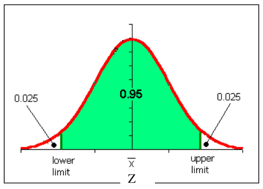

Therefore, the interval $[-z_{0.025}, z_{0.025}]$ includes $Z$ with 95% probability.

More in general, we take the $(1-\alpha / 2)$ percentile, and we can write:

$$
\begin{align*}
  P\Set{-z_{\alpha / 2} \le \frac{\overline{X} - \mu}{S/ \sqrt{n}} \le
z_{\alpha / 2}} &= 1 - \alpha \\
  P\Set{\overline{X} - z_{\alpha / 2} \cdot \frac{S}{\sqrt{n}} \le \mu \le
\overline{X} + z_{\alpha / 2} \cdot \frac{S}{\sqrt{n}}} &= 1 - \alpha
\end{align*}
$$

Therefore, the $(1-\alpha)$ level confidence interval for the population mean
$\mu$ is:

$$
\left[\overline{X} - z_{\alpha / 2} \cdot \frac{S}{\sqrt{n}}, \overline{X} +
  z_{\alpha / 2} \cdot \frac{S}{\sqrt{n}}\right]
$$

This will hold only if the population has a _finite variance_ and the _sample
is large_.

If the sample is small, we can apply this method **only if the population consists
of Normal RVs**.

In this case, we take for granted that for Normal RVs:

$$
(n-1) \cdot \frac{S^2}{\sigma^2} \sim \chi^2_{n-1}
$$

Meaning that the sample variance is distributed like a chi-square with $n-1$
degrees of freedom.

Moreover, since $\overline{X}$ and $S^2$ are independent, we have that:

$$
T = \frac{\overline{X} - \mu}{S / \sqrt{n}} \sim t_{n-1}
$$

Therefore, we can immediately obtain that:

$$
\begin{CD}
{
P\Set{\overline{X} - \frac{S}{\sqrt{n}} \cdot t_{\alpha / 2, n-1} \le \mu \le
\overline{X} + \frac{S}{\sqrt{n}} \cdot t_{\alpha / 2, n-1}} = 1 - \alpha
} \\
@VVV \\
{
  \left[\overline{X} - \frac{S}{\sqrt{n}} \cdot t_{\alpha / 2, n-1},
\overline{X} + \frac{S}{\sqrt{n}} \cdot t_{\alpha / 2, n-1}\right]
}
\end{CD}
$$

Of course, the larger the sample, the **higher the number of degrees of freedom**
in the Student's T distribution, hence the _smaller percentiles_ $t_{\alpha /
2, n-1}$, and the _narrower_ the confidence interval.

Not that the CI depends on $n$ through:

- $t_{alpha / 2, n-1}$: the higher $n$, the smaller the value, down until a
  lower bound $z_{alpha / 2}$ for $n \to \infty$.
- $\sqrt{n}$: the higher $n$, the smaller the interval.
- Possibly $\overline{X}, S$, which can however expected to be **stable** with $n$.

This means that we the CI is expected to get **narrower** when we increase the sample
width.

To better understand what a CI really is, we have to remember that it is a **random
measure** of a(n unknown) estimated constant parameter.

Therefore computing the 95% CI for the population mean means:

> If we take 100 different samples, and compute the CI for the population
> mean, then:
>
> - 95 times out of 100 the population mean will be **within** that CI
> - - 5 times out of 100 the population mean will be **outside** that CI

##### 2.7.1.1.1. Exercise: Signal and Noise

> Suppose that a signal having value $\mu$ is transmitted from location $A$.
> The value received at location $B$ is a Normal Noise with null mean and
> unknown variance $\sigma^2$.
> To reduce the decoding error, suppose the same value is sent $9$ times, with
> the successive values received being: $5, 8.5, 12, 15, 7, 9, 7.5, 6.5, 10.5$
>
> a) Construct a 95% CI for $\mu$  
> b) Repeat the above assuming $\sigma^2 = 4$  
> c) Is it possible to state in advance whether one of the two confidence
> intervals will be smaller than the other?

The sample is **small**, however it consist of **Normal RVs**, meaning we can
apply the above method.

We can start by calculate the sample mean and variance:

$$
\begin{align*}
\overline{X} &= \frac{5 + 8.5 + 12 + 15 + 7 + 9 + 7.5 + 6.5 + 10.5}{9} = 9.0 \\
S^2 &= \frac{1}{9-1} \cdot \sum_{i=1}^{9}{x_i^2 - 9 \cdot 9^2} = 9.5 \\
S &= \sqrt{9.5} \approx 3.082
\end{align*}
$$

Then, we have to compute the values such that:

$$
\begin{align*}
P\Set{-t_{\alpha/2, n-1} \le \frac{\overline{X} - \mu}{S / \sqrt{n}} \le
t_{\alpha/2, n-1}} &= 1 - \alpha \\
P\Set{\overline{X} - t_{\alpha/2, n-1 } \cdot \frac{S}{\sqrt{n}} \le \mu \le
\overline{X} + t_{\alpha/2, n-1} \cdot \frac{S}{\sqrt{n}}} &= 1 - \alpha
\end{align*}
$$

With $\alpha = 0.05$, this means that $t_{0.025, 8} = 2.306$ and the interval is:

$$
CI_a = \left(6.63; 11.37\right)
$$

On point b) we know know that $\sigma^2 = 4$, meaning that we can we use the
Normal Distribution instead of the Student's T, specifically:

$$
G = \frac{\overline{X} - \mu}{\sigma / \sqrt{n}} \sim \mathcal{N}(0, 1)
$$

Meaning:

$$
\begin{align*}
  P\Set{-z_{\alpha/2} \le \frac{\overline{X} - \mu}{\sigma / \sqrt{n}} \le
z_{\alpha/2}} &= 1 - \alpha \\
  P\Set{\overline{X} - z_{\alpha/2 } \cdot \frac{\sigma}{\sqrt{n}} \le \mu \le
\overline{X} + z_{\alpha/2} \cdot \frac{\sigma}{\sqrt{n}}} &= 1 - \alpha
\end{align*}
$$

With the above values we have that $z_{0.025} = 1.96$ and the interval is:

$$
CI_b = (7.69; 10.31)
$$

To answer point c) we have calculated that $CI_b < CI_a$, meaning that the confidence
interval is **smaller**.

We knew that $z_{\alpha / 2} < t_{alpha / 2, n-1}$, with the first being the
lower bound of the second when $n \ge 30$, meaning that we could have expected
the second interval to be smaller than the first.

However, **we could not have known it in advance** since we were not sure
whether $S$ was bigger/smaller/equal to $\sigma$.

#### 2.7.1.2. Paired Experiments

A common use of CIs is to test if a **measure is significantly different from zero**,
for example as it happens with **_Paired Experiments_**.

Paired experiments are when two systems $A$ and $B$ are given in input
**the same workloads** and measured for the same statistics.

In this case, one gets **two paired samples**, namely the $n$ responses of $A$ and
those of $B$.

However, since there is a 1:1 correspondence between each point in the sample,
we can compute the **difference of the responses** and treat it as a **single sample**.

If that difference is **significantly different from zero**, then we can
conclude that _one system is better than the other_.

##### 2.7.1.2.1. Example: Paired Experiments

> Consider a paired experiment where systems $A$ and $B$ are given the same six
> workloads as an input. Their response times are measured, and the measures are
> as in the table.
>
> Explain if $A$ is better than $B$ with a confidence of 90%.

|                |  $A$  |  $B$  | $D = A - B$ |
| :------------: | :---: | :---: | :---------: |
|      $1$       |  5.4  | 19.1  |    -13.7    |
|      $2$       | 16.6  |  3.5  |    13.1     |
|      $3$       |  0.6  |  3.4  |    -2.8     |
|      $4$       |  1.4  |  2.5  |    -1.1     |
|      $5$       |  0.6  |  3.6  |     -3      |
|      $6$       |  7.3  |  1.7  |     5.6     |
| $\overline{X}$ | 5.32  | 5.63  |    -0.32    |
|     $S^2$      | 38.22 | 44.06 |    81.62    |
|      $S$       | 6.18  | 6.64  |    9.03     |

Before we even start, we must denote that:

- $n$ is small
- $S$ is big

Just these information should suggest that it is not possible to assert that
$A$ is better than $B$ with a 90% confidence.

However, we will still do the calculation for the sake of the example.

The first step, since $n = 6 \le 30$, is to check if the difference
is approximately Normal.

We can check it with a QQ-plot.

<figure class="60">
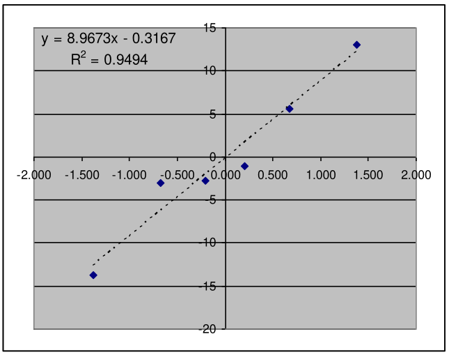
<figcaption>

With $n = 6$ almost everything will give us a linear equivalence.

</figcaption>
</figure>

The QQ plot confirms the sample is approximately Normal, so we can proceed with
the calculation of the 90% CI:

$$
\begin{align*}
  \left[\overline{X} - t_{\alpha / 2, n-1} \cdot \frac{S}{\sqrt{n}},
\overline{X} + t_{\alpha / 2, n-1} \cdot \frac{S}{\sqrt{n}}\right] &= \\
  \left[-0.32 - t_{0.05, 5} \cdot \frac{9.03}{\sqrt{6}}, -0.32 + t_{0.05, 5}
\cdot \frac{9.03}{\sqrt{6}}\right] &= \\
  \left[-0.32 - 2.015 \cdot \frac{9.03}{\sqrt{6}}, -0.32 + 2.015 \cdot
\frac{9.03}{\sqrt{6}}\right] &= \left[-7.75, +7,11\right]
\end{align*}
$$

Therefore, we cannot say with 90% confidence that A is better than B, since
in our interval $D$ can assume values with both signs.
