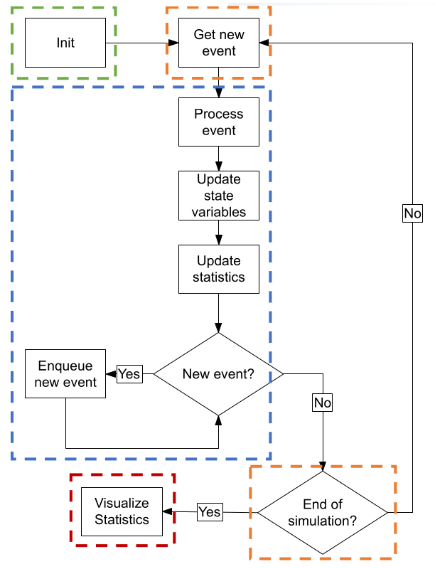
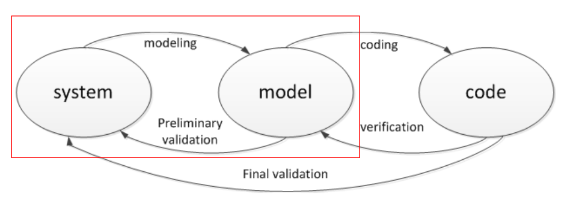

# 1. Index

<!--toc:start-->

- [1. Index](#1-index)
- [2. Systems](#2-systems)
  - [2.1. Performance Evaluations](#21-performance-evaluations)
- [3. Simulations](#3-simulations)
  - [3.1. Types of Simulations Model](#31-types-of-simulations-model)
  - [3.2. How to build a Good Simulator](#32-how-to-build-a-good-simulator)
  - [3.3. Event Queue](#33-event-queue)
  - [3.4. Components of a Simulator](#34-components-of-a-simulator)
    - [3.4.1. Example: Router Simulation](#341-example-router-simulation)
  - [3.5. Implementing the Event Queue](#35-implementing-the-event-queue)
    - [3.5.1. Min-Heap Tree](#351-min-heap-tree)
    - [3.5.2. Calendar Queue](#352-calendar-queue)
  - [3.6. Give Inputs](#36-give-inputs)
    - [3.6.1. Trace-Driven Simulations](#361-trace-driven-simulations)
    - [3.6.2. Self-Driven Simulations](#362-self-driven-simulations)
    - [3.6.3. Empirical Distribution Simulations](#363-empirical-distribution-simulations)
  - [3.7. Simulation Analysis](#37-simulation-analysis)
    - [3.7.1. Case Study: VoIP in 5G Network](#371-case-study-voip-in-5g-network)
    - [3.7.1.1. Defining the Objectives and Performance Indicators](#3711-defining-the-objectives-and-performance-indicators)
    - [3.7.1.2. Modeling the System](#3712-modeling-the-system)
    - [3.7.1.3. Validating the Model](#3713-validating-the-model)
    - [3.7.1.4. Defining the Factors](#3714-defining-the-factors)
    - [3.7.1.5. Select the Simulation Tool](#3715-select-the-simulation-tool)
    - [3.7.1.6. Implementation](#3716-implementation)
    - [3.7.1.7. Verification](#3717-verification)
      - [3.7.1.7.1. Fingerprinting](#37171-fingerprinting)
      - [3.7.1.7.2. Rubber-Duck Debugging](#37172-rubber-duck-debugging)
      - [3.7.1.7.3. Statistical Verification](#37173-statistical-verification)
      - [3.7.1.7.4. Usage of Animations and Graphs](#37174-usage-of-animations-and-graphs)
      - [3.7.1.7.5. Consistency, Degeneracy and Continuity Checks](#37175-consistency-degeneracy-and-continuity-checks)
      - [3.7.1.8. Calibrating the Simulator](#3718-calibrating-the-simulator)
      - [3.7.1.9. Experiment Design](#3719-experiment-design)
      - [3.7.1.10. Running Simulations](#37110-running-simulations)
      - [3.7.1.11. Data Collection and Analysis](#37111-data-collection-and-analysis)
      <!--toc:end-->

# 2. Systems

A **system** is the subject of our performance evaluations, and is defined as:

> A _collection of entities_ that act and interact together towards the
> accomplishment of some logical goal

The collection of entities that describes the system depends on the objective
of the evaluations. The same system might be analyzed based on different
entities in different cases.

The description of a system is given by its **State**, that might change over time.
Depending on how the state variable of system change, we define the system as:

- **Continuous System**: if the change are continuous over time
- **Discrete System**: if the change happen instantaneously at a given time

## 2.1. Performance Evaluations

When we do a performance evaluation of a system, we **monitor** its state over time.
This way we can understand how it _evolves over time_, trace its _statistics_,
or computing some _limit values_.

This can be done essentially in three ways:

1. **Measurements**: we can simply let the _real system_ (or a prototype) work and
   measure the output. The problem with this technique is that sometimes we do
   not have access to the system we want to analyze nor he are able to create
   prototype of it.
2. **Analytical Models**: We can set up an _analytical model of the
   system_ (i.e. _equations_) that binds the desired quantities. The problem with
   this technique is that it might be difficult to find these relations, and even
   more difficult to actually solve them. We can always simplify the sets of equations,
   abstracting and leaving only "important stuff", but identifying the things that
   are "important" is not always possible prior of starting.
3. **Simulations Models**: We can set up a _software replica_ of the system, giving
   it some input and recording the output it produces. This way we can replicate
   only the parts of the system that are meaningful to our analysis. The problem
   with this technique is often the prices of the resources needed to run the simulations.

Putting all together, ideally, we can build a simulation model of the system
and validate it by comparing its result with a analytical model in a
simple basic scenario. After a complete simulation study, we can start building
a prototype of the real system.

# 3. Simulations

Simulations means _**mimicking a system on a computer**_.

In order to do so we need a specific software, called _simulation software_ or _simulator_,
which goals are:

- Understanding the functioning of the system
- Predicting the behavior of the system
- Support decisions on the system
- Training on a system
- Entertaining

In order to classify a simulation model as a _good simulation model_, its
output must be sufficiently close to reality.

Therefore, our aim is to tweak the system to make the approximated output
similar to the real output (or at least statistically equivalent).

Provided we are able to obtain a good model, almost everything can be simulated.
The presence of a model can allow us to evaluate alternatives, for example
what happens if the link between the endpoints of a communication is an
Ethernet cable or a fiber optic cable, or the "experimental settings", allowing
to change everything the system interacts with, which is very hard in the real world.
Other things we are able to do are the evaluation the scalability assessment, measuring
what happens when we multiply the input (e.g., a number of users) by a factor $k$,
or the manipulation of timescales, simulating the evolution of the universe in
a few seconds/minutes, or observe how the instructions of a computer program
are fetched and executed by a processor, which will typically take times in
the order of nanoseconds.

One of the downsides of using simulated models is the presence of _stochastic quantities_:
assuming you are simulating the arrival of packets at a router, the length of
these packets and their inter-arrival times will often be generated randomly,
maybe following some probability distributions.
This means that the node throughput is itself a random variable. This means that
each measure obtained from the simulator will be a _sample of an output random
variable_, and should be treated as such.

Another downside of building simulator is the building itself. Writing down a
simulator can be very difficult.
Furthermore, simulation analysis (not writing down the code, but using that
code) requires a lot of time, and (mostly) a lot of experience.

It is difficult to realize that a simulator is nothing more than a replica of
a model of a system, and not of the system itself. This means that we are
simplifying things. Taking the wrong modeling steps in the modeling part, can
disrupt the entire work.

## 3.1. Types of Simulations Model

Simulations means different things to different people:

1. **Static vs. Dynamic**: in _static models_ the output is time-invariant and
   can be obtained as $y = f(x)$, where $f$ is the model, and $x$ the input. In
   _Dynamic models_ we are interested in observing how the model changes over
   time, adding the difficulty of replicating something that is supposed to
   happen as time progresses.
2. **Continuous vs. Discrete**: This depends on what we want to evaluate and how
   we want to do it.
3. **Deterministic vs. Stochastic**: in _deterministic models_ we do not have
   random components present. On the contrary, in _stochastic models_ random
   components will produce a set of random output from a given input.

We will work mainly with _**Discrete Event Simulators**_ (`DES`), which are
_dynamic_, _discrete_ and _stochastic_.

## 3.2. How to build a Good Simulator

The first step of building a good simulator is **identifying the state variables**.
Among these variables, since we are working with _discrete-event simulations_,
we must have a special variable that will be responsible to simulate the
flowing of time, called the **simulation clock**.

The whole simulation will then be running in **simulated time**, defined as:

> The time as measured **within** the simulation.

Simulated time (_st_) **is not** real time (_rt_), otherwise we would be
talking about _emulation_.
In order to simulate one second of _st_ we might need either more or less than
one second of _rt_.

In general, there is **no constant relationship** between the _rt-flow_ and the
_st-flow_.

To make time evolve in a simulator, we use the _simulation clock_.
In order to advance the _simulation clock_ we can follow different approaches:

1. **Next-event time advance (event-based)**: Simulated time advances only
   when an _event_ is processed. Supposing the event processes an event at time
   $t_1$. Processing the event itself implies _generating another event_ at time
   $t_2$. The system clock advances only based on the event sequence,
   therefore it is clear that _rt-duration_ of one second of _st-time_ varies
   depending on how many events are in that second.
2. **Fixed-increment time advance (quantum-based)**: the system clock advances by
   a _fixed quantum_ called $D$. At time $kD$, we process all the events that occurred
   between $(k-1)D$ and $kD$. This implies:
   - _Possible time waste_: if the granularity of events $\gg D$, we waste a
     lot of _real time_ just to advance the clock when nothing happens.
   - _Possible simultaneous processing_: if the granularity is $\ll D$, different
     events happening in the same _simulated time-slot_, will be processed at
     the same time. This allows us to use _discrete variable_ as temporal quantum.

Quantum-based simulations make sense if the system is **intrinsically time-discrete**.
Moreover, fixed-increments can be recreated by using _fake periodical events_
in \_event-based simulations.

For these reasons we will assume that our `DES` will use the **Next-Time
Advance Mechanism**.

## 3.3. Event Queue

An event is represented by a **Data Structure** that contains the following information:

- **Firing Time**: the time at which the event is scheduled to occur
- **Event Type**: the type of event (e.g., arrival, departure, etc.)
- **Other Data**: priority (needed in case of simultaneous events) and any additional
  information needed to process the event (e.g., customer ID, packet size, etc.)

Any discrete event simulator must maintain an **Event Queue**, which is a
priority queue that stores all the scheduled events in the **most efficient
possible way**.
The operation that **must** be supported by the event queue are:

1. Extraction of the _nearest future event_
2. Ordered insertion of a future event
3. Deletion of a future event

Event handling is a critical issue for system performance. Depending on ho efficiently
we perform the (de)queueing of events the RT that it takes for a simulation to
run can easily change by orders of magnitude.

## 3.4. Components of a Simulator

Since the purpose of simulating a system is to evaluate its performance, we
need to **collect statistics** about the system.

These are called **Statistical Counters**, and can be scalar values, time
series, histograms, ...

These counters, as state variables, the simulation clock and the event queue,
are part of the Data Structures of the simulator.

<div class="grid2">
<div class="">

On top of them, a simulator must provide a set of **Functions** that allow the
user to:

- **Initialize** the simulation, assigning initial values to the state
  variables, the simulation clock and the event queue.
- **Event Scheduler**: Determine the next event to be processed, and update
  the simulation clock accordingly.
- **Event Handler**: Process the event, updating the state variables and
  statistical counters as needed. It may insert new events into the event queue,
  or remove events from it.
- **Statistics Computation and Visualization**: Computes the final values of
  the statistics, producing them as output of the simulation.

The `init` function is a _special event handler_ that is called at the
beginning of the simulation, and is responsible to jump-start the whole simulation.

The activity of a simulation is a continuous cycle, as described in the figure
on the right.

</div>
<div class="">

</div>
</div>

We need to make a distinction between **General Purpose Simulators** and
**Ad-Hoc Simulators**:

<div class="grid2">
<div class="top">
<p class="p">General Purpose Simulators</p>

They provide a set of generic functions for the _event queue_, _event
scheduler_, _event handler_, and _statistics computation_.

This is good for most of the systems we may want to model, as it allows us
to focus on the _modeling_ part, and not on the _implementation_ part.

</div>
<div class="top">
<p class="p">Ad-Hoc Simulators</p>

In very specific cases we might want to exploit some characteristics of
the system we are simulating. In these cases implementing a custom simulator,
with custom event queue, event scheduler, event handler, and statistics
computation might be more efficient.

</div>
</div>

---

In this course we will explore `OMNeT++`, a general purpose simulator that
provides us with a _general purpose simulation engine_ and a _graphical user
interface_, letting us only the duty of building only the **simulation model**.

### 3.4.1. Example: Router Simulation

> Suppose we want to simulate a router, which receives and sends packets.
>
> Our goal is to know the **average delay** of packets in the queue

To model the system we could make incredible difficult structures, or simply
assume the router as a _simple queue_ of length $N$, connected to a _server_.

The first step is then to make some more assumptions about the systems:

- _Packet length_: we assume it constant and equal to $L$
- _Link Bandwidth_: we assume it constant and equal to $C$
- _Queue Length_: we assume it contains at most $N$ packets
- _Processing Time of Scheduler_: we assume it null
- _Inter-arrival Time_: we assume it as a _Random Variable_ $X\sim
Exp(\lambda)\to E[X] = \frac{1}{\lambda}$.

We can either solve this system analytically or **simulate it**.

The first step for building a simulator is to identify the **state variables**
of the system:

- **Simulation Clock**: `t = 0`
- **State Variables**:
  - _Packets in Queue_: `q = 0`
  - _Busy Status_: `busy = false`
- **Statistical Counters**:
  - _Packets Served_: `served = 0`
  - _Sum of Delays_: `delay_sum = 0`
  - _Number of Dropped Packets_: `drop = 0`
- **Configuration Parameters** (they have to be read either from configuration
  file or CLI):
  - _Packet Length_: `L`
  - _Link Bandwidth_: `C`
  - _Queue Length_: `N`
  - _Inter-arrival Time parameter_: $\lambda$

At this point we need to identify the (relevant) **events** that can happen in
the system:

1. The arrival of a packet at the router
2. The start of a transmission of a packet, the server is busy.
3. The _end_ of a transmission of a packet, the server is again available.
4. (Implicit) The Simulation End.

Let's suppose three events that can happen in the system:

1. At time $t_0$ a packet `j` arrives at the router. The simulation can evolve
   in three ways:
   - _No packets in queue_: The packet goes under service
   - $1..N-1$ _packets in the queue_: The packet is queued
   - $N$ packets in the queue: The packet is dropped
     The natural evolution for each of these cases is to schedule the next event,
     which is the arrival of packet `j+1` at time $t_0 + X$.

2. At time $t_1$ a packet `j` goes under service. In this case the next event
   will be for packet `j` to _leave the server_ at time $t_1 + \frac{L}{C}$.
3. At time $t_2$ a packet `j` leaves the server. The simulation can evolve in
   two ways:
   - _No packets in queue_: The server is now idle, the clock advances to the
     next event.
   - $1..N-1$ _packets in the queue_: At time $t_2$ the packet `j+1` goes under
     service.

For a system like this, the most efficient way to implement the _event queue_ would
probably be to devise an ad-hoc data structure. For instance, if $\frac{L}{C}
\;\ll\; E[X]$,
the _departure events_ will be much more frequent, making it very likely for:

- Type 1 events to be **tail insertions**
- Type 2/3 events to be **head insertions**

This knowledge can be exploited to implement a more efficient event queue, although
we have to be careful not to **optimize too much**, as the more optimized for
a use-case a simulator is, the less flexible it becomes.

At the end of the simulation, we will have obtained the _number of packets transmitted_
and the _sum of delays_, which will allow us to easily compute the **average delay**.

If we wanted to measure the _variance_ as well, the statistical counter we
have are not enough. Hence we would have to add a new statistical counter,
like a _vector_, which would need to keep all the delays values (eventually
removing the redundant `delay_sum`), and **re-run the whole simulation**.

## 3.5. Implementing the Event Queue

A discrete event simulator spends a lot if time handling the _event queue_, since
the steps involved in a simulation are:

1. Get the next event from the queue
2. Execute the event
3. Add new event
4. Go back to step 1

Efficiency of the event queue is therefore critical for the performance of the whole
simulation. This, we need to optimize common operations in the queue:
**extraction of the next event**, **insertion of a new event**, and **deletion
of an event**.

Commonly employed data structures for the event queue are:

- **Min-Heap Tree**
- **Calendar Queue**

### 3.5.1. Min-Heap Tree

It's a _binary tree_ (with $N$ nodes) where:

- The value of a parent node is **less than or equal** to the value of each of
  its children.
- Each level is filled _from left to right_. Level $n+1$ cannot be populated
  unless level $n$ is completely fill. Thus, its depth is approximately $\log_2(N)$,

The basic observation is that we do not need to keep _all events sorted_, but
we only need to be able to find the **next in time** quickly.
Using the **event firing time** as a sorting key, the root of the tree
represents the next event to be executed.

To implement a **Min-Heap** we can use a `last_index` variable and a simple
array where for any node `j`:

- The children is at position `2j+1` and `2j+2`
- The parent is at position `floor((j-1)/2)`

Using an array will keep all the nodes **contiguous in memory**, which is good
for cache performance.

The nearest future event is the one in the **root node**, which extraction is $O(1)$.

After the extraction, we need to **re-heapify** the tree. To do so, we can
take the _last node_ and put it as the new root. Then, if the root is grater
than at least one of its children, we swap it with the minimum between the two
children. We can then recursively delve in the tree and do the same with each
sub-tree. This whole operation is $O(\log_2(N))$.

Overall, is faster than using a _linked list_ or a _sorted array_.

For the insertion the procedure is similar. We insert the new node at the _last
position_, and then proceed to _bubble it up_ the tree, swapping it with its
parent if it is smaller, with a complexity of $O(\log_2(N))$.

The deletion of a node is similar to the extraction of the root in terms of
_re-heapification_, with the consideration is that locating the event takes $O(N)$.

This means that in models with frequent event deletions might not be suitable
to implement the _event queue_ with a Min-Heap.

### 3.5.2. Calendar Queue

Is a data structure that keeps track of $M$ **buckets** each of which is
a _sorted list_ of events.

The buckets represents the month of a calendar, the events the appointments in
each month.

All buckets have the same _width_ $\delta$, which represents the time interval of
events that can be stored in that bucket. An event with firing time $t$ will be
placed in buckets $i = \left\lfloor\frac{t}{\delta}\right\rfloor_{\text{mod } M}$

Since each bucket is a sorted list, events within the same bucket are sorted
in time.

If the events are distributed more or less uniformly, the probability of
having an
"empty" bucket is quite small.

Moreover, if $M$ is large enough, the number of collisions of events of different
years on the same day is low.

In a worst-case-scenario, it may happen that:

- All events are in the same bucket, which will degenerate the calendar queue
  into a single sorted list. The complexity will be either $O(N)$ for linear
  queues, or $O(\log_2{N})$ for min-heap.
- We need to cycle through $O(M)$ empty buckets.

The calendar queue has a worst-case complexity of $O(N+M)$ (or $O(\log_2{N} + M)$),
although the average number of operation required to insert/extract events is
quite small.

We take in consideration worst-case costs when we need to guarantee a _maximum
execution time_, meanwhile we consider average-case costs when we want to minimize
the overall running time of a system.

If events are:

- Evenly distributed in the buckets
- There are too many consecutive buckets

Then it is quite easy to locate the next event to be scheduled, and it is not
computationally expensive to keep each bucket's queue sorted.

Since the number of buckets is not infinite, it can happen that two events distant
"a year apart", fall into the same bucket.

Thus, when extracting the next event we have to take into consideration that it
might be in a bucket that is not the current one.

The rule we follow is the following:

```pseudocode
j = <current_year>  # It starts at 0 and increments every time we complete a cycle
if (<firing_time_of_top_event> >= j * M * delta)
  // Go to the next bucket
else
  // Pick from the current bucket
```

On average we need to sort only a small subset of events for each bucket. Although
incrementing $M$ decreases the number of collisions by bucket, it increases
the number of queues we need to sort.

Thus, we need to wisely choose $\delta$ and $M$.

Since the number of elements could change over time, it is possible to **dynamically
resize** the calendar:

- If the number of events is _twice_ the number of buckets &emsp; $\to$ &emsp;
  $M = M * 2$
- If the number of events is _half_ the number of buckets &emsp; $\to$ &emsp;
  $M = \frac{M}{2}$

When resizing the calendar, we need to **re-hash** all the events. There are two
strategies to do this:

- **Freeze**: When changing $M$, we stop the simulation, build the new _calendar-queue_,
  move all the events from the old queue to the new one and then resume the simulation
- **Gradual**: When changing $M$, we build the new queue and start populating it
  with new events. While we do this, we keep extracting events from the old queue,
  until it is empty, then discard it (except for the "end of simulation"
  events, which must be moved to the new queue). Each time we want to extract
  a new event we must check whether it is in the old or new queue.

## 3.6. Give Inputs

We have several way to give inputs to a simulation system:

- **Trace-Driven**: the simulations takes inputs by measuring a real system.
- **Self-Driven**: the simulations uses _artificially generated_ inputs from a distribution.

It is also possible to use an hybrid form of the two approaches, for example
we can obtain MPEG video packets and transmit them to nodes that are
moving according to a theoretical distribution.

There are also cases when we can't fit our data to a known distribution, but we
have to **extract a distribution from the PMF of our data**, in an approach
called **Empirical Distribution**.

### 3.6.1. Trace-Driven Simulations

An example of trace-driven simulation is using a `MPEG` compressed video.

The file is composed of a list of tuples with format `<time, video_frame_size>`.

Supposing we want to generate an event at a given time that triggers the
transmission of a video frame, we can simply read the file and schedule the events.

Simulating this kind of files is extremely difficult though, so we might think
to use an actual compressed video.

This has some advantages, like _saleability_ (we can use the same video for
different simulations) and nice validation (we can compare the output of the
simulation with the actual video).

As disadvantages, we have that the simulation is _not flexible_ (we can't
change the video) and _not scalable_ (we can't use the same video for
different scenarios). Furthermore, we might need to filter the data introducing
an overhead to obtain a _trace_ that might not be even tuned (adjusted to increase
ratios).

### 3.6.2. Self-Driven Simulations

Its the opposite of the previous approach. In this case we generate the input
artificially, using a probability distribution that closely mirrors the phenomenon
of interest.

To select the right distribution we can gather data from the system and find it
mathematically, read any existing literature, or use _common-sense_ and _try-and-error_.

This approach is more flexible and scalable, but it might be difficult to find
the right distribution, and it might be difficult to validate the simulation.

### 3.6.3. Empirical Distribution Simulations

It's the last resort we should use when we can't find a distribution that fits
our data.

We derive an empirical PMF (EPMF) from available samples, being beware of _censored
data_ (data we miss because of the way we collected it).
In this phase it is customary to add an **exponential tail** to the right to take
into account the probability to obtain _larger values_.

In this case, the approach is the following:

1. We find an EPMF
2. We compute the probabilities
3. We generate the same input with the same probabilities

As we said, this is a last-resort approach, since it is difficult to validate
and it is not flexible nor scalable.

## 3.7. Simulation Analysis

Simulation, as any other engineering practice, has a **workflow**, a set of
action to be taken.

These are very important, since they allow us to **validate** the simulation.

It's not a secret that some of the steps of the workflow are _boring_,
especially if they cannot be automated and we have to do them manually.

Exactly for this reason, simulation analysis is **costly and error prone**.

The workflow addresses the following steps:

1. Identify the **objective** of the simulation
1. Identify the **Key Performance Indicators** (KPIs) we want to measure
1. Choose the correct **model** for the system
1. Understand the **factors** that influence the system
1. **Validate** the model, comparing it with a real system or an analytical model
1. Select the **tool** to actually implement the simulation (`OmNeT++` in our case)
1. Actually **implement the simulator**.
1. Verify the simulator, checking that it works as expected and that it is
   free of bugs
1. **Calibrate** the parameters of the simulator
1. Design the **experiments** to be run,
1. **Run** the experiment and **analyze** the results

### 3.7.1. Case Study: VoIP in 5G Network

User Equipments (UEs) establish a **Voice-over-IP (VoIP)** communication with
their respective remote endpoint.

The final user's Quality of Experience (QoE) is determined by _throughput_,
_end-to-end latency_, _jitter_, _packet loss_, etc...

In this architecture, the 5G Radio Access Network pays a big role in determining
the final performance.

Every **Transmission Time Interval (TTI)**, each _base station_ allocates
mutually exclusive **Resource Blocks (RBs)** to the UEs in its coverage area
based on their **channel quality**.

In 5G networks, TTI is $1\;ms$ and the RBs are allocated in a **time-frequency grid**,
where each RB is $180\;kHz$ wide.

The problem is that neighboring base stations **use the same frequency
spectrum**, meaning that transmissions from neighboring base stations can interfere
with each other, **degrading the performance**.

Hence, it is necessary to **coordinate the RB allocation** among neighboring base
stations.

> [!note]
> These informations where only given to us to understand the problem, but we
> will not go into the details of how 5G networks work, since it is not the
> focus of this course.

#### 3.7.1.1. Defining the Objectives and Performance Indicators

The first step is to **define the objectives** of the simulation.

We are searching for a **SMART** objective (_Specific, Measurable, Achievable, Relevant
and Time-bound_), since they help us to plan the necessary **time**, **manpower**
and **skill** needed for project.

_"I want to simulate the 5G network"_ is not an objective, since it does not
specify an achievable goal, nor it is specific in what it actually means.

Instead, in our case study the objective is:

> Study the benefits of different 5G network's interference mitigation
> techniques on VoIP performance.

Once we defined the objective, we need to identify the **Key Performance Indicators
(KPIs)**.

As we could expect, they are measurable metrics heavily dependent on the objectives.

For our case study, they are related to "studying the benefits", meaning
understanding which techniques is _better_ than the others, hence:

> Which techniques achieves a higher end-to-end throughput and/or a lower latency.

#### 3.7.1.2. Modeling the System

Building a model of the system is one of the most important steps in the simulation
workflow, as well as one of the **most difficult**.

Modeling allows us to _abstract some unnecessary details_, and includes the possibility
to model the system through **many sub-models**, each of which can be simulated
independently.

For our case study possible decision points are related on:

- **Router/Base Station sub-model**: choosing whether it should process delay, queuing,
  implement CRC/checksum, etc...
- **Link sub-model**: choosing whether it should implement a _propagation delay_,
  if it should allow for _bit corruption_
- **Encoding/Decoding sub-model**: choosing whether it should implement a
  _computation delay_, if to use _buffers_ and which are their sizes

More in general, a typical simulation model follows the following paradigm:

1. Identify the **entities** of the system (packets in our case)
1. Identify the **generators** and the **sink** of the entities (the source
   and destination of packets in our case)
1. Identify the **routes** of the entities (the path packets take in our case)
1. Identify the **queueing nodes**, where entities can stop waiting for something
   to happen (the base stations in our case)
1. Identify the **service nodes**, where entities can be processed (the base stations
   in our case)
1. Identify the **resources** that the entities need to use (the RBs in our case)
1. Identify the **Contextual Information** that can influence the system (the channel
   quality or the user position in our case)

> [!IMPORTANT]
> When making any **assumption** about the system, it is **mandatory** (not really,
> just really good practice) to **justify it** and record it in an **_Assumption
> Document_**.

Modeling is a _fine art_. We should find a balance between _too much abstraction_,
which make the model less reliable, and _too much detail_, which make the
model too complex to be simulated.

There is also the subtlety of **upgradability** of the model, meaning the
possibility to **easily add/remove features/parameters** to the model.

#### 3.7.1.3. Validating the Model

**Models _need to be validated_** to ensure that they correctly represent the
system for which the stand in.

Validating a model means **verifying that the assumption made lead to something
that _behaves as similarly as possible to the real system_**.

Validation can be done using three techniques:

- **Expert Intuition**: we can ask an expert of the system to evaluate the model
  and give feedback on its correctness. This is a _cheap_ and _quick_ way to
  validate a model, but it is not very reliable.
- **Real System Measurements**: we can compare the output of the model with
  the output of the real system. This is a _reliable_ way to validate a model,
  but it is not always possible to do so.
- **Theoretical Result**: we can compare the output of the model with the output
  of an analytical model. This is a _reliable_ way to validate a model, but it
  is not always possible to do so.

In general validation is a continuous process, that happens during the whole simulation
workflow.

The _Preliminary Validation_, done before the actual validation, is just a
weak check of the model against the system.

Instead, the _Final Validation_ is a strong check for the (already verified) code
against the system.



#### 3.7.1.4. Defining the Factors

A **factor** is a variable that can influence our system.

For example, in our case the _number of users_ is a factor, since:

- With 1 user we will have _no interference_
- With 2 users we will have possible _interference_ and _resource competition_
- With 1000 users we will be sure to have _interference_ and _resource competition_

Some factors are **controllable**, meaning that we can set them to a specific
value, while some factors are **uncontrollable** and often follow some Random
Variable distribution.

In the case of our 5G network, some of the factors we can define are:

- The **application traffic model**. This is a **qualitative** (i.e., not
  quantitative) factor.
- The **number of base stations or users** on which we want to test the VoIP
  performance, which is instead a **quantitative** factor
- The **queue size** at the base station side, which is quantitative
- The **interference mitigation algorithm** (seeing as we want to compare some of
  them using simulation), which is not quantitative again.

> [!note]
> Factors can make us **change the model** we are using.
> However, changing the model **can changes the unfixed factors**.

#### 3.7.1.5. Select the Simulation Tool

Once we have a clear idea of what we are going to do, we need to select the
**most suitable simulation tool** for our case study.

There are several alternatives from which we can choose:

- **Ready-Made simulators**: they are simulators that have already been
  implemented and are ready to use. They are often very specific to a certain
  domain, and can be very efficient for that domain. However, they are not
  flexible and cannot be easily adapted to other domains. Also, they often have
  a steep learning curve and can be costly.
- **Simulation-Oriented Frameworks**: they are frameworks that provide a set
  of libraries and tools that can be used to implement simulators. They often
  provide a set of abstractions that can be used to implement simulators.
  However, they are not as efficient as ready-made simulators and require more
  effort to implement a simulator. (e.g., `Simulink`, `Arena`, ...)
- **Simulation-Oriented Programming Languages**: they are programming
  languages that have been designed to facilitate the implementation of
  simulators. They often provide a set of libraries and tools that can be used
  to implement simulators. However, they are not as efficient as ready-made
  simulators and require more effort to implement a simulator.(e.g., `Simula`, ...)
- **General-Purpose Programming Languages**: they are programming languages
  that can be used to implement simulators. They are often very flexible and can
  be used to implement simulators for any domain. However, they require more
  effort to implement a simulator and are not as efficient as ready-made simulators.
  (e.g, `C++`, `Java`, ...)

For the purpose of this course the choice is "forced" to use the `OmNeT++` framework,
which is a **general-purpose discrete event simulator**.

#### 3.7.1.6. Implementation

Coding must be state-of-the-art, meaning that we must use the best practices of
software engineering.

If using a simulation framework, we must use the **best practices** of that framework.

However, any coding should follow the best practices of software engineering
and programming:

- Perform **extensive debugging** and **unit testing** of the code
- Use **Anti-bugging** techniques to avoid common mistakes and pitfall. A techniques
  could be to _add specific code that checks for specific conditions_
  (`assert` statements, `if` statements, ...) that **raise exceptions** when the
  condition is not met.

#### 3.7.1.7. Verification

When we produced a code that doesn't crash we **are still far from being done**.

Now the verification step takes place, which is to **verify that the code
_correctly implements the model_**.

It is usually the **hardest, longest and most boring** step of the whole
simulation workflow, since we **don't know what is expected and what is not**.

> [!caution]
> Never **ever** start running simulation before terminating this part, as we will
> definitely find some "logical bug" and will be forced to throw away all
> everything we have done and start over.

Part of the verification consists in **running simple scenarios** of growing
complexity, whose results can be _verified manually_.

In this scenario, we are able to manually compute the results meaning we can
_hard-code_ the expected results in the code and check that the simulation produces
the expected output.

After the simulation passes these kind of verification, we can start complicating
the scenario by adding more factors, and check that the simulation still
produces the expected outputs.

##### 3.7.1.7.1. Fingerprinting

It is also possible to use several more advanced techniques to verify the correctness
of the simulation, like **fingerprinting**.

**Fingerprinting** is a technique that allows us to **verify the correctness
of the simulation** by comparing the output of the simulation with a known
good output.

This is done by extracting an _hash_ (_fingerprint_) out of a known good
result, and use it as a **reference** to compere the future outputs of the simulation.

##### 3.7.1.7.2. Rubber-Duck Debugging

**Rubber-Duck Debugging** is a structured walk-through technique that helps
the programmer understand the behavior of the code and find bugs.

It follows the idea that for truly understand something, we should be able to
explain it to someone else (for example a rubber-duck).

This process, if used alongside **event traces** (like log files, or simply
trace outputs) we can _trace_ what our code actually did.

Of course this can also benefit from using a **_debugger_** to step through the
code and inspect the state of the simulation at each step.

##### 3.7.1.7.3. Statistical Verification

When we are simulating a system that has **stochastic behavior**, we need to
be careful when verifying the correctness of the simulation.

In these cases, the implementation of the model may be correct, but still
produce **wrong results**.

This could happen because of _bugs in statistic computations_.

For example, using a non-full-period LCG or using the same stream for different
purpose generator could affect the whole simulation.

There is not a standard way to verify the correctness of a simulation with
stochastic behavior, but we can use _common-sense_ and _try-and-error_ to check
that the results are reasonable and follow the theoretical expectations.

##### 3.7.1.7.4. Usage of Animations and Graphs

Some simulation frameworks, for example `OmNeT++`, provide **animations** and
**graphs** to visualize what is actually happening in the simulation.

This makes easier for us to _spot odd behavior_, increasing the chances to find
bugs in the code.

##### 3.7.1.7.5. Consistency, Degeneracy and Continuity Checks

**Consistency Checks** are checks that verify that the simulation is
consistent in similar scenarios. For example, the system should behave the
same way either if we have one source sending at 100 kbps or two sources
sending at 50 kbps each.

**Degeneracy Checks** are checks that verify that the simulation still holds
even in limit-case scenarios. For example with _zero error rate_, _zero
propagation time_, _infinite queues_, _zero users_, ...

**Continuity Checks** are checks that verify that the simulation behaves
continuously when we change the parameters of the system. For example, if we
increase the number of users from 1 to 2, the performance should not change
drastically, like if we increased the user by 1000x.

#### 3.7.1.8. Calibrating the Simulator

In a simulator there are several **configuration variables** that needs to be given
a value.

The set of all configuration variables is called **simulation scenario**, and
it is made of _factors_ and _configuration parameters_, with these that
will be kept constant.

Scenarios must be **carefully engineered** to ensure that the simulation
mirrors real-life-like operating conditions.

Regarding realism, we need to **calibrate** the simulator to ensure that it
behaves as close as real-life as possible. For example, it makes no sense to
test connections with 60 hops, since they are never that long.

In our use case, we can calibrate the simulator by using **realistic values**
for the _number of base stations_, knowing that one single BS will cause no
interference, while a low number (or a two big one) will not access the impact
of interference as the real system.

Between all the parameters, two have to be considered very carefully:

- Simulation Duration
- Warm-up time

#### 3.7.1.9. Experiment Design

As we said before, factors can change the model we are using. Thus, we have to
verify that the model is able to support at least the **range of values of interest
(levels)** we want to test for each factor.

Note that, having two factors $n_1$ and $n_2$ values each, we would need to run
$n_1 \cdot n_2$ simulations to test all the combinations of values.

This is clearly not possible when the number of factors grows beyond a few nits.

Hopefully, we can **reduce the number of factors** by using _common-sense_, removing
combinations that are not interesting or not realistic.

However, this phase is **generally one of the most difficult** to do. Its
importance is not negligible, since it is exactly in this phase that we establish
the possible outputs of the simulation and the scenario it will run on.

There are known techniques that can help reducing the number of factors, like $2^kr!$
analysis, which tells us at a reasonable price which factors have the highest impact
on performance.

#### 3.7.1.10. Running Simulations

Running simulations **take time**. For this reason it's important to
know beforehand which scenario we want to test and if parameters are set
to the right values and mutually consistent.

There are several reason why the simulation might take a long time to run, like:

- Hardware used to host the simulation
- Type/Number of recorded statistics
- Logging

For instance, we might want to disable anti-bugging and trace-logging features when
running real simulations, as in this phase all bugs **must have already been corrected**.

For large simulation campaigns it can be useful to run simulations in _parallel_
over multiple machines:

- **Parallel Discrete-Event Simulation (PDES)**: the simulation is split into multiple
  parts, each of which is run on a different machine. The machines communicate with
  each other to synchronize the simulation.
- **Multiple Replications in Parallel (MRIP)**: the simulation is run multiple times
  in parallel, each time with different random seeds. This allows us to obtain a
  better estimate of the performance metrics.

Of course, these techniques should not be implemented by hand, but rather
using a simulation automation software that does this for us.

This before Parallel and Distributed Simulation is an active research field, which
we will not deal with for now.

Instead, we will focus on **Multiple Replications in Parallel**, which is a simpler
approach in which each simulation is done independently on different _CPU cores_,
allowing us to obtain more results in the same time.

#### 3.7.1.11. Data Collection and Analysis

When we deal with large simulations, we produce **large amounts of data**
(it is not uncommon to produce in the order of hundreds of MB) that needs to
be collected and analyzed.

The results for each run of the simulation are produced starting from different
scenarios, so its not enough just to save the results of each run in different files,
but we also need a way to draw relations between them and the scenarios they were
produced from.

A first approach can be to use a file-system-based approach, where we save the various
files in specific directories, and use a naming convention to relate the
files to the scenarios.

However, this is utterly error-prone, and it is very easy to lose track of the files
and their relations.

Thus, the correct solution is either to **use a database** or, if possible, to
**use a simulation framework that helps us to automate this phase**.

After collecting the data, we need to analyze it to obtain the
**performance indices**.
These will be used to produce visuals (_graph_, _tables_, _animations_, ...) to
sustain the conclusions of the simulation.

In this part our task is not to generate _numbers_, but to generate **insights**,
trying to show why our results are what they are, and how they have actually
improved the system.
