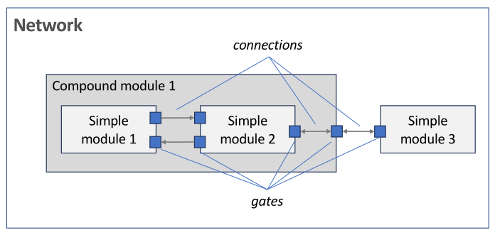
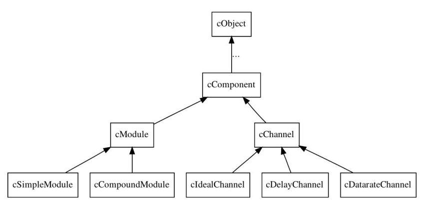
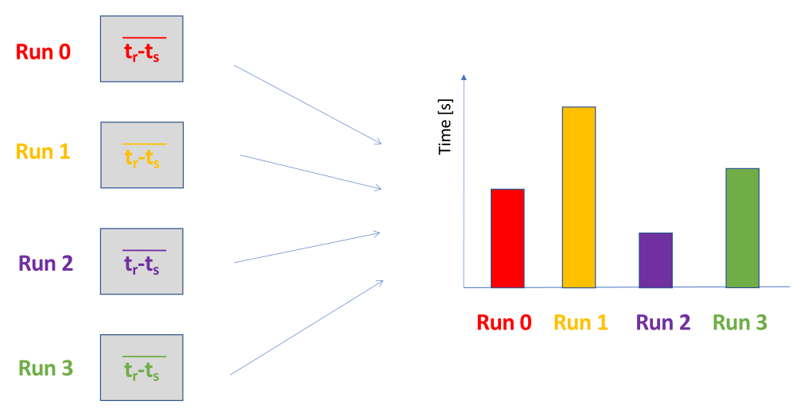
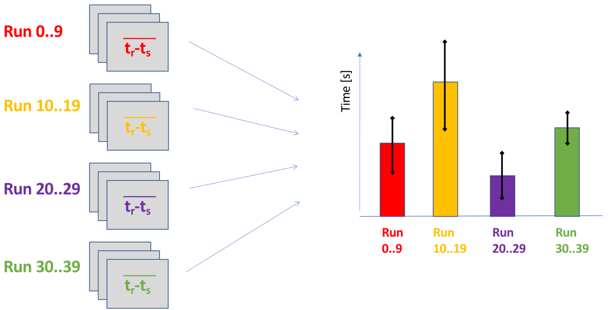
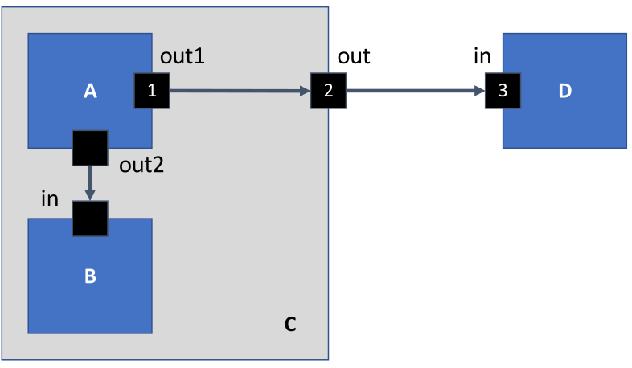

# 1. Index

<!--toc:start-->

- [1. Index](#1-index)
- [2. OMNeT++](#2-omnet)
  - [2.1. Model Paradigm](#21-model-paradigm)
    - [2.1.1. Modeling Entities](#211-modeling-entities)
      - [2.1.1.1. Defining Parameters](#2111-defining-parameters)
  - [2.2. Modeling Behavior](#22-modeling-behavior)
    - [2.2.1. Initialize Method](#221-initialize-method)
    - [2.2.2. HandleMessage Method](#222-handlemessage-method)
      - [2.2.2.1. Implementation Details](#2221-implementation-details)
  - [2.3. Event Scheduling](#23-event-scheduling)
  - [2.4. Timers](#24-timers)
  - [2.5. Hierarchy of Modules](#25-hierarchy-of-modules)
  - [2.6. Providing Random Inputs](#26-providing-random-inputs)
  - [2.7. Text-based output](#27-text-based-output)
  - [2.8. Collecting Metrics](#28-collecting-metrics)
  - [2.9. Defining Scenarios](#29-defining-scenarios)
    - [2.9.1. Running Different Experiments](#291-running-different-experiments)
  - [2.10. Handling Output Files](#210-handling-output-files)
  - [2.11. Compound Modules](#211-compound-modules)
    - [2.11.1. Cross-Module Calls](#2111-cross-module-calls)
    - [2.11.2. Internal Connections](#2112-internal-connections)
  - [2.12. Message Definition](#212-message-definition)
  <!--toc:end-->

# 2. OMNeT++

`OMNeT++` is a **discrete-event simulation framework** based on `C++` that provides
users with
**basic building blocks** to define a simulation: _event queue_, _statistic collection_,
_random number generation_, etc.

Moreover, it provides a complete simulation library (i.e., classes, functions,
data structures, etc.) that help us building our simulation model.

It also offers a number of tools that ease the development and maintenance of the
code, like **integrated debugging** and **validation testing**, as well as
**statistics generation** and **automated management of simulation campaigns**.

Its community is very active and provides a lot of support to new users, as
well as **extension libraries** for specific domains (e.g., `Simu5G` for 5G
networks, `Veins` for vehicular networks, `INET` for Internet protocols, etc.).

It is free to use for academic use, but still used by many top ICT companies, and
has a very large active community worldwide.

It comes with a **eclipse-based IDE** that allows users to easily create,
edit, compile, and run simulations, as well as to visualize the results in a
graphical way, as well as both **powerful GUI** and **CLI** tools to run
simulations and analyze results.

From the very first lines of the `OMNeT++` manual:

> OMNeT++ itself is not a simulator of anything concrete, but rather
> **provides infrastructure and tools for writing simulations**.  
> One of the fundamental ingredients of this infrastructure is a
> component architecture for simulation models. Models are assembled
> from reusable components termed **modules**.  
> Well-written modules are truly reusable, and can be combined in
> various ways **like LEGO blocks**

## 2.1. Model Paradigm

Let’s consider two very simple scenarios composed of two nodes, where each node
receives a packet from its peer, processes it and sends it back.

This can be modeled with different levels of abstraction:

- **Tin-can telephone**: two cups connected by a wire/string.
- **P2P network communication**: two computers connected over a generic network
  (e.g., the Internet)

Both systems are characterized by having:

- **Two Communicating Nodes**: these have associated _computation time_ and a _message
  length_ parameters.
- **One Communication Channel**: this has an associated _delay_ and _loss
  probability_ parameters

Furthermore they also share the same parameters:

- **Propagation Delay**
- **Message Length**
- **Computation Time**
- **Loss Probability**
- ...

In `OMNeT++` entities are modeled into either:

- **Communicating and Processing Elements**: these are called **modules** and
  can be either _simple_ or _compound_.
- **Connections**: these are used to connect modules together through their _gates_.

The communications between modules are modeled as **messages** that are sent
through the connections linking their _gates_.

### 2.1.1. Modeling Entities

In order to build our model, we have to define **different things** via **different
files**.

`OMNeT++` separates:

- **Model's Structure**: files in `NED` (NEtwork Description) language, which is
  a **declarative language** that describes the **topology of the model** exploiting
  inheritance and interfaces.
- **Model's Behavior**: files in `C++`, which are the **implementation of the
  modules** defined in the `NED` files.
- **Model's Parameters**: files in `INI` format, which are used to **configure
  the simulation** (e.g., number of nodes, message length, propagation delay,
  etc.) and to **collect statistics**.

Suppose we have two elements, `A` and `B`, with `A` that communicates to `B` through
a connection.

In the `NED` file we define the **structure** of the model, meaning
the fact that we have two modules, a connection, each module has certain
parameters, etc.

If at a certain point we complicate our model, adding two more elements and forming
a ring connection `A` to `B` to `C` to `D` to `A`, we can **reuse** the same modules
defined in the `C++` files, and just change the `NED` file to define the new topology.

Instead, if we want to change a parameter of a connection, for example from `10s`
of delay to `0.1s`, we just need to **change the `INI` file**.

> [!note]
> The example we will see now comes from the TicToc tutorial available on the
> `OmneT++` website.

**Simple Modules** are the basic building block in the `OMNeT++` architecture, and
they can be composed together to form **Compound Modules**.

Both types of modules have in/out/inout interfaces called **gates**, from which
_connections_ can be established to other modules to exchange **messages**.

All these elements can be arbitrarily connected together to form a **network**.



Let's start with the definition of a **Simple Module** called `Txc`, with two gates,
one for input and one for output:

```ned
simple Txc
{
  gates:
    input in;
    output out;
}
```

To create two instances of the simple module `Txc` to create a network,
we can define a `network` called `TicToc`:

```ned
network TicToc
{
  submodules:
    tic: Txc;
    toc: Txc;
  connections:
    tic.out --> { delay = 100ms; }  --> toc.in;
    tic.in  <-- { delay = 100ms; }  --> toc.out;
}
```

This will have defined the network topology, but still lacks the **behavior** of
the modules, which is defined in the `C++` files.

#### 2.1.1.1. Defining Parameters

A module has parameters which can be assigned default values that will e used
when no actual parameters are given in the network `NED` or `INI` file.

```ned
simple Txc {
  parameters:
    double procTime = default(10);
    double delay @unit(s) = default(100s);

  gates:
    input in;
    output out;
}
```

When we use the module in a network we can assign values to the parameters,
which will override the default ones:

```ned
network Tictoc {
  submodules:
    tic: Txc {
      procTime = 1s;
      delay = 0.1s;
    }
    toc: Txc;
}
```

Using parameters will be very useful when writing the model behaviour, since it
will allow us to avoid hard-coding "magical" values.

## 2.2. Modeling Behavior

In a discrete-event simulation, the systems evolves following a **cause-effect**
paradigm.

In `OMNeT++`, events are (almost always) **the reception of messages** by a module.

Thus, defining the processing of a message means defining the behavior of a module.

The behavior of modules is defined via `C++` files, meaning that each simple module
**must be associated** with a `C++ Class` that defines its behavior.

**Compound modules** _do not have_ associated classes, but their behavior is the
summation of their composing modules.

As a result, also a network does not have a behavior.

In our `TicToc` network, we want to model a system where `Tic` and `Toc`
repeatedly bounce back a message until the simulation ends, assuming that `Tic`
talks first.

We first have to identify two events to be handled:

- **Simulation Starts**: the effects involves creating a new event if the name of
  the `Txc` module is _tic_ (i.e., sending a message to the module called _toc_)
- **The `Txc` module receives a message**: the effect involves creating a new event
  (i.e., sending back the message, which results in a new event to be handled
  by the other module)

Actually, there may be a third event, i.e. _max simulation time is reached_, which
(in this case) makes the simulation terminate.

Note that max simulation time may be not set, in those cases the simulation does
not end unless termination is forced (e.g., by typing `Ctrl+C`).

While for the _`Txc` receives a message_ event it is clear who generates it, it
the _simulation starts_ event is **automatically generated at the creation of
a module** (usually at the beginning of the simulation), which in turn
executes the corresponding behavior.

This means that if we have $N$ modules, we will have N _simulation starts_
event, one for each module, and each of them executes its behavior.

Each _simple module_ has a **C++ class** in which we should define the following
methods:

- `initialize()`: called automatically after a module is created and is generally
  used to perform setup operations on a module. It is essentially a
  _module-constructor_ even if if can exists along side the actual one, since this
  function is more related to the simulation than to the module itself.
- `handleMessage()`: is called **whenever a message is received** by a simple module.
  It is generally used to identify the message type, manage it, and create
  a new one.
- `finish()`: is called automatically at the deletion of the module from the
  simulation (usually, at the end of the simulation for all the modules). It is
  generally used to record statistics.

Each handler can make use of the following functions to **create new events**:

- `send()`: used for sending out OMNeT++ messages through an
  output gate (i.e., to another module connected to that gate through a connection).
- `scheduleAt()`: used by a module to send a message to itself. In
  practice, the net effect of invoking `send` and `scheduleAt` functions is to
  **add a new event** with the given firing time in the event queue.
- `cancelEvent()`: used to cancel a timer: remove an event from the event queue.

The actual implementation of the **cause-effect** relation is done automatically
by the `OMNeT` environment, since each module-related class has to
inherit at least from the `cSimpleModule` class, which provides the basic
functionality.

> [!TIP]
> By using the `OMNeT++ IDE` commands, this step is done automatically.

To actually pair the `C++` class with the `NED` module, we have to use the
`Define_Module()` macro.

```cpp
#include <omnetpp.h>

class TXc : public cSimpleModule {
  protected:

    virtual void initialize();

    virtual void handleMessage(cMessage *msg);

    virtual void finish();
};

// Module class need to be registered with OMNeT++
Define_Module(Txc);
```

> [!caution]
> The `Define_Module()` macro should not be put in the `.h` file of the class,
> but in the `.cpp` file.

### 2.2.1. Initialize Method

In our example we can use the initialize method to create the first event:

```cpp
void Txc::initialize() {
  if (strcmp("tic", getName()) == 0) {
    cMessage *msg = new cMessage("tictocMsg");

    // "out" is the name of the gate as defined in the NED file
    send(msg, "out");
  }
}
```

The `getName()` is a member function inherited from the `cSimpleModule` class, that
returns the name of the current module.

The `send()` function is also inherited from the `cSimpleModule` class, and it is
used to send a message through a gate, which is identified by its name
(in this case `out`).

> [!Note]
> There is no mention of the module which will receive the message.
> This actually increases the flexibility of the model, because it allows us to
> define a new network without changing the behavior of the modules, as long as
> they have the same gate names.

### 2.2.2. HandleMessage Method

Usually, a module may receive different types of messages, so `handleMessage()`
should do two things:

1. Check what kind of message has been received (e.g., by name or type)
2. Decide what and where to send the next message, or if to schedule a new
   event for itself.

```cpp
void Txc::handleMessage(cMessage *msg) {
  /*
   * Check message type
   *
   * In this case there is just one message, so we can skip this step
   *  otherwise we could use something like:
   *
   * if (msg->isName("ticTocMsg")) {
   *   do stuff
   * }
   */

  // send the response
  send(msg, "out");
}
```

When _tic_ sends a message through the `out` gate, `OMNeT++` automatically
creates an event having:

- **Reception Time**: the time when the message is received by `toc`. This
  automatically takes into consideration the connection delay, defined in
  either the `NED` or the `INI` file.
- **Priority**: used to choose between concurrent events
- **Data**: the actual message

This event will be put in the `event queue`, and when it is the first event in the
queue it will he handled by the `handleMessage()`.

#### 2.2.2.1. Implementation Details

In `C++` `Tic`, `Toc` and `Msg` are all `C++` objects.

`Msg` has an `owner` field, which indicates the module that owns it in that moment,
i.e. where the message is at that time of the simulation.

Whenever a `send()` is called, the `owner` field is changed to an "external" object,
the one that actually implements the event queue.

When the simulation time is equal to the arrival time, the "external" object will
_dequeue_ the message, changing its owner to the **destination module**.

Instead, if a `scheduleAt()` was invoked, the owner will be changed back to the
module that added the event to the queue.

At this point, the "external" object will call the `handleMessage()` method of
whoever model is saved as the _owner_ of the message, passing the message as an
argument.

As the `OMNeT++` manual states:

> The concept of **object ownership** is associated with the **_right to
> delete objects_**.
>
> The ownership mechanism is mostly used for sanity check: you will get an
> exception if a module tries to delete/send a message that it does not own.
> This will become important when we will introduce _"cross-module calls"_

## 2.3. Event Scheduling

Events (messages) are placed in an _event queue_ called **Forward Event Set (FES)**,
which is implemented as a **_binary heap_**.

The FES is accessed by an **event scheduler**, whose main operations are:

- `takeNextEvent()`: removes the first event from the FES and returns it to the
  simulation kernel. Events are extracted by arrival time. If two events arrives
  at the same time, it extracts the one with highest priority.
  If two events have the same priority, it extracts the one inserted earlier into
  the FES.
- `executeEvent()`: executes the event, which means calling the `handleMessage()`
  method of the module that owns the message.

In something like:

```cpp
while (!fes->isEmpty()) {
  e = takeNextEvent();
  e.executeEvent();   // calls the handleMessage() of the module that owns the message

  // <advance clock>
}
```

Both the FES and the event scheduler are configurable by extending the respective
classes:

- `cFutureEventSet`
- `cScheduler`

## 2.4. Timers

Sometimes, events need to be scheduled after a certain amount of time.

In this case we can take advantage of the `scheduleAt()` function, which
allows us to sending a message to ourself later in time.

At that point, when we will receive the message, we can perform the desired action.

To do that, we need to discriminate between messages that have been sent by other
modules and messages that were sent to ourself.

A possible full implementation of the code would require each `Txc` module
to create its own instance of `beep` message

```cpp
class Txc : public cSimpleModule {
  private:
    cMessage *beep_;
    cMessage *tictopMsg_;

  protected:
    virtual void initialize();
    virtual void handleMessage(cMessage *msg);
    virtual void finish();
};
```

```cpp
void Txc::initialize() {
  if (strcmp("tic", getName()) == 0) {
    cMessage* msg = new cMessage("tictocMsg");
    send(msg, "out");
  }
  beep_ = new cMessage("beep");
}
```

```cpp
void Txc::handleMessage(cMessage *msg) {
  if (msg->isName("tictocMsg")) {
    simtime_t time = par("procTime"); // recovers the parameter of the module
    scheduleAt(simTime() + time, beep_);

    tictocMsg_ = msg;     // store for later transmission
  }
  else if (msg->isSelfMessage()) {    // equivalent to msg == beep_
    send(tictocMsg_, "out");
  }
}
```

- `isSelfMessage()` is a member function of the class `cMessage` which returns
  true if the given message was scheduled via the `scheduleAt` function.
- `isName()` is a member function of the class `cMessage` which returns true
  if the message name is the same as the string passed as argument
- `scheduleAt(time,msg)` sends the message `msg` to this module. The message will
  be received at absolute time time. A variant of `scheduleAt()` is called
  `scheduleAfter(offset,msg)`, which instead schedule a message after a time
  offset starting from now.

```cpp
void Txc::finish() {
  cancelEvent(beep_);
  delete beep_;

  // or cancelAndDelete(beep_);
}
```

## 2.5. Hierarchy of Modules

When you include the `<omnetpp.h>` header, we can use all these classes provided
the `OMNeT++` simulation library.

Most objects in the simulation derives from the `cObject` (pure virtual) class,
which defines several virtual member functions that are either _inherited_
or _redefined_ by subclasses.

The simulation library also provides useful containers such as `cArray` and
`cQueue` classes, which can be used to store messages.

They also define member functions and iterators, just like the `stdlib`.



## 2.6. Providing Random Inputs

By default `OMNeT++` uses the **_Mersenne Twister_** RNG, which comes
with several distributions (`uniform()`, `exponential()`, `normal()`, etc.).

This allows us to easily generate random inputs for our simulation,
without the need to implement our own RNG.

Of course, it is still very important to provide the seeds to the various instances,
but without the need to worry about searching the one that gives us a full period.

For example we can use it in the `C++` files:

```cpp
void Txc::handleMessage(cMessage* msg) {
  if (msg->isName("tictocMsg")) {
    double time = uniform(0, 10);
    sheduleAt(simTime() + time, beep_);
    tictocMsg_ = msg;
  }
  // ...
}
```

To avoid hard-coding number, We can also generate random numbers directly in the
`NED` code just like we did before:

```ned
network Tictoc {
  submodules:
    tic: Txc {
      procTime = uniform(0s,10s);
    }
  // [...]
}
```

```ned
simple Txc {
  paramaters:
    volatile double procTime @unit("s") = default(uniform(0s,10s));
}
```

The `volatile` keyword allows the `C++` to extract each time a new uniform random
value.

## 2.7. Text-based output

When producing output we can either use the classic `C++` approach, by using `cout`
or write to output file, or we can use the **more efficient built-in approach**.

This doesn't print to standard output, but instead uses `EV` as **output streams**,
by giving several log levels:

- `EV_FATAL`
- `EV_ERROR`
- `EV_WARN`
- `EV_INFO`
- `EV_DETAIL`
- `EV_DEBUG`
- `EV_TRACE`

Their destination of the `EV` streams depends on how simulation are run:

- **GUI**: the log is written in the specific area of the main window
- **CLI**: the log is not displayed anywhere.

## 2.8. Collecting Metrics

The output of the system can be observed with **signals**.

Each **signal** can be seen as a _container for the values assumed by a certain
metric during the simulation_.

Signals can be of various kind, depending on the way the values are stored.

At the end of the simulation, the recorder associated with a signal returns
the metric as we defined it in the `NED`.

These can be:

- A scalar value (e.g., average, sum, count)
- A histogram (store ranges and bins to produce a pdf)
- A vector (e.g., a time series representing all the values assumed by the
  metric over time)

Signals are defined in `NED` files as part of modules. They can be referred to
in `C++` code in order to use them for storing values.

Alternatively, we can record statistics using the simulation library directly
(e.g., using/deriving the `cStatistics` class), although the resulting recording
will be hard-coded in modules.

To use a signal we first have to define a **signal** and a **statistic**
inside the `NED` file.

The _statistic_ will record data coming from a signal defined as "source",
and can held more than one type of recording (e.g., mean, sum, count, etc.).

We differentiate between:

- **_Scalar_ metrics** : they are a synthesis of the values assumed by a certain
  metric during the whole simulation. They are useful when studying the _steady
  state behavior_ of a system (e.g., average delay) or _cumulative values_ (e.g.,
  sum of sent messages).
- **_Vector_ metrics**: they are useful when observing the "evolution" of the status
  system, since each value "emitted" is stored in the `@statistic` _with its
  emission time_. This way we can recover those values and plot them in a graph
  to observe the evolution of the system. They usually require more memory.

```ned
simple Txc {
    // ...
  parameters:
    @signal[delay](type=long);
    @statistic[delayStat](source=delay; record=mean;);

  // ...
}
```

After that, inside the `C++` class definition, we have to **define
a variable** with type `simsignal_t`:

```cpp
class Txc : public cSimpleModule {
  private:
    simsignal_t delaySignal_;
    // ...
};
```

Then, in the `initialize()` method we have to **register the signal**
through the `registerSignal()` function:

```cpp
void Txc::initialize() {
  // ...

  /**
    * The string passed as parameter must be the signal name
    * defined in the NED file.
    *
    * The function returns the ID of the signal
    */
  delaySignal_ = registerSignal("delay");
  // ...
}
```

To actually write values into the signal, we can use the `emit()` function:

```cpp
// somewhere in the code, typically in `handleMessage()`

// ...
emit(delaySignal_, value);
// ...
```

## 2.9. Defining Scenarios

To be able to assign actual parameters of a simulation, overwriting the
default values in the `NED` file, we use **INI files**.

The `INI` files will be organized in multiple **configurations**, that inherit
parameters to the `General` one.

```ini
[General]
network = Tictoc
sim-time-limit = 100s
# ...

[Config Test1]
description = "First TicToc campaing"
# This uses `*` as a wildcard
Tictoc.t*c.proctime = 50ms

[Config specificTest]
# inherits from Test1 and adds further values
extends = Test1
sim-time-limit = 5s
```

Once our model is ready and implemented, we have do **define our simulation
scenarios** by specifying:

- **Simulation Parameters**: they are the parameters whose **value** may
  be already defined in the `NED` file, but we might want to **override** in
  the `INI` file.
- **Model Factors**: they are parameters whose **different values** we want
  to explore during the simulation campaign.

> [!TIP]
> In `OMNeT++` they both are modeled as _parameters_. A quick way do differentiate
> them is understanding that for a fixed simulation:
>
> - _Simulation Parameters_ hold a **fixed value**
> - _Model Factors_ hold different values, which are explored in a **simulation
>   campaign**.

### 2.9.1. Running Different Experiments

By setting different values for the model factors, we can run different experiments.

In particular, we can define a **simulation campaign** by defining a **set of
experiments** that will be run one after the other.

For example, defining:

```ini
*.tic.procTime = ${1, 10}s
*.toc.procTime = ${1, 10}s
```

We automatically create **4 different runs**, one for each combination of the
parameters.



Supposing we are measuring a statistic (e.g., average delay), each run will
produce its own value, according to the `NED` file. This way we can easily compare
them.

If we want to run each configuration multiple times, we can use the `repeat` parameter:

```ini
repeat = 10
seed-set = ${repetition}

*.tic.procTime = ${1, 10}s
*.toc.procTime = ${1, 10}s
```

This will make the simulation run each configuration 10 times, each time with a
**different RNG seed**.

Each run of a configuration will have its `repetition_id`, going from `0` to `9`,
which will be used to generate the seed for the RNG, because of the
`seed-set = ${repetition}` option.

This means that the first run of each configuration will be run **with the
same seed**, as well as the second run, and so on.

> [!CAUTION]
> If we didn't added the `seed-set` parameter, `OMNeT++` would have used
> a different seed for each run.  
> Thus, the first run of each configuration would have been run with a different
> seed, making the comparison of the results **not fair**.

Using repetition allows us to **average the results** of each independent repetition
for each configuration, and plot the confidence interval as well.



Other typical simulation parameters that can be set in the `INI` file are:

- `sim-time-limit`: the maximum simulation time, after which the simulation
  will terminate.
- `warmup-period`: the warm-up period, which is the time after which the
  simulation will start collecting statistics. This is useful to avoid collecting
  statistics during the transient phase of the simulation.
- `repeat`: the number of repetitions for each configuration.
- `seed-set`: the seed set for the RNG, which can be set to `${repetition}` to
  have a different seed for each repetition.

## 2.10. Handling Output Files

When running a simulation campaign, `OMNeT++` will generate two
**output files** for each run:

- **Output Scalar File (`.sca`)**
- **Output Vector File (`.vec`)**

This files will be stored into the folders defined by the respective
parameters in the `INI` file.

By default the names are set as:

```ini
output-scalar-file = ${resultdir}/${configname}-${runnumber}.sca
output-vector-file = ${resultdir}/${configname}-${runnumber}.vec
```

In order to make it simpler to link a specific output file to a simulation
configuration, allowing us to easily remember which output file corresponds
to which configuration, we can **assign names to iteration variables**:

```ini
*.tic.delay = ${dtic=1,10}
*.toc.delay = ${dtoc=1,10}

output-scalar-file = ${resultdir}/${configname}/${iterationvars}-${repetition}.sca
output-vector-file = ${resultdir}/${configname}/${iterationvars}-${repetition
```

This will create **a different directory for each configuration**, and save
inside the output files.

The `$iterationvars` variable will be automatically replaced by the names of the
iteration variables and their values: `dtic=1_dtoc=1`, `dtic=1_dtoc=10`,
`dtic=10_dtoc=1`, `dtic=10_dtoc=10`.

> [!WARNING]
> If we forget to add `${repetition}`, all the repetitions for the same combination
> of iteration vars will collide in the same output file.

Both `.sca` and `.vec` files can be examined inside `OMNeT++` IDE, or using a
third file with extension `.anf`, and by just _dragging and dropping_ the
two files inside the opened `.anf` file.

## 2.11. Compound Modules

If we consider more complex systems, like a _client-server architecture_,
from a high-level perspective we just need to consider the behaviour of
the involved node as a whole.

We can model them as **modules**, thus associate to them an atomic
behavior.

When implementing a complex system module, we can model each component
as a **simple module** as well.

```ned
module PC {
  parameters:
    int cpuSpeed;
    int monitorSize;
  gates:
    // ...
  submodules:
    hd : HardDisk;
    wifi: WiFi;
    explorer : Browser;
  connections:
    // ...
}
```

Where `HardDisk`, `WiFi` and `Browser` are all simple modules, each with its own
behavior.

A simple module inside a compound one may want to obtain its "father" parameters.
This is possible by using the `getParentModule()` function, which returns a
pointer to the _parent module_.

```cpp
// Within the Explorer C++ class
cModule* pc;
pc = getParentModule();

int size = pc->par("monitorSize");
```

Also the compound module can get the parameters of is sub-modules:

```cpp
// Inside the PC C++ class

// Not recommended approach
cModule* hd = pc->getSubmodule("hd");
int hdSize = hd->par("hdSize");

// This approach is better
cModule* hd = pc->getHardDiskSubmodule();
int size = hd->getSize();
```

> [!WARNING]
> The first approach is not recommended since we **need to actually know
> the _exact name_ of both the sub-module and the parameter**. This makes the code
> less flexible in case we assign the sub-module a different name.

### 2.11.1. Cross-Module Calls

Sometimes there may be the need for two nodes to interact without messages.

This can be achieved by keeping a reference to the other module (a `cModule` pointer).

We may model this extraction through a **_Oracle Module_**: a supernatural
entity of the systems which knows everything about the system and can provide
information to the modules.

```cpp
cModule* temp;
temp = findModuleByPath("oracle");

OracleClass* oracle;
oracle = check_and_cast<OracleClass*>(temp);  // Dynamic cast with error checking

int serverId;
serverId = oracle->aSearchFunction("server");

int serverIP = serverId->getIP();
```

> [!CAUTION]
> **Cross-module calls** are to be used only with **setters** and **getters**.  
> If we were, for example, to send a message through a cross-module call, we
> would be sending from another source, messing with the whole simulation.

### 2.11.2. Internal Connections

<div class="grid2">
<div class="">
When considering simple modules, we always connected gates according
to the pattern `output --> input`, as our idea was to _send
something though gates_ rather than _towards nodes_.

When considering compound modules, we is still true for external connections,
but its a bit different for internal connections.

To connect an internal module gate to the compound module gate, we have to connect
`output --> output` or `input <-- input`, not as much as a connection to send a
message, bu as a connection between two _interfaces_.

```ned
module C {
  parameters:
    // ...
  gates:
    output out;

  submodules:
    a: A;
    b: B;

  connections:
    out <-- a.out1;   // output --> output
    a.out2 --> b.in;  // output --> input
}
```

</div>
<div class="">

</div>
</div>

## 2.12. Message Definition

So far, we have seen messages "just" as a way to **trigger an event at a specific
module**.

However, `OMNeT++` messages **can also include data** that needs to travel from
the source module to the destination module. This is actually what one would expect
from a message, that is carrying data.

`OMNeT++` provides a `cMessage` class, which can be used to redefine our own
messages.

This way we can **extend** the `cMessage` to make it include new fields,
along with the corresponding getter and setter methods.

We can define new messages by creating a **message file** with the `.msg` extension.

The syntax is the same as `NED`.

When we build our project, the environment will **automatically generate a new
C++ class** (both `.h` and `.cpp`), derived from `cMessage` and extended
with the new fields.

```msg
message MyMessage {
  char source;
  int type;
}
```

We can now use our new `MyMessage` class whenever we want, just by including
the generated header file:

```cpp
#include "myMessage_m.h"

// Somewhere in module A
MyMessage* msg = new MyMessage(msgName);
msg->setSource('A');

// Somewhere in module B
MyMessage* tmpMsg;
tmpMsg = check_and_cast<MyMessage*>(msg);
char source = tempMsg->getSource();
// ...

delete tmpMsg;
```
